
세션 9개 · 사진 127장

<ul class="toc">
<li><a href="#weapon">weapon — 무기</a></li>
<li><a href="#terran">terran — 테란 아군</a></li>
<li><a href="#building">building — 건물</a></li>
<li><a href="#anim">anim — 애니메이션</a></li>
<li><a href="#audio">audio — 소리</a></li>
<li><a href="#character_mesh">character_mesh — 캐릭터 모델</a></li>
<li><a href="#design">design — 기획</a></li>
<li><a href="#vfx">vfx — 이펙트</a></li>
<li><a href="#zerg">zerg — 저그</a></li>
</ul>
<h2 id="weapon">weapon <small>무기</small></h2>

총 모델을 실제 크기에 맞춰 게임에 넣고 양손 총 위치를 조정했습니다.

<a href="/assets/d/2026-10-25/WindowsEditor_HighresScreenshot00714.jpg" target="_blank">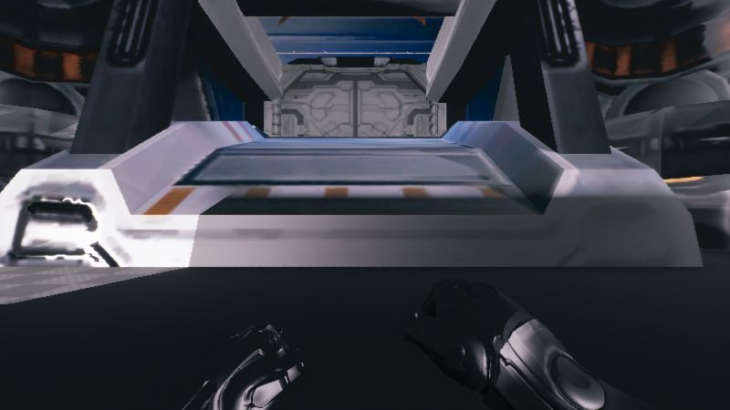</a>

06:18 스타크래프트 2 방식의 총기 움직임은 기존 방식을 그대로 쓰기로 정했습니다.

<a href="/assets/d/2026-10-25/WindowsEditor_ScreenShot00442.jpg" target="_blank">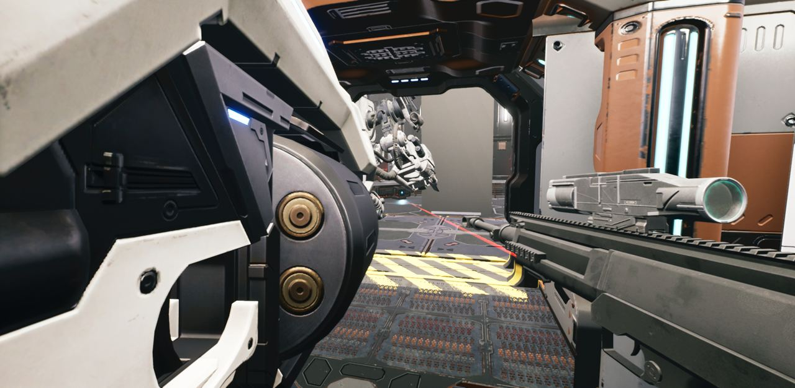</a>

16:17 총 모델 파일을 정리하고 샷건과 라이플을 고해상도 모델로 바꿨습니다.

<a href="/assets/d/2026-10-25/WindowsEditor_ScreenShot00443.jpg" target="_blank">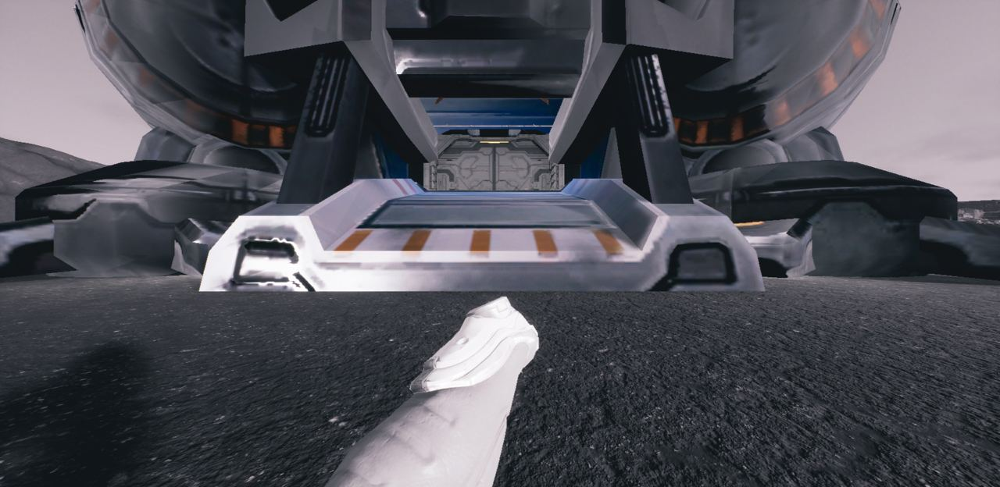</a>

16:43 가우스 소총 총검을 수평으로 맞추고 탄창 등 부품을 따로 조절하게 했습니다

<a href="/assets/d/2026-10-25/WindowsEditor_HighresScreenshot00715.jpg" target="_blank">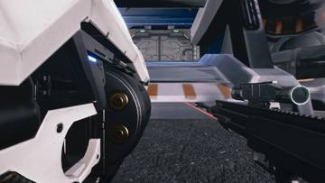</a>
<a href="/assets/d/2026-10-25/WindowsEditor_HighresScreenshot00716.jpg" target="_blank">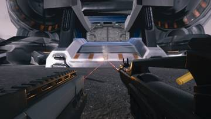</a>
<a href="/assets/d/2026-10-25/WindowsEditor_HighresScreenshot00717.jpg" target="_blank">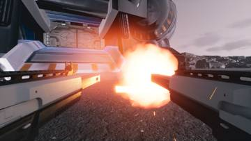</a>
<a href="/assets/d/2026-10-25/WindowsEditor_HighresScreenshot00718.jpg" target="_blank">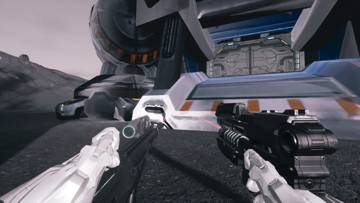</a>
<a href="/assets/d/2026-10-25/WindowsEditor_HighresScreenshot00719.jpg" target="_blank">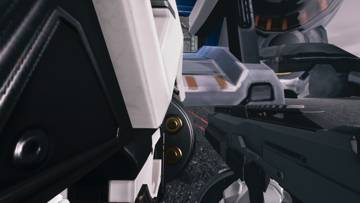</a>
<a href="/assets/d/2026-10-25/WindowsEditor_HighresScreenshot00720.jpg" target="_blank">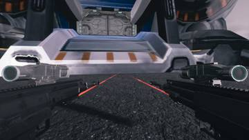</a>
<a href="/assets/d/2026-10-25/WindowsEditor_HighresScreenshot00721.jpg" target="_blank">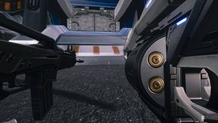</a>

17:23 가우스 총의 드럼 윗부분도 드럼 부품과 함께 떨어지게 고쳤습니다.

<a href="/assets/d/2026-10-25/WindowsEditor_HighresScreenshot00727.jpg" target="_blank">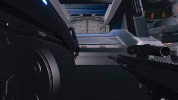</a>
<a href="/assets/d/2026-10-25/WindowsEditor_HighresScreenshot00728.jpg" target="_blank">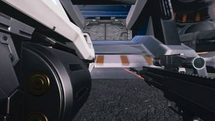</a>
<a href="/assets/d/2026-10-25/WindowsEditor_HighresScreenshot00729.jpg" target="_blank">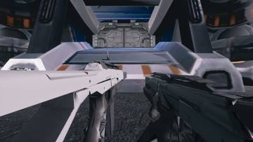</a>
<a href="/assets/d/2026-10-25/WindowsEditor_HighresScreenshot00730.jpg" target="_blank">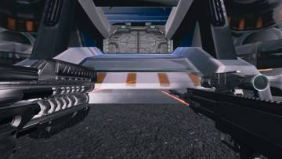</a>
<a href="/assets/d/2026-10-25/WindowsEditor_HighresScreenshot00731.jpg" target="_blank">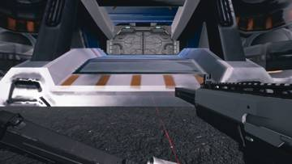</a>
<a href="/assets/d/2026-10-25/WindowsEditor_HighresScreenshot00732.jpg" target="_blank">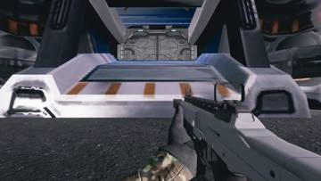</a>

18:50 장갑을 레네게이드와 레이스 모델로 바꿔 총기 확인에 쓸 수 있게 했습니다.

<a href="/assets/d/2026-10-25/WindowsEditor_HighresScreenshot00734.jpg" target="_blank">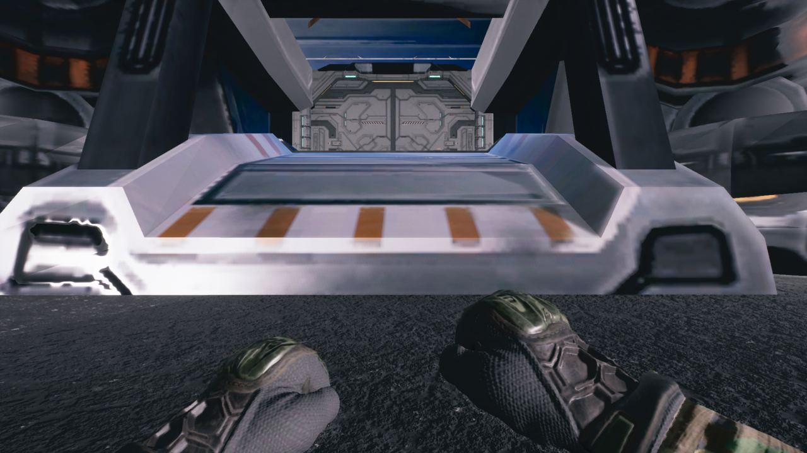</a>

19:18 장갑 질감이 보라색으로 나오던 문제를 고쳤습니다.

<a href="/assets/d/2026-10-25/WindowsEditor_HighresScreenshot00743.jpg" target="_blank">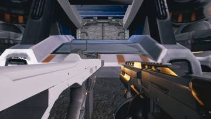</a>
<a href="/assets/d/2026-10-25/WindowsEditor_HighresScreenshot00744.jpg" target="_blank">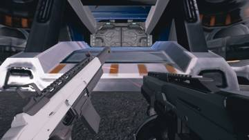</a>
<a href="/assets/d/2026-10-25/WindowsEditor_HighresScreenshot00747.jpg" target="_blank">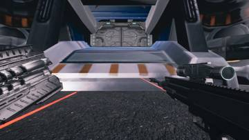</a>
<a href="/assets/d/2026-10-25/WindowsEditor_HighresScreenshot00759.jpg" target="_blank">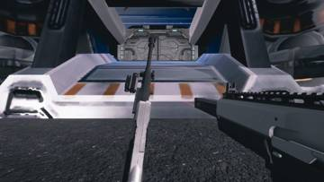</a>
<a href="/assets/d/2026-10-25/WindowsEditor_HighresScreenshot00760.jpg" target="_blank">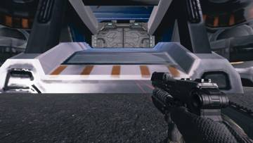</a>
<a href="/assets/d/2026-10-25/WindowsEditor_HighresScreenshot00770.jpg" target="_blank">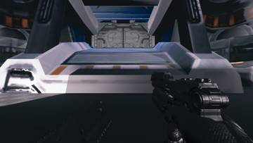</a>
<a href="/assets/d/2026-10-25/WindowsEditor_HighresScreenshot00783.jpg" target="_blank">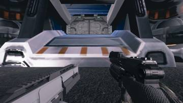</a>
<a href="/assets/d/2026-10-25/WindowsEditor_HighresScreenshot00785.jpg" target="_blank">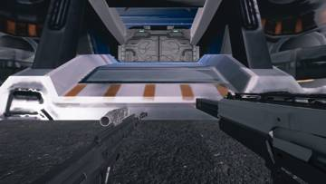</a>
<a href="/assets/d/2026-10-25/WindowsEditor_HighresScreenshot00795.jpg" target="_blank">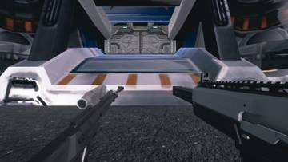</a>
<a href="/assets/d/2026-10-25/WindowsEditor_HighresScreenshot00797.jpg" target="_blank">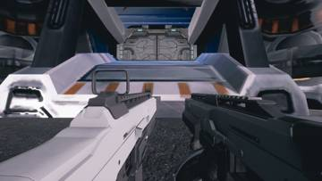</a>
<a href="/assets/d/2026-10-25/WindowsEditor_HighresScreenshot00800.jpg" target="_blank">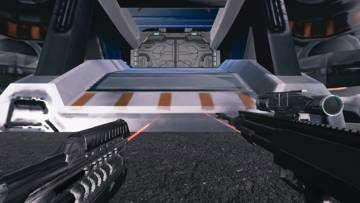</a>
<a href="/assets/d/2026-10-25/WindowsEditor_HighresScreenshot00802.jpg" target="_blank">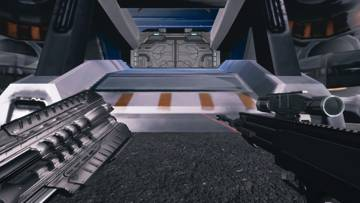</a>

19:21 울펜슈타인 2 방식으로 왼팔이 거울 반전된 자기 애니메이션을 재생하게 했습니다.

<a href="/assets/d/2026-10-25/WindowsEditor_HighresScreenshot00963.jpg" target="_blank">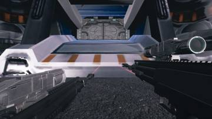</a>
<a href="/assets/d/2026-10-25/WindowsEditor_HighresScreenshot00964.jpg" target="_blank">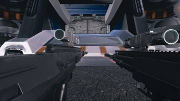</a>

22:32 F7 패널에 왼총 탭을 넣어 쌍권총의 왼쪽 총을 따로 조정할 수 있게 했습니다.

<h2 id="terran">terran <small>테란 아군</small></h2>

시즈탱크 내부 색과 좌석을 다듬고 플레이어 몸을 새 모델로 바꿨습니다.

<a href="/assets/d/2026-10-25/WindowsEditor_HighresScreenshot00723.jpg" target="_blank">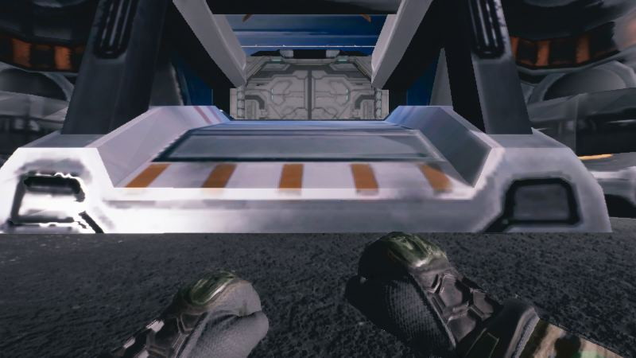</a>

18:04 플레이어 1인칭 팔을 레네게이드 팔로 바꿨습니다.

<a href="/assets/d/2026-10-25/WindowsEditor_HighresScreenshot00725.jpg" target="_blank">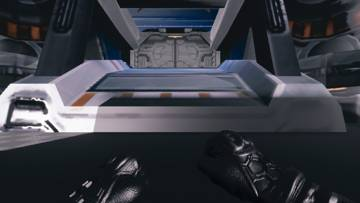</a>
<a href="/assets/d/2026-10-25/WindowsEditor_HighresScreenshot00726.jpg" target="_blank">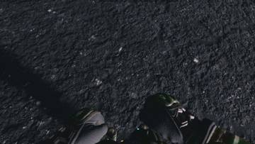</a>

18:28 플레이어 몸 전체를 레네게이드 모델로 바꿨습니다.

<a href="/assets/d/2026-10-25/WindowsEditor_HighresScreenshot00803.jpg" target="_blank">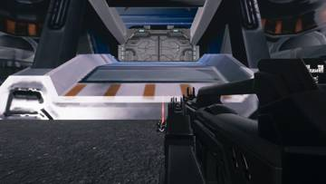</a>
<a href="/assets/d/2026-10-25/WindowsEditor_HighresScreenshot00805.jpg" target="_blank">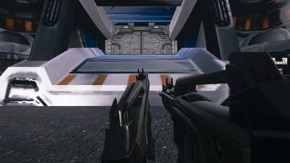</a>
<a href="/assets/d/2026-10-25/WindowsEditor_HighresScreenshot00810.jpg" target="_blank">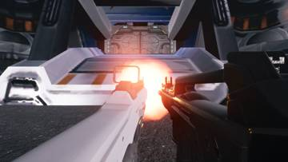</a>
<a href="/assets/d/2026-10-25/WindowsEditor_HighresScreenshot00818.jpg" target="_blank">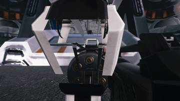</a>
<a href="/assets/d/2026-10-25/WindowsEditor_HighresScreenshot00819.jpg" target="_blank">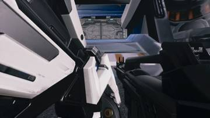</a>
<a href="/assets/d/2026-10-25/WindowsEditor_HighresScreenshot00820.jpg" target="_blank">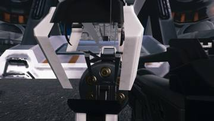</a>
<a href="/assets/d/2026-10-25/WindowsEditor_HighresScreenshot00821.jpg" target="_blank">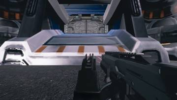</a>
<a href="/assets/d/2026-10-25/WindowsEditor_HighresScreenshot00823.jpg" target="_blank">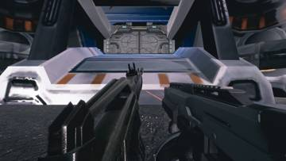</a>
<a href="/assets/d/2026-10-25/WindowsEditor_HighresScreenshot00824.jpg" target="_blank">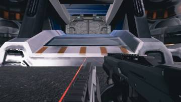</a>
<a href="/assets/d/2026-10-25/WindowsEditor_HighresScreenshot00827.jpg" target="_blank">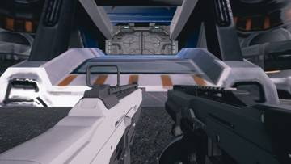</a>
<a href="/assets/d/2026-10-25/WindowsEditor_HighresScreenshot00835.jpg" target="_blank">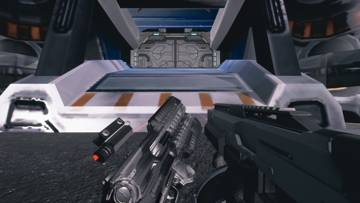</a>
<a href="/assets/d/2026-10-25/WindowsEditor_HighresScreenshot00836.jpg" target="_blank">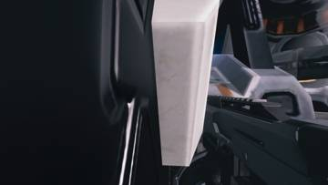</a>
<a href="/assets/d/2026-10-25/WindowsEditor_HighresScreenshot00837.jpg" target="_blank">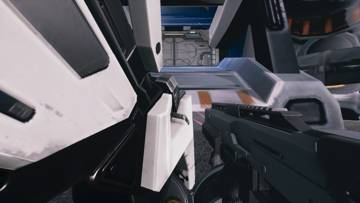</a>
<a href="/assets/d/2026-10-25/WindowsEditor_HighresScreenshot00838.jpg" target="_blank">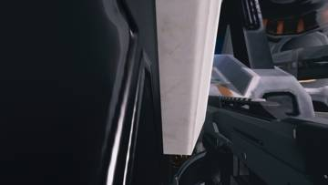</a>
<a href="/assets/d/2026-10-25/WindowsEditor_HighresScreenshot00839.jpg" target="_blank">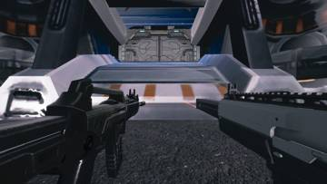</a>
<a href="/assets/d/2026-10-25/WindowsEditor_HighresScreenshot00840.jpg" target="_blank">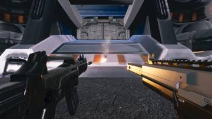</a>

20:32 사령부 안뜰에 직접 몰 수 있는 SCV를 놓았습니다.

22:28 공성 전차 좌석 뒤쪽 구멍을 면으로 막았습니다.

22:55 공성 전차 내부 색을 흰색에서 어두운 올리브색 금속으로 바꿨습니다

23:15 공성 전차에 앞뒤로 움직이는 운전석과 내부 소품을 만들었습니다

<h2 id="building">building <small>건물</small></h2>

병영과 보급고 벽에 우리 게임의 총을 걸고 천장 로봇팔을 늘렸습니다.

21:54 사령부 무기 벽의 총 크기를 손에 쥐었을 때 크기에 맞췄습니다.

22:07 보급고 입구 바닥의 주황색 고리를 지웠습니다.

22:19 보급고 문을 새로 구한 SF 문 팩의 F형으로 교체했습니다.

22:42 보급고 장비 벽의 임시 총을 치우고 우리 게임의 총 18종을 줄 맞춰 걸었습니다.

<h2 id="anim">anim <small>애니메이션</small></h2>

손가락과 엄지 구부림, 파워슈트 팔 움직임을 자연스럽게 다듬었습니다.

<h2 id="audio">audio <small>소리</small></h2>

왼손 총 소리 오류를 고치고 환경음 자료를 조사했습니다.

<h2 id="character_mesh">character_mesh <small>캐릭터 모델</small></h2>

스타2 스펙터 모델을 실제 키에 맞춰 배치하고 고글 구멍을 메웠습니다.

<h2 id="design">design <small>기획</small></h2>

테란 유닛 크기표를 정리했습니다.

<h2 id="vfx">vfx <small>이펙트</small></h2>

요원 모델의 청록빛 줄을 끄고 저렴한 재질을 만들었습니다.

<h2 id="zerg">zerg <small>저그</small></h2>

다른 게임의 저그 떼 AI와 수치를 조사했습니다.

