
작업 10개 · 사진 42장

<ul class="toc">
<li><a href="#building">건물</a></li>
<li><a href="#design">기획</a></li>
<li><a href="#weapon">무기</a></li>
<li><a href="#terran">테란 아군</a></li>
<li><a href="#vfx">이펙트</a></li>
<li><a href="#gearwall">장비 거치대</a></li>
<li><a href="#zerg">저그</a></li>
<li><a href="#weaponskin">무기 도색</a></li>
<li><a href="#audio">소리</a></li>
<li><a href="#character_mesh">캐릭터 모델</a></li>
</ul>
<h2 id="building">건물</h2>

보급고 조명과 벽 색, 병사 모델을 손봐 더 밝아졌습니다.

<a href="/assets/d/2026-10-26/WindowsEditor_HighresScreenshot01025.jpg" target="_blank">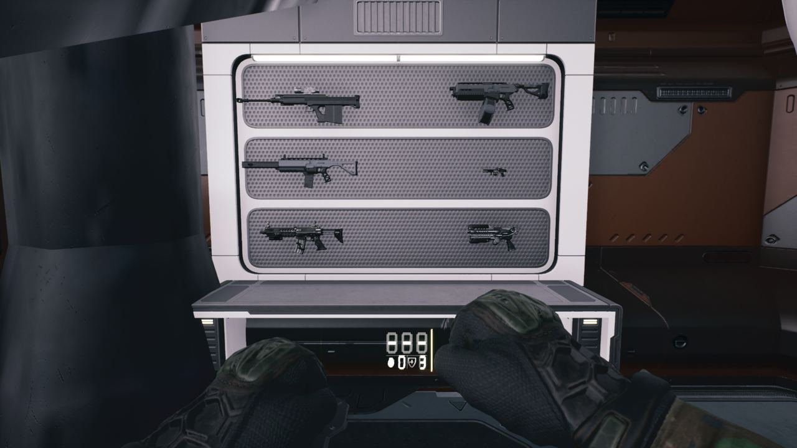</a>

02:22 무기 벽의 총을 새 장비실 벽으로 옮겼습니다.

02:41 보급고 슈트 조명을 끄고 벽 패널을 줄였습니다.

03:01 옛 승강기 자리에서 캐릭터가 바닥 아래로 빠지던 문제를 고쳤습니다.

<a href="/assets/d/2026-10-26/WindowsEditor_HighresScreenshot01050.jpg" target="_blank">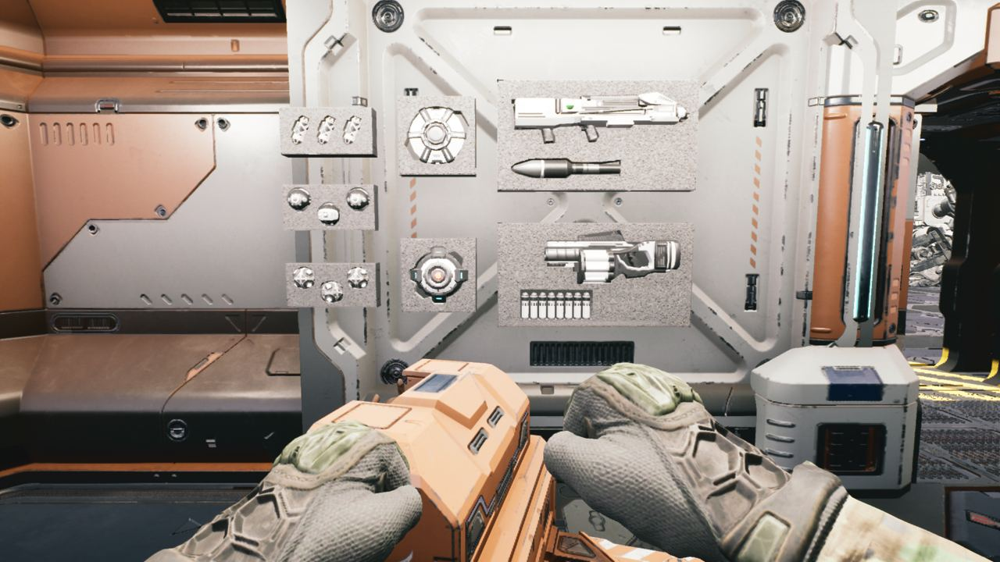</a>

03:05 사령부 왼쪽 방의 휘어진 벽을 평평한 벽으로 바꿨습니다.

<a href="/assets/d/2026-10-26/WindowsEditor_HighresScreenshot01052.jpg" target="_blank">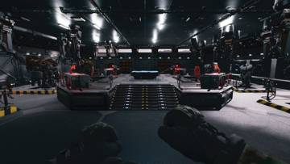</a>
<a href="/assets/d/2026-10-26/WindowsEditor_HighresScreenshot01054.jpg" target="_blank">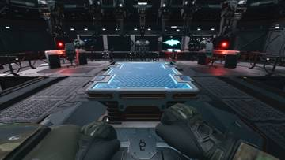</a>

03:11 병영에 테란 색감 조명과 경고 표시를 입혔습니다.

<a href="/assets/d/2026-10-26/WindowsEditor_HighresScreenshot01059.jpg" target="_blank">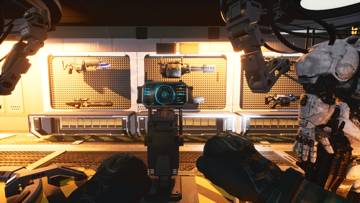</a>
<a href="/assets/d/2026-10-26/WindowsEditor_HighresScreenshot01058.jpg" target="_blank">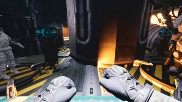</a>

03:13 보급고에 경고 표시와 바닥 조명을 입혔습니다.

<a href="/assets/d/2026-10-26/WindowsEditor_HighresScreenshot01063.jpg" target="_blank">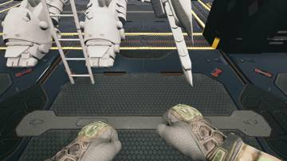</a>
<a href="/assets/d/2026-10-26/WindowsEditor_HighresScreenshot01064.jpg" target="_blank">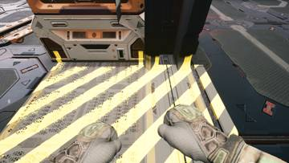</a>

03:40 사령부의 SCV 장식을 없애고 색감을 다듬었습니다.

<a href="/assets/d/2026-10-26/WindowsEditor_HighresScreenshot01119.jpg" target="_blank">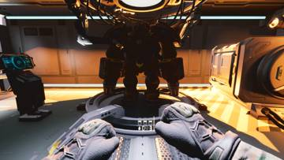</a>
<a href="/assets/d/2026-10-26/WindowsEditor_HighresScreenshot01123.jpg" target="_blank">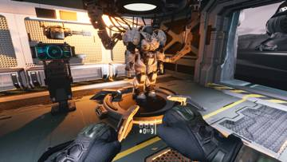</a>

05:06 보급고 장비 벽과 조명을 새 구성으로 정리했습니다.

<a href="/assets/d/2026-10-26/WindowsEditor_HighresScreenshot01134.jpg" target="_blank">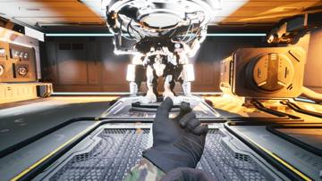</a>
<a href="/assets/d/2026-10-26/WindowsEditor_HighresScreenshot01135.jpg" target="_blank">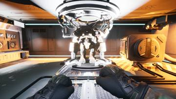</a>

05:24 보급고 조명 세기와 범위를 조정했습니다.

<a href="/assets/d/2026-10-26/WindowsEditor_HighresScreenshot01165.jpg" target="_blank">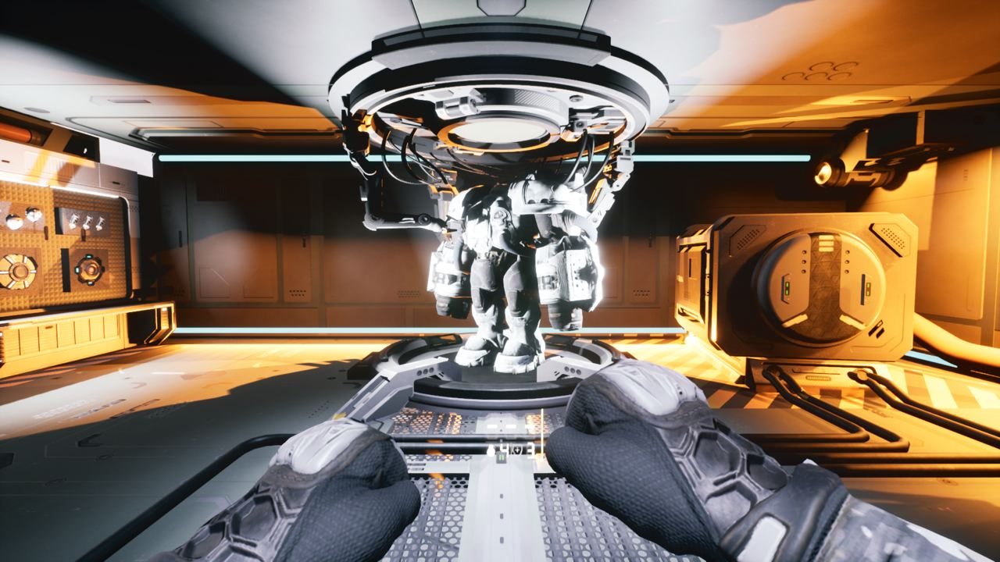</a>

06:56 보급고 중장갑 병사를 새 모델로 바꿔 흰색으로 입혔습니다.

08:05 보급고 스킨 슈트의 머리가 커 보이던 문제를 줄였습니다.

<a href="/assets/d/2026-10-26/WindowsEditor_HighresScreenshot01214.jpg" target="_blank">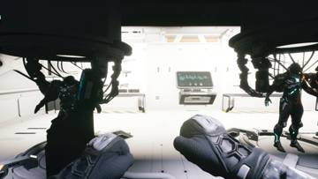</a>
<a href="/assets/d/2026-10-26/WindowsEditor_HighresScreenshot01215.jpg" target="_blank">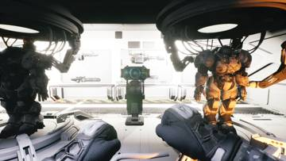</a>

08:36 하얗게 바뀐 보급고 벽에 맞춰 조명을 새로 배치했습니다.

<a href="/assets/d/2026-10-26/WindowsEditor_HighresScreenshot01222.jpg" target="_blank">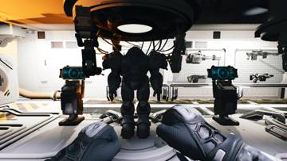</a>
<a href="/assets/d/2026-10-26/WindowsEditor_HighresScreenshot01233.jpg" target="_blank">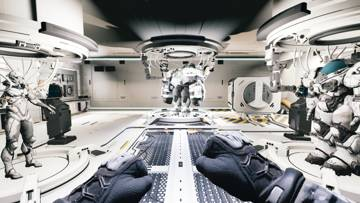</a>
<a href="/assets/d/2026-10-26/WindowsEditor_HighresScreenshot01235.jpg" target="_blank">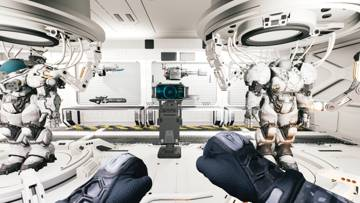</a>
<a href="/assets/d/2026-10-26/WindowsEditor_HighresScreenshot01241.jpg" target="_blank">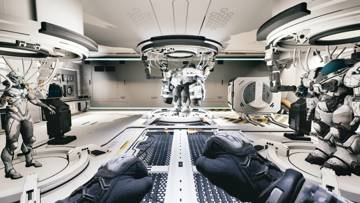</a>

16:20 보급고 조명이 너무 강한 곳을 줄이고 통로 조명을 더했습니다.

<h2 id="design">기획</h2>

총 메뉴가 밝은 하늘과 흰 벽 위에서도 또렷하게 보입니다.

02:49 장비 벽을 수류탄, 전술, 지뢰, 홀로그램 네 가지로 정리했습니다.

04:47 보급고 컴퓨터 콘솔을 플랫폼마다 하나씩 놓았습니다.

05:09 보급고 장비를 조준해서 여는 메뉴로 바꿨습니다.

<a href="/assets/d/2026-10-26/WindowsEditor_HighresScreenshot01144.jpg" target="_blank">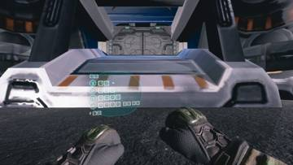</a>
<a href="/assets/d/2026-10-26/WindowsEditor_HighresScreenshot01156.jpg" target="_blank">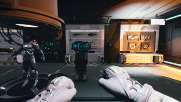</a>

05:55 장비 벽을 보고 키를 누르면 옆에 명령 목록이 뜨게 했습니다.

08:44 장비 메뉴가 소품에 가려지지 않고 앞에 보이게 했습니다.

<a href="/assets/d/2026-10-26/WindowsEditor_design_menu_near15_noocc.jpg" target="_blank">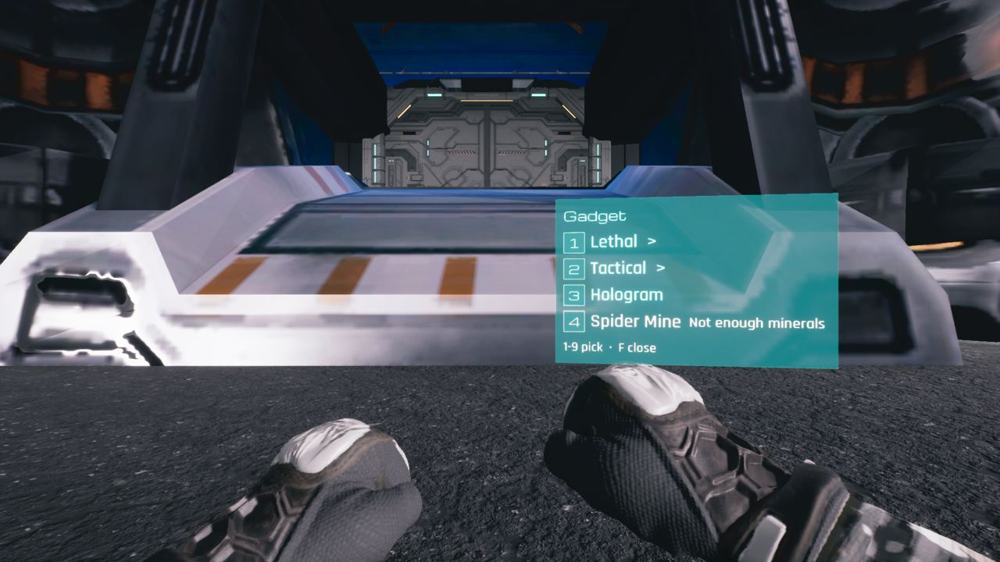</a>

09:28 흰 보급고 벽에서도 장비 메뉴가 잘 보이게 했습니다.

<a href="/assets/d/2026-10-26/WindowsEditor_design_depot_d1.jpg" target="_blank">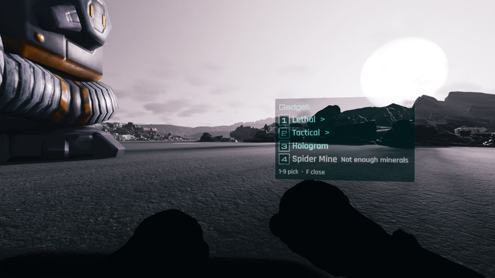</a>

10:13 밝은 하늘 앞에서도 장비 메뉴가 또렷하게 보이게 했습니다.

<h2 id="weapon">무기</h2>

거미지뢰, 펄스 수류탄, 중력 수류탄을 새로 다듬었습니다.

<a href="/assets/d/2026-10-26/WindowsEditor_HighresScreenshot01042.jpg" target="_blank">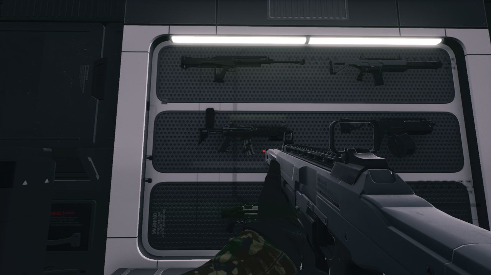</a>

02:49 보급고 벽에 걸린 총을 집을 수 있게 고쳤습니다.

05:20 장비를 수류탄, 전술, 지뢰, 홀로그램으로 정리했습니다.

<a href="/assets/d/2026-10-26/WindowsEditor_HighresScreenshot01140.jpg" target="_blank">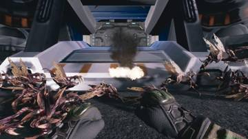</a>
<a href="/assets/d/2026-10-26/WindowsEditor_HighresScreenshot01141.jpg" target="_blank">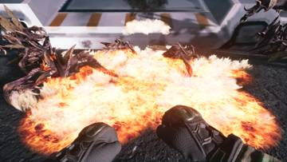</a>

05:37 집속 폭탄 조각 여섯 개가 모두 퍼져 나가게 고쳤습니다.

05:49 록다운 장비가 터진 자리에 빛이 번지게 했습니다.

<a href="/assets/d/2026-10-26/WindowsEditor_HighresScreenshot01159.jpg" target="_blank">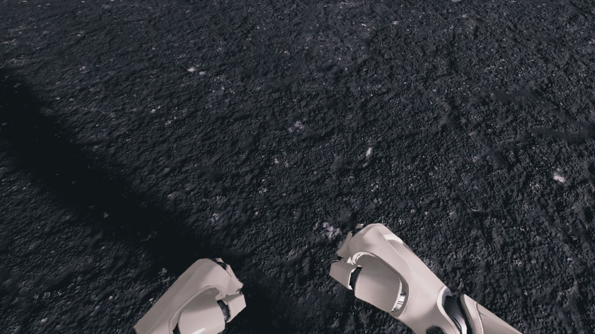</a>

06:07 플레이어의 1인칭 몸과 팔에 트루퍼 스킨을 입혔습니다.

<a href="/assets/d/2026-10-26/WindowsEditor_HighresScreenshot01168.jpg" target="_blank">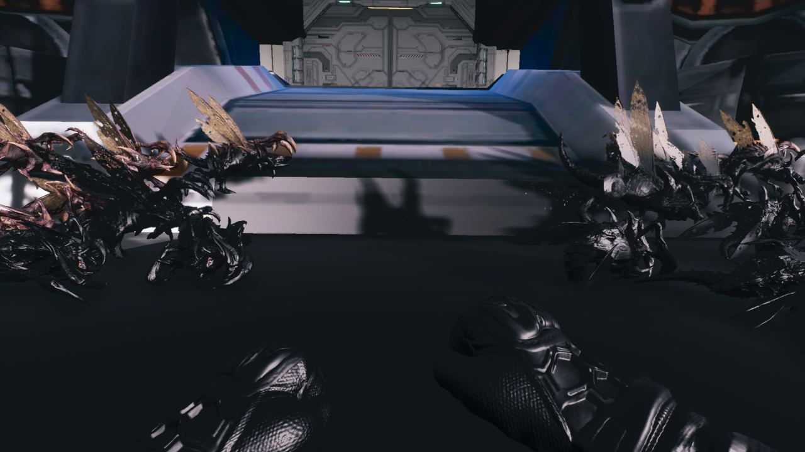</a>

07:15 중력 수류탄이 적을 끌어당기는 대신 공중으로 띄우게 했습니다.

<a href="/assets/d/2026-10-26/WindowsEditor_HighresScreenshot01176.jpg" target="_blank">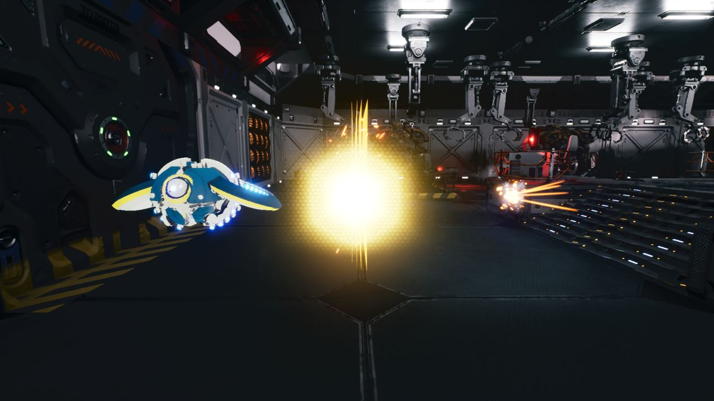</a>

07:40 펄스 수류탄을 파란 폭발의 강한 파편탄으로 바꿨습니다.

07:44 지뢰를 스타크래프트 2 무기고의 지뢰 모델로 바꿨습니다.

<h2 id="terran">테란 아군</h2>

고스트 슈트의 머리 모습을 맞췄습니다.

<a href="/assets/d/2026-10-26/WindowsEditor_scv_board1.jpg" target="_blank">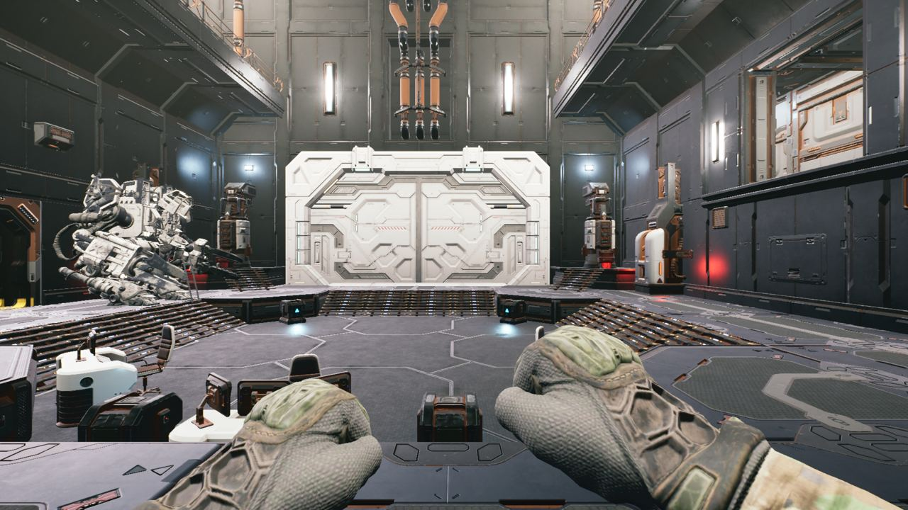</a>

03:20 SCV를 새로 불러와 탑승 중 사라지던 문제를 고쳤습니다.

<a href="/assets/d/2026-10-26/WindowsEditor_HighresScreenshot01100.jpg" target="_blank">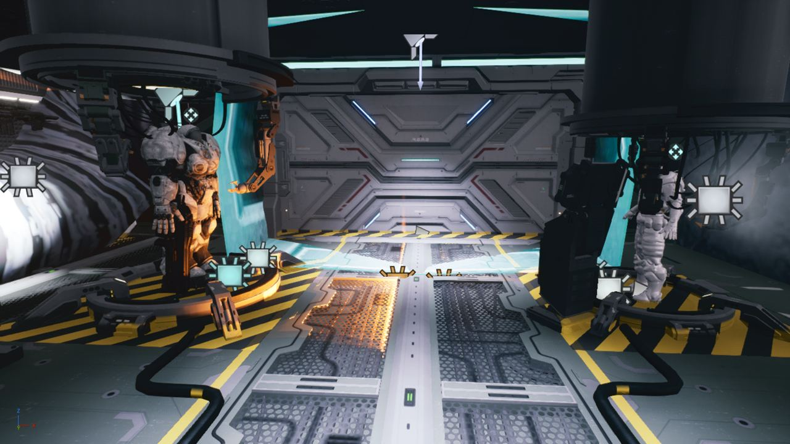</a>

04:15 고스트 머리 질감을 레이스 장갑처럼 하얗게 바꿨습니다.

<h2 id="vfx">이펙트</h2>

보급고 내부를 흰색으로 바꾸고 올가미가 저글링에 보이게 했습니다.

<a href="/assets/d/2026-10-26/WindowsEditor_HighresScreenshot01088.jpg" target="_blank">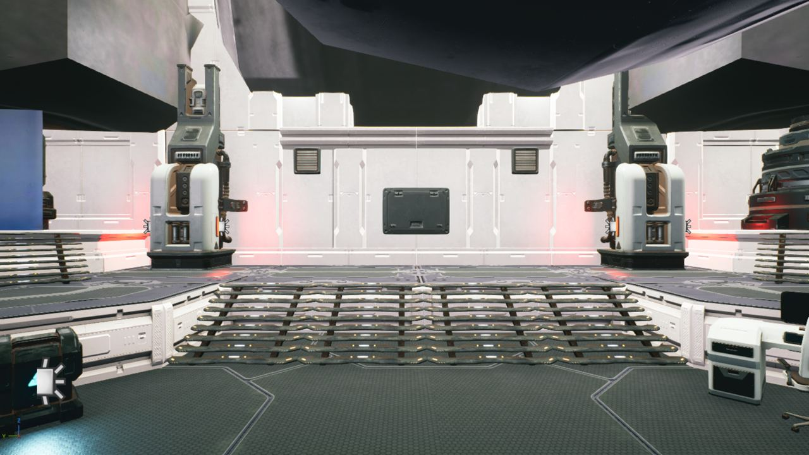</a>

04:13 보급고 벽에 낡은 흰색 페인트 질감을 입혔습니다.

<a href="/assets/d/2026-10-26/WindowsEditor_HighresScreenshot01118.jpg" target="_blank">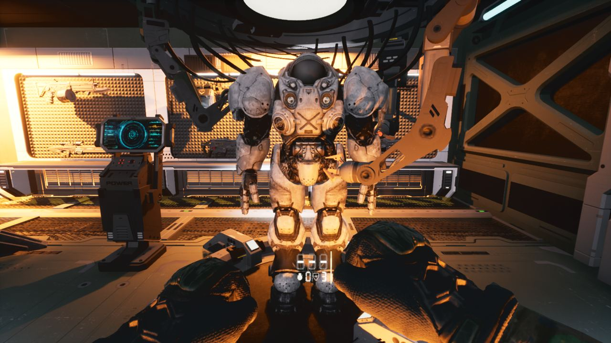</a>

05:03 병영과 사령부 벽을 낡은 흰색 칠로 바꿨습니다.

06:17 록다운 장비에 묶인 저글링의 다리를 줄이 감게 했습니다.

07:15 공상과학 총기 팩의 발광을 모두 껐습니다.

<a href="/assets/d/2026-10-26/WindowsEditor_sc2emis_depot_before_A.jpg" target="_blank">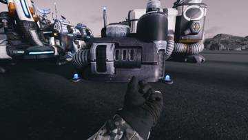</a>
<a href="/assets/d/2026-10-26/WindowsEditor_sc2emis_depot_before_B.jpg" target="_blank">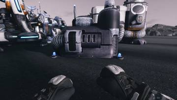</a>

07:54 스타크래프트 건물 외관의 발광을 껐습니다.

<a href="/assets/d/2026-10-26/WindowsEditor_gw_s_heavy_arml.jpg" target="_blank">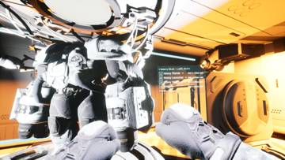</a>
<a href="/assets/d/2026-10-26/WindowsEditor_HighresScreenshot01193.jpg" target="_blank">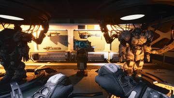</a>

08:31 보급고 내부를 낡은 흰색으로 바꿨습니다.

<a href="/assets/d/2026-10-26/WindowsEditor_HighresScreenshot01213.jpg" target="_blank">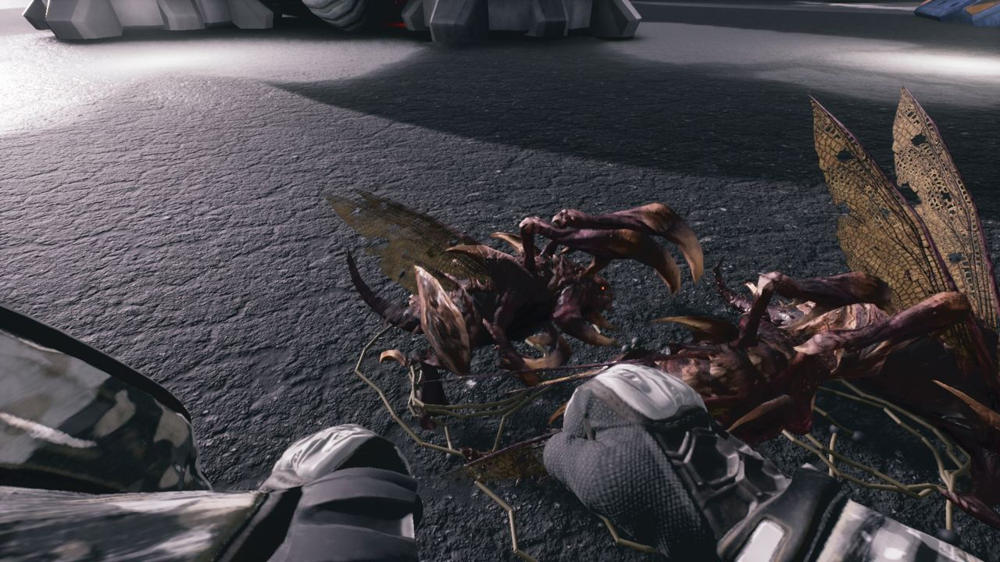</a>

08:58 저글링에게 감기는 줄이 몸에 가려 안 보이던 문제를 고쳤습니다.

<h2 id="gearwall">장비 거치대</h2>

보급고 벽에서 총과 장비를 메뉴로 고르게 했습니다.

<a href="/assets/d/2026-10-26/WindowsEditor_gearwall_bow.jpg" target="_blank">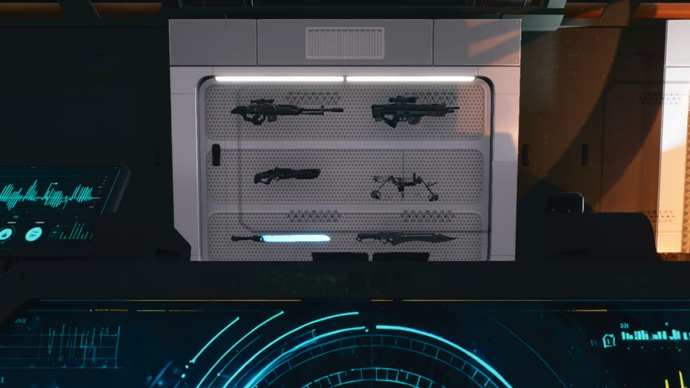</a>

05:44 고스트 무기 벽의 활을 가로로 눕혔습니다.

07:36 슈트 선택 틀을 모델 중심에 맞췄습니다.

<a href="/assets/d/2026-10-26/WindowsEditor_gw_s_power_shl.jpg" target="_blank">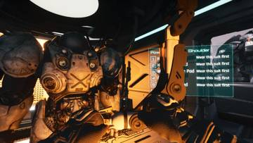</a>
<a href="/assets/d/2026-10-26/WindowsEditor_gw_d_take_menu.jpg" target="_blank">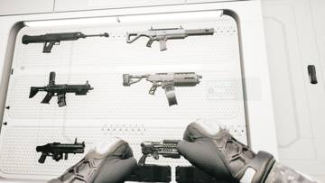</a>

08:34 총기 벽 메뉴 제목을 영어로 바꿔 깨진 글자를 없앴습니다.

<h2 id="zerg">저그</h2>

중력 수류탄이 저글링을 공중으로 띄우게 했습니다.

05:58 중력장과 충격 장비로 저글링이 끌려가거나 밀려나게 했습니다.

07:35 중력 수류탄이 저글링을 들어 올리게 했습니다.

08:37 펄스 수류탄의 밀어내기를 없애고 파란 파편탄으로 바꿨습니다.

<h2 id="weaponskin">무기 도색</h2>

C-14 소총 무늬를 새로 짰습니다.

08:47 C-14 총의 표면 펼침을 다시 해 질감 해상도를 높였습니다.

<h2 id="audio">소리</h2>

문 열리고 닫히는 소리를 스타2 소리로 바꿨습니다.

<h2 id="character_mesh">캐릭터 모델</h2>

고스트 슈트 모델의 목과 머리를 정리했습니다.

