
세션 11개 · 사진 223장

<ul class="toc">
<li><a href="#building">building — 건물</a></li>
<li><a href="#weapon">weapon — 무기</a></li>
<li><a href="#design">design — 기획</a></li>
<li><a href="#terran">terran — 테란 아군</a></li>
<li><a href="#vfx">vfx — 이펙트</a></li>
<li><a href="#gearwall">gearwall — 장비 거치대</a></li>
<li><a href="#zerg">zerg — 저그</a></li>
<li><a href="#perf">perf — 성능</a></li>
<li><a href="#audio">audio — 소리</a></li>
<li><a href="#weaponskin">weaponskin — 무기 도색</a></li>
<li><a href="#character_mesh">character_mesh — 캐릭터 모델</a></li>
</ul>
<h2 id="building">building <small>건물</small></h2>

보급고 조명과 벽 색, 병력 모델을 손봐 더 밝고 깔끔해졌습니다.

<a href="/assets/d/2026-10-26/WindowsEditor_HighresScreenshot01001.jpg" target="_blank">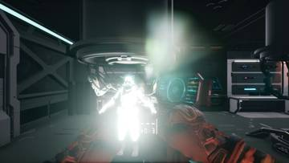</a>
<a href="/assets/d/2026-10-26/WindowsEditor_HighresScreenshot01002.jpg" target="_blank">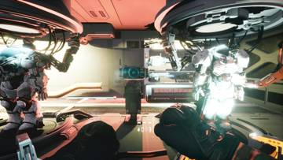</a>
<a href="/assets/d/2026-10-26/WindowsEditor_HighresScreenshot01003.jpg" target="_blank">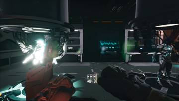</a>
<a href="/assets/d/2026-10-26/WindowsEditor_HighresScreenshot01004.jpg" target="_blank">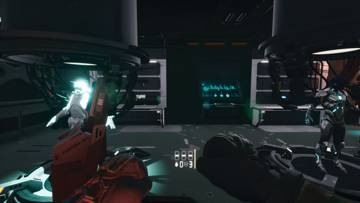</a>
<a href="/assets/d/2026-10-26/WindowsEditor_HighresScreenshot01007.jpg" target="_blank">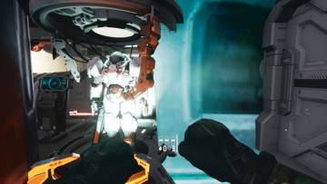</a>
<a href="/assets/d/2026-10-26/WindowsEditor_HighresScreenshot01009.jpg" target="_blank">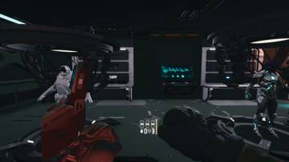</a>
<a href="/assets/d/2026-10-26/WindowsEditor_HighresScreenshot01014.jpg" target="_blank">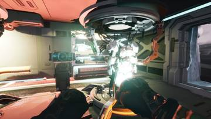</a>
<a href="/assets/d/2026-10-26/WindowsEditor_HighresScreenshot01016.jpg" target="_blank">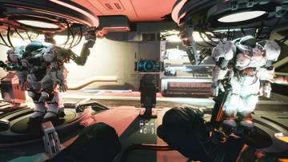</a>
<a href="/assets/d/2026-10-26/WindowsEditor_HighresScreenshot01017.jpg" target="_blank">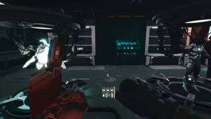</a>
<a href="/assets/d/2026-10-26/WindowsEditor_HighresScreenshot01018.jpg" target="_blank">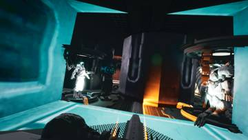</a>
<a href="/assets/d/2026-10-26/WindowsEditor_HighresScreenshot01019.jpg" target="_blank">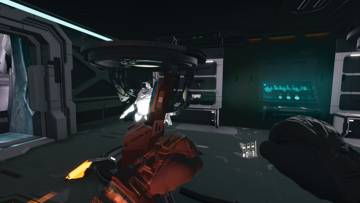</a>
<a href="/assets/d/2026-10-26/WindowsEditor_HighresScreenshot01021.jpg" target="_blank">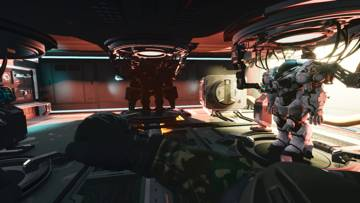</a>
<a href="/assets/d/2026-10-26/WindowsEditor_HighresScreenshot01022.jpg" target="_blank">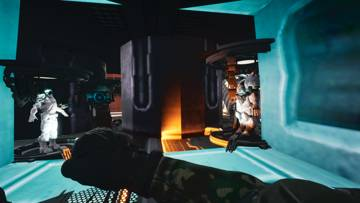</a>
<a href="/assets/d/2026-10-26/WindowsEditor_HighresScreenshot01025.jpg" target="_blank">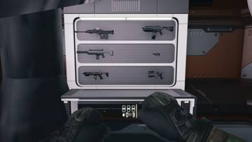</a>

02:22 장비실이 옮겨졌는데 총이 옛 자리에 남아 있어서 새 방 무기 벽으로 옮겼습니다.

<a href="/assets/d/2026-10-26/WindowsEditor_HighresScreenshot01027.jpg" target="_blank">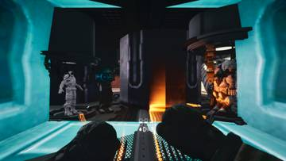</a>
<a href="/assets/d/2026-10-26/WindowsEditor_HighresScreenshot01028.jpg" target="_blank">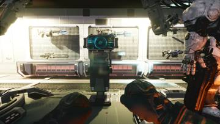</a>
<a href="/assets/d/2026-10-26/WindowsEditor_HighresScreenshot01029.jpg" target="_blank">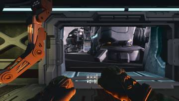</a>

02:41 보급고 슈트 조명을 끄고 파워 벽을 패널 3장으로 줄였습니다.

<a href="/assets/d/2026-10-26/WindowsEditor_HighresScreenshot01046.jpg" target="_blank">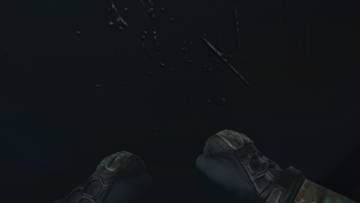</a>
<a href="/assets/d/2026-10-26/WindowsEditor_HighresScreenshot01047.jpg" target="_blank">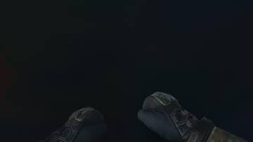</a>
<a href="/assets/d/2026-10-26/WindowsEditor_HighresScreenshot01048.jpg" target="_blank">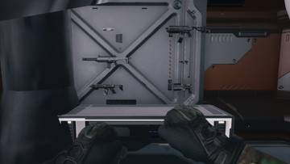</a>
<a href="/assets/d/2026-10-26/WindowsEditor_HighresScreenshot01049.jpg" target="_blank">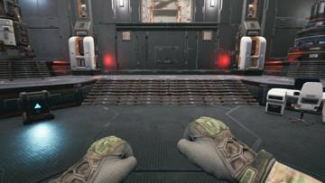</a>

03:00 옛 엘리베이터 자리로 가면 캐릭터가 바닥 아래로 빠지던 문제를 고쳤습니다.

03:05 사령부 왼쪽 방의 휘어진 벽을 평평한 벽으로 바꾸고 장비를 옮겼습니다.

<a href="/assets/d/2026-10-26/WindowsEditor_HighresScreenshot01053.jpg" target="_blank">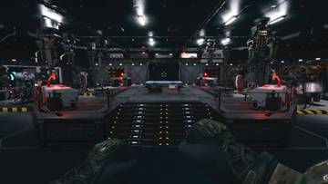</a>

<a href="/assets/d/2026-10-26/WindowsEditor_HighresScreenshot01055.jpg" target="_blank">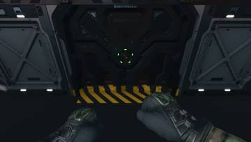</a>

03:11 배럭에 테란 색감 조명과 경고 표시를 입혔습니다.

<a href="/assets/d/2026-10-26/WindowsEditor_HighresScreenshot01057.jpg" target="_blank">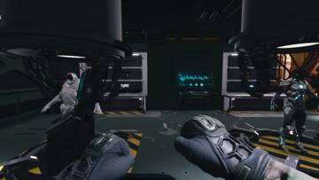</a>

03:13 보급고에 테란 색감의 경고 표시와 바닥 조명을 입혔습니다.

<a href="/assets/d/2026-10-26/WindowsEditor_HighresScreenshot01066.jpg" target="_blank">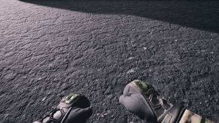</a>
<a href="/assets/d/2026-10-26/WindowsEditor_HighresScreenshot01067.jpg" target="_blank">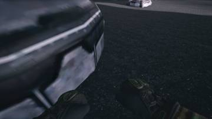</a>
<a href="/assets/d/2026-10-26/WindowsEditor_HighresScreenshot01068.jpg" target="_blank">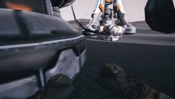</a>
<a href="/assets/d/2026-10-26/WindowsEditor_HighresScreenshot01069.jpg" target="_blank">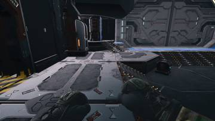</a>

03:40 사령부의 SCV 장식을 없애고 테란 색감을 한 번 더 다듬었습니다.

<a href="/assets/d/2026-10-26/WindowsEditor_HighresScreenshot01071.jpg" target="_blank">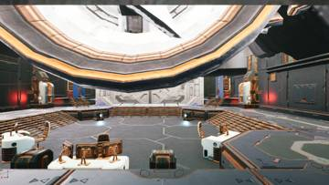</a>
<a href="/assets/d/2026-10-26/WindowsEditor_HighresScreenshot01072.jpg" target="_blank">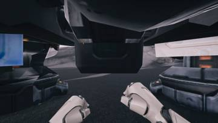</a>
<a href="/assets/d/2026-10-26/WindowsEditor_HighresScreenshot01073.jpg" target="_blank">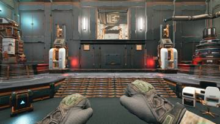</a>
<a href="/assets/d/2026-10-26/WindowsEditor_HighresScreenshot01074.jpg" target="_blank">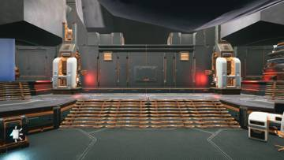</a>
<a href="/assets/d/2026-10-26/WindowsEditor_HighresScreenshot01078.jpg" target="_blank">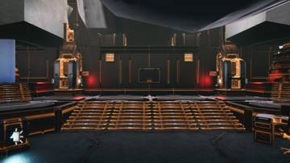</a>

03:56 무기는 밝은 회색 낡은 도장에 어두운 금속 부품으로 하기로 정했습니다.

<a href="/assets/d/2026-10-26/WindowsEditor_HighresScreenshot01115.jpg" target="_blank">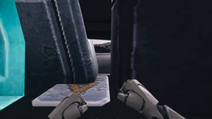</a>
<a href="/assets/d/2026-10-26/WindowsEditor_HighresScreenshot01116.jpg" target="_blank">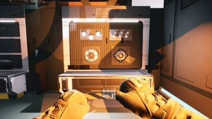</a>
<a href="/assets/d/2026-10-26/WindowsEditor_HighresScreenshot01117.jpg" target="_blank">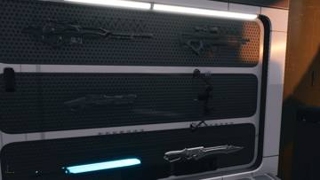</a>

<a href="/assets/d/2026-10-26/WindowsEditor_HighresScreenshot01124.jpg" target="_blank">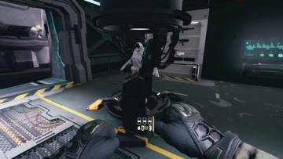</a>
<a href="/assets/d/2026-10-26/WindowsEditor_HighresScreenshot01125.jpg" target="_blank">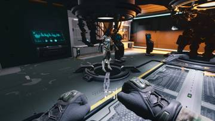</a>
<a href="/assets/d/2026-10-26/WindowsEditor_HighresScreenshot01126.jpg" target="_blank">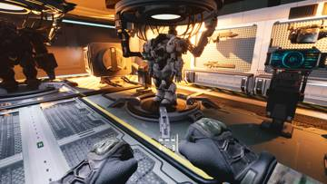</a>

05:06 보급고 가젯 벽과 조명을 새 구성으로 정리했습니다.

<a href="/assets/d/2026-10-26/WindowsEditor_HighresScreenshot01129.jpg" target="_blank">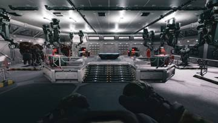</a>
<a href="/assets/d/2026-10-26/WindowsEditor_HighresScreenshot01131.jpg" target="_blank">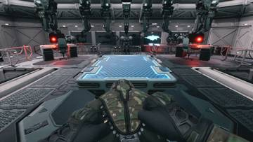</a>
<a href="/assets/d/2026-10-26/WindowsEditor_HighresScreenshot01133.jpg" target="_blank">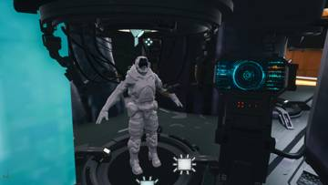</a>

<a href="/assets/d/2026-10-26/WindowsEditor_HighresScreenshot01136.jpg" target="_blank">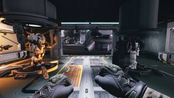</a>

05:24 보급고 조명 세기와 범위를 조정하고 중장갑 콘솔을 뺐습니다.

<a href="/assets/d/2026-10-26/WindowsEditor_HighresScreenshot01163.jpg" target="_blank">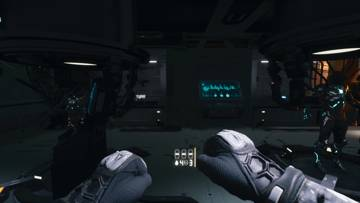</a>
<a href="/assets/d/2026-10-26/WindowsEditor_HighresScreenshot01164.jpg" target="_blank">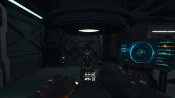</a>

<a href="/assets/d/2026-10-26/WindowsEditor_HighresScreenshot01166.jpg" target="_blank">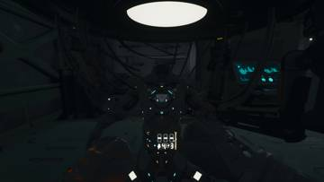</a>
<a href="/assets/d/2026-10-26/WindowsEditor_HighresScreenshot01167.jpg" target="_blank">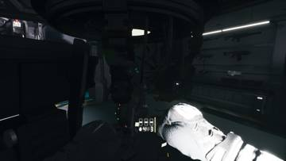</a>

06:56 보급고의 중장갑 병사와 일반 병사를 새 모델로 바꿔 흰색으로 입혔습니다.

<a href="/assets/d/2026-10-26/WindowsEditor_HighresScreenshot01187.jpg" target="_blank">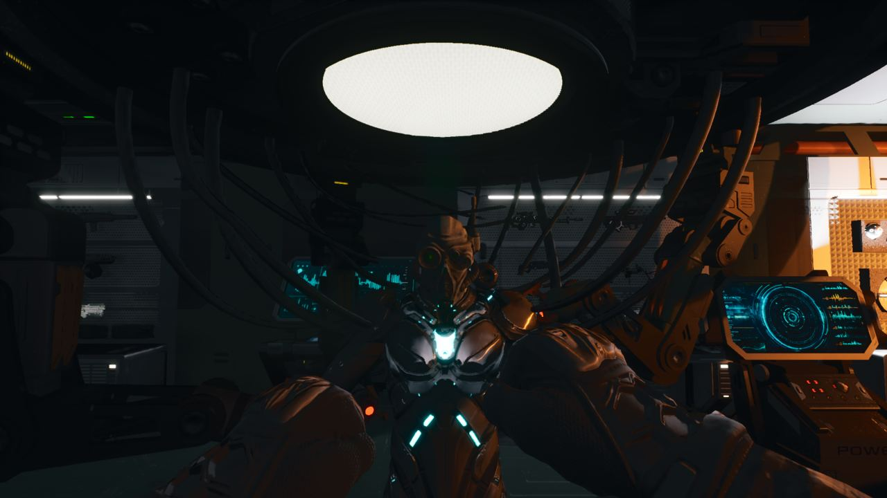</a>

08:05 보급고 스킨 슈트를 다시 불러오고 머리가 커 보이던 문제를 줄였습니다.

<a href="/assets/d/2026-10-26/WindowsEditor_HighresScreenshot01201.jpg" target="_blank">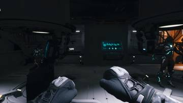</a>
<a href="/assets/d/2026-10-26/WindowsEditor_HighresScreenshot01202.jpg" target="_blank">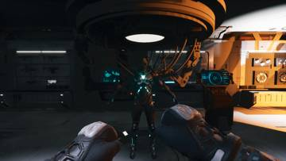</a>

08:36 하얗게 바뀐 보급고 벽에 맞춰 조명을 새로 배치했습니다.

16:20 보급고 조명이 너무 강한 곳을 줄이고 통로 조명을 더했습니다.

<h2 id="weapon">weapon <small>무기</small></h2>

거미지뢰, 펄스 수류탄, 중력 수류탄을 새로 다듬었습니다.

02:49 보급고 방의 총을 집을 수 있게 고쳐 벽에 18정이 걸리게 했습니다.

05:20 수류탄, 전술, 지뢰, 홀로그램으로 장비를 정리하고 방패 설치는 뺐습니다.

05:37 집속 폭탄 조각들이 서로 부딪치지 않고 여섯 개 모두 퍼져 나가게 고쳤습니다.

05:49 록다운 장비가 터진 자리에 빛이 번지게 했습니다.

06:07 플레이어의 1인칭 몸과 팔에 트루퍼 스킨을 입혔습니다.

07:15 중력 수류탄이 적을 끌어당기는 대신 공중으로 띄우게 바꿨습니다.

07:40 펄스 수류탄을 파란 폭발의 강한 파편 수류탄으로 바꿨습니다.

07:44 지뢰를 스타크래프트 2의 무기고 지뢰 모델로 바꿨습니다.

<h2 id="design">design <small>기획</small></h2>

총 메뉴가 밝은 하늘과 흰 벽 위에서도 또렷하게 보이도록 고쳤습니다.

02:49 장비 벽을 수류탄, 전술, 지뢰, 홀로그램 네 가지로 정리했습니다.

04:47 보급고 컴퓨터 콘솔을 플랫폼마다 하나씩 놓고 장비 화면을 띄웠습니다.

05:09 보급고 장비를 조준한 무기나 갑옷 부위에서 F로 여는 메뉴로 바꿨습니다

05:55 장비 벽을 보고 F를 누르면 옆에 명령 목록이 뜨는 메뉴를 만들었습니다.

08:44 장비 메뉴가 보급고 소품에 가려지지 않고 장면 앞에 보이게 했습니다

09:28 흰 보급고 벽에서도 장비 메뉴가 잘 보이게 밝기와 배경을 고쳤습니다.

10:13 밝은 하늘 앞에서도 장비 메뉴가 비치지 않고 또렷하게 보이게 했습니다

<h2 id="terran">terran <small>테란 아군</small></h2>

고스트 슈트의 머리 크기와 위치를 맞췄습니다.

03:20 SCV를 새로 불러와 사다리를 달고 탑승 중 사라지던 문제를 고쳤습니다.

04:15 고스트 머리 텍스처를 레이스 장갑처럼 하얗게 바꿨습니다

<h2 id="vfx">vfx <small>이펙트</small></h2>

보급고 내부를 흰색으로 바꾸고 올가미가 저글링에 보이게 했습니다.

04:13 보급고 벽면에 낡은 흰색 페인트 질감을 입혔습니다

05:03 병영과 사령부 벽 재질을 낡은 흰색 칠로 바꿨습니다.

05:24 엔진 함정 기록에 재질 갱신 문제와 충돌 사례를 추가했습니다.

06:17 록다운 장비에 묶인 저글링의 다리를 줄이 감는 효과를 넣었습니다.

07:15 공상과학 무기 팩의 발광을 모두 껐습니다.

07:54 스타크래프트 건물 외관의 발광을 재질 값만 바꿔 껐습니다.

08:31 보급고 내부를 재질 값만 바꿔 낡은 흰색으로 만들었습니다.

08:58 저글링에게 감기는 줄이 몸에 가려 안 보이던 문제를 고쳤습니다.

<h2 id="gearwall">gearwall <small>장비 거치대</small></h2>

보급고 벽에서 총과 장비를 F키 메뉴로 고를 수 있게 했습니다.

05:44 고스트 무기 벽의 활을 가로로 눕혔습니다.

07:36 슈트 선택 틀을 모델 중심에 맞췄고, 전체 빌드는 성공했습니다.

08:34 총기 벽 메뉴 제목을 영어로 바꿔 깨져 보이던 한글 글자를 없앴습니다.

<h2 id="zerg">zerg <small>저그</small></h2>

중력 수류탄이 저글링을 공중으로 띄우도록 했습니다.

05:58 중력장과 충격 장비를 만들어 저글링이 중앙으로 끌려가거나 밀려나게 했습니다.

06:05 엔진 빌드가 복사한 소스를 건너뛰는 함정을 기록했습니다

07:35 중력 수류탄이 저글링을 들어 올리게 하고 락다운 볼라 속박을 넣었습니다.

08:37 펄스 수류탄의 밀어내기 효과를 없애고 더 강한 파란 파편탄으로 바꿨습니다.

<h2 id="perf">perf <small>성능</small></h2>

07:25 

<h2 id="audio">audio <small>소리</small></h2>

문 열리고 닫히는 소리를 스타2 소리로 바꿨습니다.

07:44 스타크래프트 2의 건물 소리와 병사 발소리를 들어 비교하는 도구를 만들었습니다.

<h2 id="weaponskin">weaponskin <small>무기 도색</small></h2>

C-14 소총 무늬를 새로 짜고 회색 금속 질감을 입혔습니다.

08:47 C-14 총의 표면 펼침을 업계 규칙대로 다시 해서 질감 해상도를 높였습니다.

<h2 id="character_mesh">character_mesh <small>캐릭터 모델</small></h2>

고스트 슈트 모델의 목과 머리를 깔끔하게 정리했습니다.

