
세션 8개 · 사진 112장

<ul class="toc">
<li><a href="#depot">depot — 보급창</a></li>
<li><a href="#weapon">weapon — 무기</a></li>
<li><a href="#audio">audio — 소리</a></li>
<li><a href="#building">building — 건물</a></li>
<li><a href="#gearwall">gearwall — 장비 거치대</a></li>
<li><a href="#vehicle">vehicle — 차량</a></li>
<li><a href="#design">design — 기획</a></li>
<li><a href="#siegetank">siegetank — 시즈탱크</a></li>
</ul>
<h2 id="depot">depot <small>보급창</small></h2>

보급고 입구 복도를 바닥 중심으로 정리하고 문 주변을 손봤습니다.

<a href="/assets/d/2026-10-27/WindowsEditor_HighresScreenshot01248.jpg" target="_blank">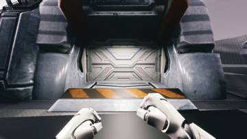</a>
<a href="/assets/d/2026-10-27/WindowsEditor_HighresScreenshot01249.jpg" target="_blank">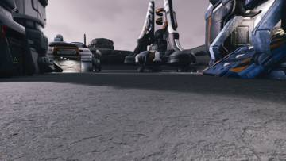</a>
<a href="/assets/d/2026-10-27/WindowsEditor_HighresScreenshot01250.jpg" target="_blank">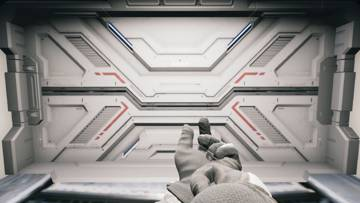</a>
<a href="/assets/d/2026-10-27/WindowsEditor_HighresScreenshot01251.jpg" target="_blank">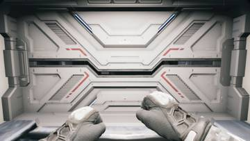</a>
<a href="/assets/d/2026-10-27/WindowsEditor_HighresScreenshot01252.jpg" target="_blank">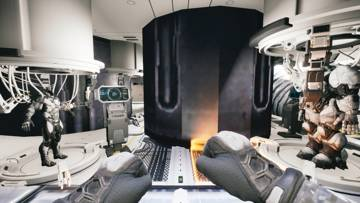</a>
<a href="/assets/d/2026-10-27/WindowsEditor_HighresScreenshot01253.jpg" target="_blank">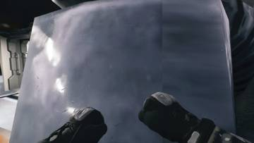</a>
<a href="/assets/d/2026-10-27/WindowsEditor_HighresScreenshot01254.jpg" target="_blank">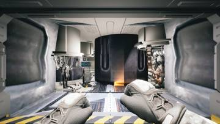</a>
<a href="/assets/d/2026-10-27/WindowsEditor_HighresScreenshot01255.jpg" target="_blank">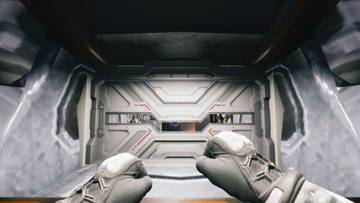</a>
<a href="/assets/d/2026-10-27/WindowsEditor_HighresScreenshot01256.jpg" target="_blank">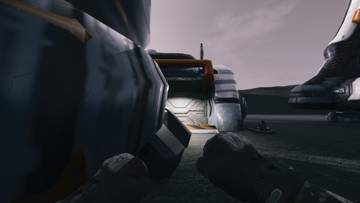</a>
<a href="/assets/d/2026-10-27/WindowsEditor_HighresScreenshot01257.jpg" target="_blank">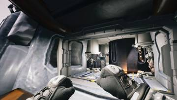</a>
<a href="/assets/d/2026-10-27/WindowsEditor_HighresScreenshot01258.jpg" target="_blank">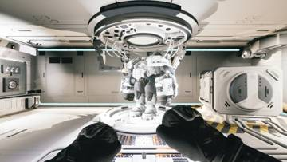</a>
<a href="/assets/d/2026-10-27/WindowsEditor_HighresScreenshot01259.jpg" target="_blank">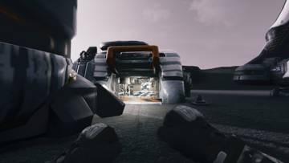</a>
<a href="/assets/d/2026-10-27/WindowsEditor_HighresScreenshot01263.jpg" target="_blank">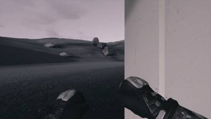</a>
<a href="/assets/d/2026-10-27/WindowsEditor_HighresScreenshot01264.jpg" target="_blank">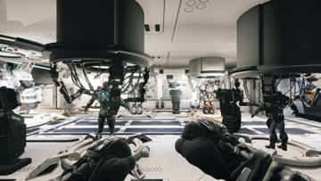</a>

<a href="/assets/d/2026-10-27/WindowsEditor_HighresScreenshot01270.jpg" target="_blank">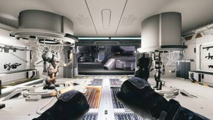</a>

04:35 문이 열려 있어도 건물 밖에서는 내부가 보이지 않게 고쳤습니다.

<a href="/assets/d/2026-10-27/WindowsEditor_HighresScreenshot01275.jpg" target="_blank">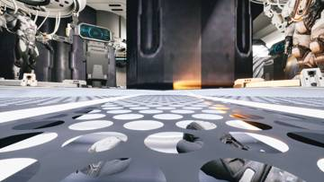</a>
<a href="/assets/d/2026-10-27/WindowsEditor_HighresScreenshot01276.jpg" target="_blank">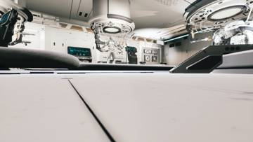</a>
<a href="/assets/d/2026-10-27/WindowsEditor_HighresScreenshot01277.jpg" target="_blank">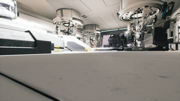</a>
<a href="/assets/d/2026-10-27/WindowsEditor_HighresScreenshot01278.jpg" target="_blank">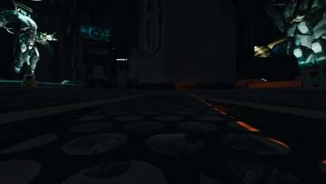</a>
<a href="/assets/d/2026-10-27/WindowsEditor_HighresScreenshot01279.jpg" target="_blank">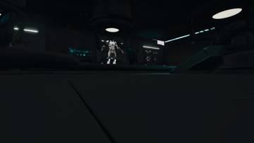</a>
<a href="/assets/d/2026-10-27/WindowsEditor_HighresScreenshot01280.jpg" target="_blank">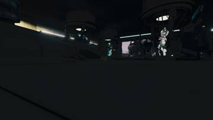</a>
<a href="/assets/d/2026-10-27/WindowsEditor_HighresScreenshot01283.jpg" target="_blank">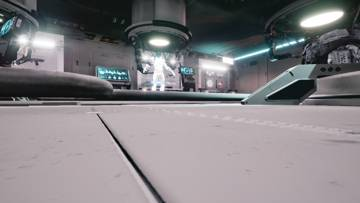</a>
<a href="/assets/d/2026-10-27/WindowsEditor_HighresScreenshot01285.jpg" target="_blank">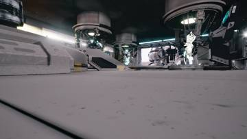</a>

06:46 방 조명을 보급고 지하실 원본 조명으로 되돌렸습니다

<a href="/assets/d/2026-10-27/WindowsEditor_HighresScreenshot01287.jpg" target="_blank">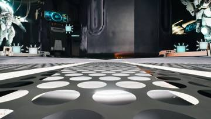</a>
<a href="/assets/d/2026-10-27/WindowsEditor_HighresScreenshot01288.jpg" target="_blank">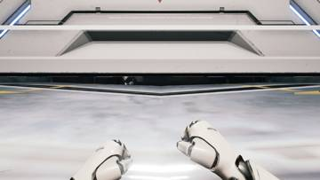</a>
<a href="/assets/d/2026-10-27/WindowsEditor_HighresScreenshot01290.jpg" target="_blank">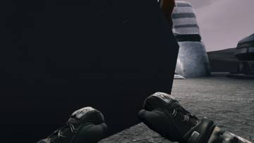</a>
<a href="/assets/d/2026-10-27/WindowsEditor_HighresScreenshot01291.jpg" target="_blank">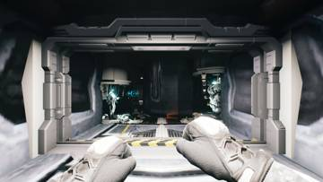</a>
<a href="/assets/d/2026-10-27/WindowsEditor_HighresScreenshot01292.jpg" target="_blank">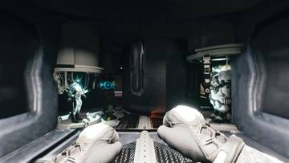</a>

07:08 입구 통로 조명을 되살리고 방 노출을 맞췄습니다.

<a href="/assets/d/2026-10-27/WindowsEditor_HighresScreenshot01297.jpg" target="_blank">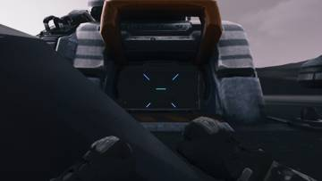</a>
<a href="/assets/d/2026-10-27/WindowsEditor_HighresScreenshot01298.jpg" target="_blank">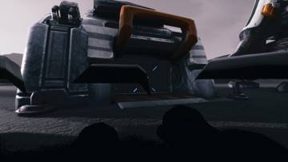</a>
<a href="/assets/d/2026-10-27/WindowsEditor_HighresScreenshot01299.jpg" target="_blank">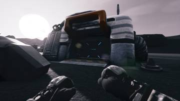</a>
<a href="/assets/d/2026-10-27/WindowsEditor_HighresScreenshot01300.jpg" target="_blank">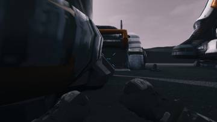</a>
<a href="/assets/d/2026-10-27/WindowsEditor_HighresScreenshot01301.jpg" target="_blank">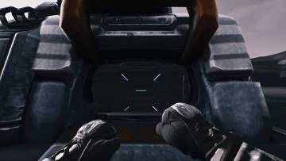</a>
<a href="/assets/d/2026-10-27/WindowsEditor_HighresScreenshot01302.jpg" target="_blank">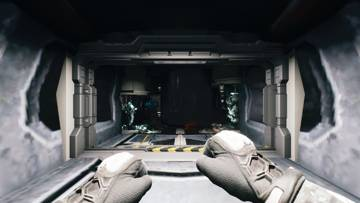</a>
<a href="/assets/d/2026-10-27/WindowsEditor_HighresScreenshot01303.jpg" target="_blank">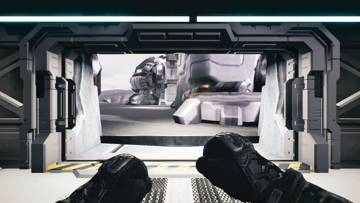</a>

07:36 보급고 방 구성품이 바깥에서는 모두 숨겨지도록 고쳤습니다

<a href="/assets/d/2026-10-27/WindowsEditor_HighresScreenshot01344.jpg" target="_blank">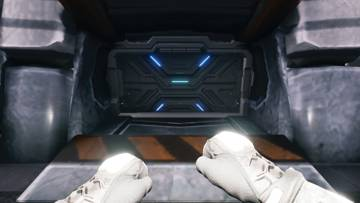</a>
<a href="/assets/d/2026-10-27/WindowsEditor_HighresScreenshot01345.jpg" target="_blank">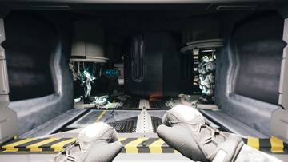</a>
<a href="/assets/d/2026-10-27/WindowsEditor_HighresScreenshot01346.jpg" target="_blank">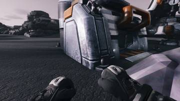</a>
<a href="/assets/d/2026-10-27/capture_depot_out.jpg" target="_blank">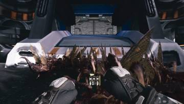</a>
<a href="/assets/d/2026-10-27/capture_depot_in.jpg" target="_blank">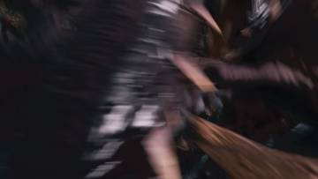</a>
<a href="/assets/d/2026-10-27/WindowsEditor_HighresScreenshot01347.jpg" target="_blank">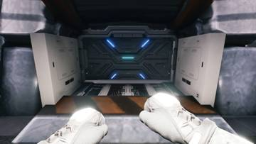</a>
<a href="/assets/d/2026-10-27/WindowsEditor_HighresScreenshot01348.jpg" target="_blank">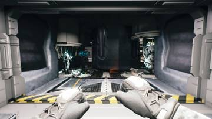</a>

12:36 복도 벽을 출입문 바깥면에서 곧게 이어지도록 다시 배치했습니다

<a href="/assets/d/2026-10-27/WindowsEditor_HighresScreenshot01352.jpg" target="_blank">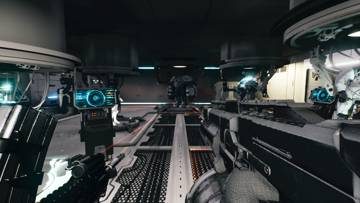</a>
<a href="/assets/d/2026-10-27/WindowsEditor_HighresScreenshot01353.jpg" target="_blank">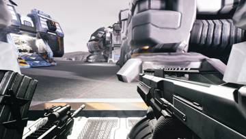</a>
<a href="/assets/d/2026-10-27/WindowsEditor_HighresScreenshot01354.jpg" target="_blank">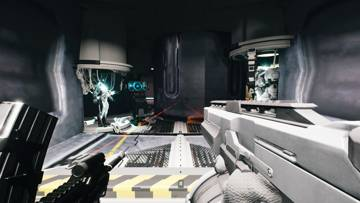</a>
<a href="/assets/d/2026-10-27/WindowsEditor_HighresScreenshot01355.jpg" target="_blank">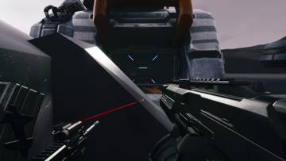</a>
<a href="/assets/d/2026-10-27/WindowsEditor_HighresScreenshot01356.jpg" target="_blank">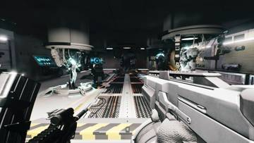</a>
<a href="/assets/d/2026-10-27/WindowsEditor_HighresScreenshot01357.jpg" target="_blank">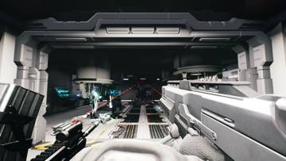</a>
<a href="/assets/d/2026-10-27/WindowsEditor_HighresScreenshot01358.jpg" target="_blank">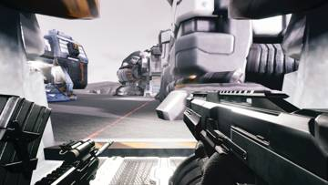</a>

18:46 보급고 문 근처에서 선체가 방을 가로지르던 문제를 고쳐 숨겼습니다.

<a href="/assets/d/2026-10-27/WindowsEditor_HighresScreenshot01360.jpg" target="_blank">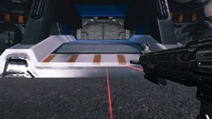</a>

19:34 블렌더 시뮬레이션이 게임 안 보급고 동작과 똑같이 움직이게 맞췄습니다

<h2 id="weapon">weapon <small>무기</small></h2>

양손 권총 위치를 맞추고 가우스 총의 개머리판과 대검을 다듬었습니다.

06:34 가우스 샷건 총열을 늘리고 SC2 워피그를 참고해 가늠자를 달았습니다.

07:26 쌍권총을 다시 만드는 반복을 고치고 발사 간격과 레이저를 정리했습니다.

07:47 F7 조절창이 열려 있을 때는 우클릭이 총을 쏘지 않게 했습니다.

08:12 양손 권총의 좌우 반전 방식을 없애고 왼팔과 왼쪽 총을 따로 맞추게 했습니다.

08:23 집중 키를 Ctrl에서 F로 바꾸고 다른 용도와 겹치지 않게 했습니다.

12:04 가우스 가늠자가 총구를 막지 않게 앞쪽으로 옮기고 길이를 줄였습니다.

12:20 가우스 총 위쪽 레일 중 조준기와 겹치는 한 칸만 지웠습니다.

12:26 가우스 총검을 사용자가 준 M9 총검 모델로 바꿨습니다.

12:45 왼손 쌍권총 자세를 오른손의 거울상으로 계산하는 도구를 만들었습니다

19:44 모든 보조 무기의 왼손 쌍권총 자세를 오른손 자세 거울상으로 맞췄습니다.

<h2 id="audio">audio <small>소리</small></h2>

재장전 소리를 동작별로 잘라 제때 나오게 했습니다.

07:26 이미 끝난 할 일 항목을 정리하고 SC2 선택을 기다리는 상태로 남겼습니다.

11:51 재장전 소리를 동작 순간마다 따로 재생되도록 잘게 나눴습니다.

12:02 재장전 소리 목록을 무기 쪽 형식에 맞추고 소리가 제 타이밍에 나게 했습니다.

<h2 id="building">building <small>건물</small></h2>

병영의 붉은 조명을 줄였습니다.

07:30 병영의 붉은 보조 조명을 800에서 300으로 줄였습니다.

<h2 id="gearwall">gearwall <small>장비 거치대</small></h2>

07:47 

<h2 id="vehicle">vehicle <small>차량</small></h2>

레오파드 전차 내부를 실제 크기로 시즈탱크에 넣고 질감을 입혔습니다.

12:22 레오파드 내부를 실제 크기로 되돌리고 바닥과 천장 높이를 맞췄습니다.

<h2 id="design">design <small>기획</small></h2>

왼손 총 정보판이 총을 따라다니도록 고쳤습니다.

19:17 왼쪽 쌍권총 패널이 총을 따라다니도록 3D 위치에 붙였습니다

<h2 id="siegetank">siegetank <small>시즈탱크</small></h2>

시즈탱크 내부용 레오파드 전차 모델을 구역별로 나눴습니다.

