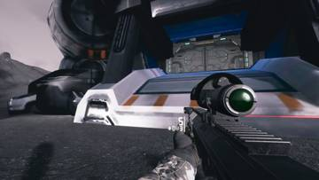
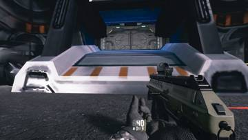
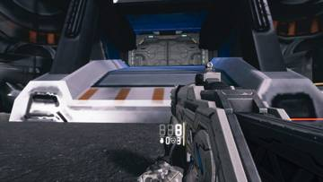
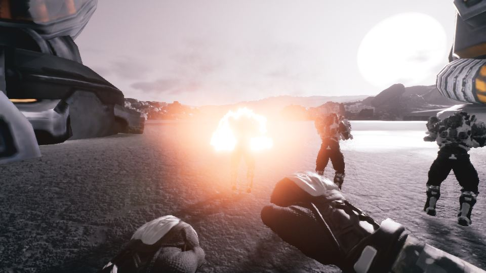
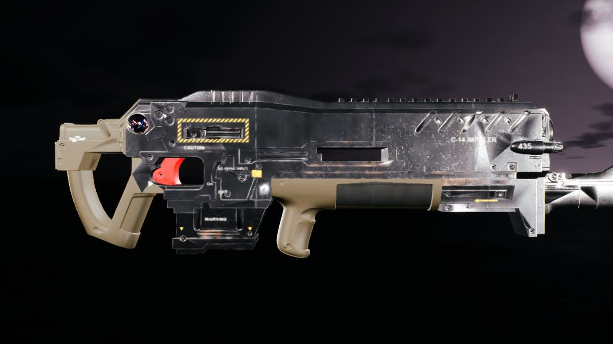

작업 7개 · 사진 5장

<ul class="toc">
<li><a href="#design">기획</a></li>
<li><a href="#weapon">무기</a></li>
<li><a href="#vfx">이펙트</a></li>
<li><a href="#weaponskin">무기 도색</a></li>
<li><a href="#depot">보급창</a></li>
<li><a href="#gearwall">장비 거치대</a></li>
<li><a href="#audio">소리</a></li>
</ul>
<h2 id="design">기획</h2>

메뉴 효과음을 넣고 쌍권총 정보판을 새로 만들었습니다.

02:28 총 패널 줄을 탄, 가젯, 상태 순으로 정리했습니다.

03:05 세로 총 패널의 탄약 줄에 발사 모드 아이콘을 넣었습니다.

03:23 쌍권총 각 총에 따로 붙는 패널과 조준점을 만들었습니다.

03:59 쌍권총 각각에 자기 총 옆에 붙는 탄약 패널을 달았습니다.

21:47 장비와 보급 메뉴 등에 메뉴 효과음을 연결했습니다.

<h2 id="weapon">무기</h2>

쌍권총 사격과 재장전이 게임에서 작동하게 했습니다.

02:40 가우스, 샷건, 권총 등 총 모델을 게임에 옮겨 크기를 맞췄습니다.

02:57 쌍권총의 왼쪽 위치를 오른쪽과 따로 잡았습니다.

20:28 쌍권총에서 왼쪽 총이 사라지고 거꾸로 돌던 문제를 고쳤습니다.

21:48 쌍권총의 왼쪽 총이 제 모델을 유지하게 했습니다.

<h2 id="vfx">이펙트</h2>

유탄발사기 폭발을 새 폭발 효과로 바꿨습니다.

03:14 유탄발사기 폭발을 새 폭발 효과로 바꿨습니다.

<h2 id="weaponskin">무기 도색</h2>

여러 총에 회색 도색을 적용하고 C-14 무늬를 넣었습니다.

03:17 C-14 소총의 새 질감 모델을 게임에 가져왔습니다.

22:22 권총 금속 부위만 회색으로 칠하는 도장 방식을 적용했습니다.

<h2 id="depot">보급창</h2>

보급고 방과 문, 복도를 한 덩어리로 묶었습니다.

17:53 보급고의 방과 복도를 하나의 건물로 묶었습니다.

<h2 id="gearwall">장비 거치대</h2>

18:24 보급고 안의 총과 갑옷이 새 방 구성을 따르게 했습니다.

<h2 id="audio">소리</h2>

아군 총소리를 키우고 메뉴 효과음을 넣었습니다.

22:51 아군 총소리가 안 들리던 문제를 고쳐 소리를 키웠습니다.

