
세션 9개 · 사진 83장

<ul class="toc">
<li><a href="#design">design — 기획</a></li>
<li><a href="#weapon">weapon — 무기</a></li>
<li><a href="#vfx">vfx — 이펙트</a></li>
<li><a href="#weaponskin">weaponskin — 무기 도색</a></li>
<li><a href="#depot">depot — 보급창</a></li>
<li><a href="#gearwall">gearwall — 장비 거치대</a></li>
<li><a href="#audio">audio — 소리</a></li>
<li><a href="#perf">perf — 성능</a></li>
<li><a href="#zerg">zerg — 저그</a></li>
</ul>
<h2 id="design">design <small>기획</small></h2>

메뉴 효과음을 넣고 양손 총 정보판을 새로 만들었습니다.

<a href="/assets/d/2026-10-28/WindowsEditor_HighresScreenshot01375.jpg" target="_blank">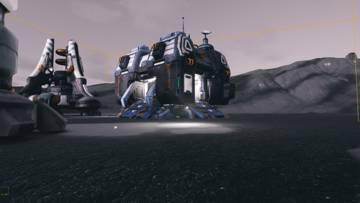</a>
<a href="/assets/d/2026-10-28/WindowsEditor_HighresScreenshot01376.jpg" target="_blank">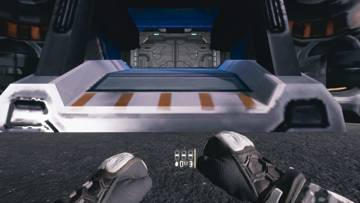</a>
<a href="/assets/d/2026-10-28/WindowsEditor_HighresScreenshot01378.jpg" target="_blank">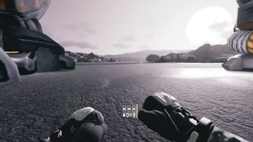</a>
<a href="/assets/d/2026-10-28/WindowsEditor_HighresScreenshot01379.jpg" target="_blank">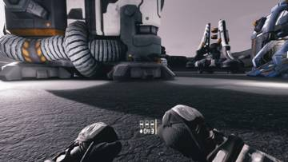</a>
<a href="/assets/d/2026-10-28/WindowsEditor_HighresScreenshot01380.jpg" target="_blank">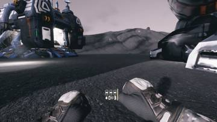</a>
<a href="/assets/d/2026-10-28/WindowsEditor_HighresScreenshot01393.jpg" target="_blank">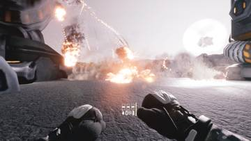</a>
<a href="/assets/d/2026-10-28/WindowsEditor_HighresScreenshot01404.jpg" target="_blank">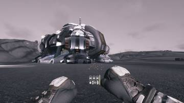</a>
<a href="/assets/d/2026-10-28/WindowsEditor_HighresScreenshot01405.jpg" target="_blank">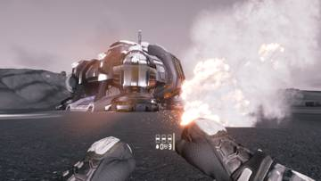</a>
<a href="/assets/d/2026-10-28/WindowsEditor_HighresScreenshot01406.jpg" target="_blank">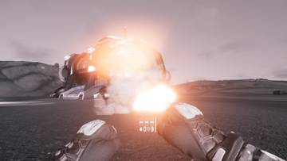</a>
<a href="/assets/d/2026-10-28/WindowsEditor_HighresScreenshot01407.jpg" target="_blank">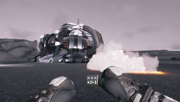</a>
<a href="/assets/d/2026-10-28/WindowsEditor_HighresScreenshot01408.jpg" target="_blank">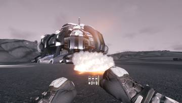</a>
<a href="/assets/d/2026-10-28/WindowsEditor_HighresScreenshot01413.jpg" target="_blank">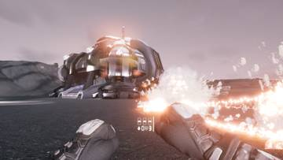</a>
<a href="/assets/d/2026-10-28/WindowsEditor_HighresScreenshot01414.jpg" target="_blank">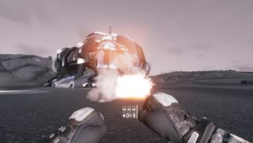</a>
<a href="/assets/d/2026-10-28/WindowsEditor_HighresScreenshot01415.jpg" target="_blank">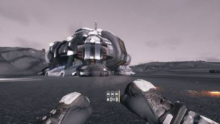</a>
<a href="/assets/d/2026-10-28/WindowsEditor_HighresScreenshot01416.jpg" target="_blank">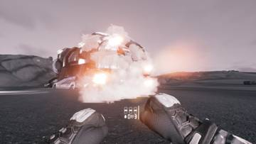</a>
<a href="/assets/d/2026-10-28/WindowsEditor_HighresScreenshot01422.jpg" target="_blank">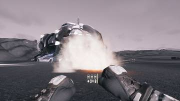</a>
<a href="/assets/d/2026-10-28/WindowsEditor_HighresScreenshot01423.jpg" target="_blank">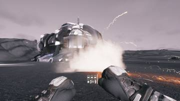</a>
<a href="/assets/d/2026-10-28/WindowsEditor_HighresScreenshot01425.jpg" target="_blank">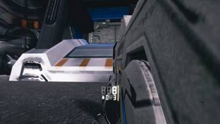</a>
<a href="/assets/d/2026-10-28/WindowsEditor_HighresScreenshot01426.jpg" target="_blank">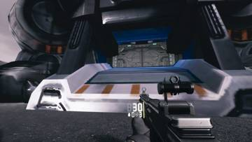</a>
<a href="/assets/d/2026-10-28/WindowsEditor_HighresScreenshot01427.jpg" target="_blank">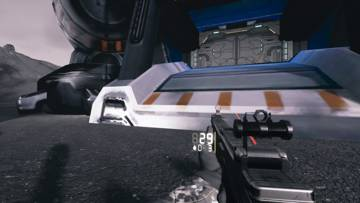</a>

02:28 총 패널의 줄 순서를 탄, 가젯, 상태 순으로 정리하고 가로 세로 비교 버튼을 넣었습니다.

<a href="/assets/d/2026-10-28/WindowsEditor_HighresScreenshot01435.jpg" target="_blank">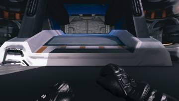</a>
<a href="/assets/d/2026-10-28/WindowsEditor_HighresScreenshot01436.jpg" target="_blank">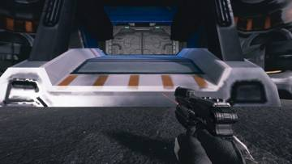</a>
<a href="/assets/d/2026-10-28/WindowsEditor_HighresScreenshot01437.jpg" target="_blank">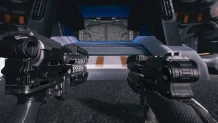</a>

03:05 세로 총 패널의 탄약 줄에 발사 모드 아이콘을 넣었습니다.

<a href="/assets/d/2026-10-28/WindowsEditor_ScreenShot00451.jpg" target="_blank">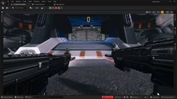</a>
<a href="/assets/d/2026-10-28/WindowsEditor_HighresScreenshot01444.jpg" target="_blank">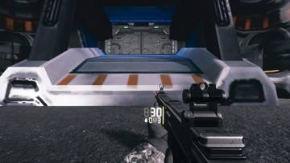</a>

03:23 쌍권총 각 총에 따로 붙는 패널을 만들고 조준점을 추가했습니다

<a href="/assets/d/2026-10-28/WindowsEditor_HighresScreenshot01448.jpg" target="_blank">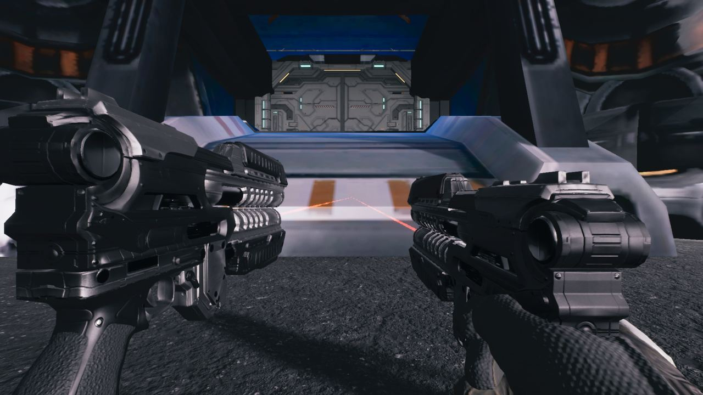</a>

03:59 쌍권총 각각에 자기 총 옆에 붙는 탄약 패널을 달았습니다

<a href="/assets/d/2026-10-28/WindowsEditor_HighresScreenshot01474.jpg" target="_blank">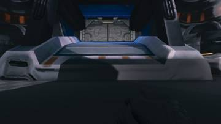</a>
<a href="/assets/d/2026-10-28/WindowsEditor_HighresScreenshot01475.jpg" target="_blank">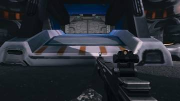</a>
<a href="/assets/d/2026-10-28/WindowsEditor_HighresScreenshot01476.jpg" target="_blank">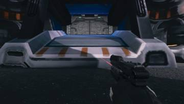</a>

19:41 옛 쌍권총 화면 요소를 모두 지우고 처음부터 다시 만들기로 했습니다.

<a href="/assets/d/2026-10-28/WindowsEditor_HighresScreenshot01487.jpg" target="_blank">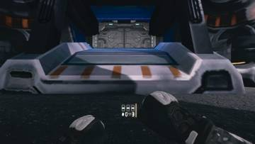</a>
<a href="/assets/d/2026-10-28/WindowsEditor_HighresScreenshot01493.jpg" target="_blank">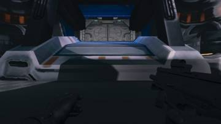</a>
<a href="/assets/d/2026-10-28/WindowsEditor_HighresScreenshot01496.jpg" target="_blank">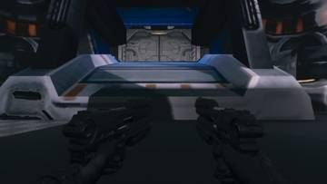</a>
<a href="/assets/d/2026-10-28/WindowsEditor_HighresScreenshot01497.jpg" target="_blank">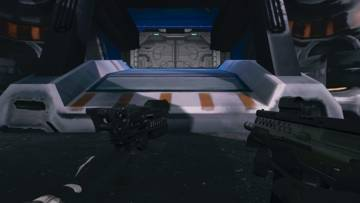</a>
<a href="/assets/d/2026-10-28/WindowsEditor_HighresScreenshot01498.jpg" target="_blank">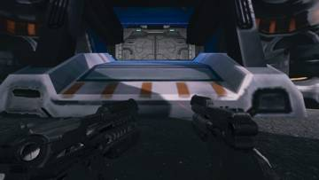</a>
<a href="/assets/d/2026-10-28/WindowsEditor_HighresScreenshot01499.jpg" target="_blank">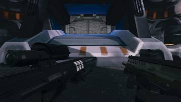</a>

21:47 장비와 보급 메뉴 등 인터페이스에 메뉴 효과음을 연결했습니다.

<h2 id="weapon">weapon <small>무기</small></h2>

양손 권총 사격과 재장전이 게임에서 작동하도록 만들었습니다.

<a href="/assets/d/2026-10-28/WindowsEditor_HighresScreenshot01424.jpg" target="_blank">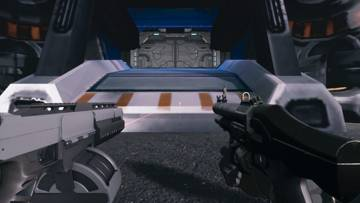</a>

<a href="/assets/d/2026-10-28/WindowsEditor_HighresScreenshot01431.jpg" target="_blank">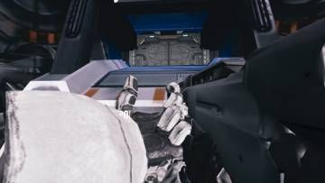</a>

02:40 가우스, SR-8, 페로맥, FN92 총 모델을 언리얼에 옮기고 크기를 맞췄습니다.

<a href="/assets/d/2026-10-28/WindowsEditor_HighresScreenshot01434.jpg" target="_blank">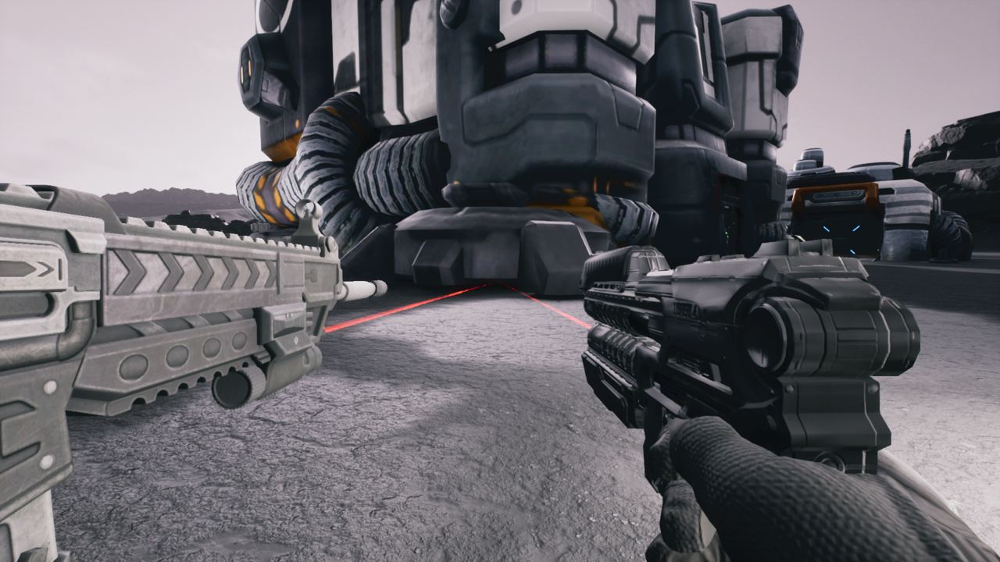</a>

02:57 양손 권총의 왼쪽 위치를 오른쪽과 따로 잡고 레이저와 총구 화염을 정리했습니다.

<a href="/assets/d/2026-10-28/WindowsEditor_HighresScreenshot01468.jpg" target="_blank">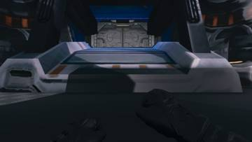</a>
<a href="/assets/d/2026-10-28/WindowsEditor_HighresScreenshot01469.jpg" target="_blank">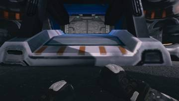</a>
<a href="/assets/d/2026-10-28/WindowsEditor_HighresScreenshot01470.jpg" target="_blank">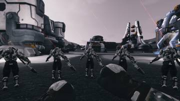</a>
<a href="/assets/d/2026-10-28/WindowsEditor_HighresScreenshot01472.jpg" target="_blank">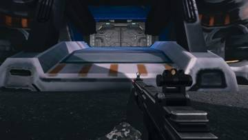</a>

18:58 예전 양손 권총 구현을 지우고 새 구성으로 갈아엎었습니다.

<a href="/assets/d/2026-10-28/WindowsEditor_HighresScreenshot01479.jpg" target="_blank">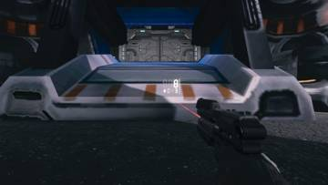</a>
<a href="/assets/d/2026-10-28/WindowsEditor_HighresScreenshot01484.jpg" target="_blank">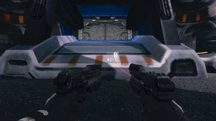</a>
<a href="/assets/d/2026-10-28/WindowsEditor_HighresScreenshot01486.jpg" target="_blank">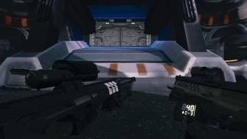</a>

20:28 쌍권총에서 왼쪽 총이 사라지고 거꾸로 돌아가던 문제들을 고쳤습니다.

<a href="/assets/d/2026-10-28/WindowsEditor_HighresScreenshot01490.jpg" target="_blank">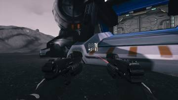</a>
<a href="/assets/d/2026-10-28/WindowsEditor_HighresScreenshot01491.jpg" target="_blank">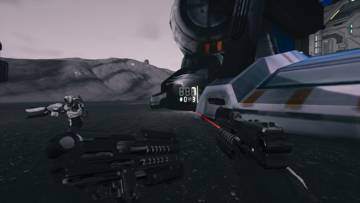</a>
<a href="/assets/d/2026-10-28/WindowsEditor_HighresScreenshot01492.jpg" target="_blank">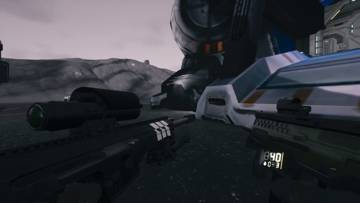</a>

<a href="/assets/d/2026-10-28/WindowsEditor_HighresScreenshot01512.jpg" target="_blank">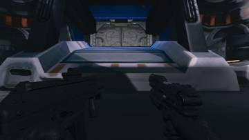</a>
<a href="/assets/d/2026-10-28/WindowsEditor_HighresScreenshot01518.jpg" target="_blank">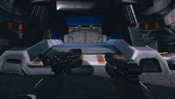</a>

21:48 쌍권총의 왼쪽 총이 제 모델을 유지하고 총구 섬광을 껐습니다

<h2 id="vfx">vfx <small>이펙트</small></h2>

유탄 발사기 폭발을 새 폭발 효과로 바꿨습니다.

03:14 유탄발사기 폭발을 새 폭발 이펙트 팩으로 바꾸고 반경에 맞춰 키웠습니다.

<h2 id="weaponskin">weaponskin <small>무기 도색</small></h2>

여러 총에 회색 금속 도색 옵션을 만들고 C-14 무늬를 게임에 넣었습니다.

03:17 C-14 소총의 새 텍스처 모델을 게임에 가져왔습니다

22:22 FN92 권총에 금속 부위만 회색으로 칠하는 자동 도장 방식을 적용했습니다

23:40 총 도색 확인 화면에서 엉뚱한 부품이 총을 가리던 문제를 고쳤습니다.

<h2 id="depot">depot <small>보급창</small></h2>

보급고 방과 문, 복도를 한 덩어리로 묶었습니다.

17:53 보급고의 방과 복도를 하나의 건물로 묶어 흩어진 조각을 없앴습니다

<h2 id="gearwall">gearwall <small>장비 거치대</small></h2>

보급고 벽의 총과 장비가 새 보급고 구성을 따르게 했습니다.

18:24 보급고 안의 총과 갑옷이 새 방 구성품을 읽도록 바꿨습니다

<h2 id="audio">audio <small>소리</small></h2>

아군 총소리를 키우고 게임 이벤트마다 효과음을 넣었습니다.

22:51 아군 총소리가 안 들리던 문제를 고쳐 소리 크기를 두 배 이상 키웠습니다.

<h2 id="perf">perf <small>성능</small></h2>

성능 측정 방식을 정리했습니다.

<h2 id="zerg">zerg <small>저그</small></h2>

성능 측정 때 건물에서 떨어진 곳에서 시작하도록 했습니다.

