
세션 8개 · 사진 58장

<ul class="toc">
<li><a href="#weapon">weapon — 무기</a></li>
<li><a href="#weaponskin">weaponskin — 무기 도색</a></li>
<li><a href="#zerg">zerg — 저그</a></li>
<li><a href="#terran">terran — 테란 아군</a></li>
<li><a href="#audio">audio — 소리</a></li>
<li><a href="#design">design — 기획</a></li>
<li><a href="#perf">perf — 성능</a></li>
<li><a href="#vfx">vfx — 이펙트</a></li>
</ul>
<h2 id="weapon">weapon <small>무기</small></h2>

총 사용 시 끊김을 줄이고 총구 화염 위치를 맞췄습니다.

<a href="/assets/d/2026-10-29/WindowsEditor_HighresScreenshot01539.jpg" target="_blank">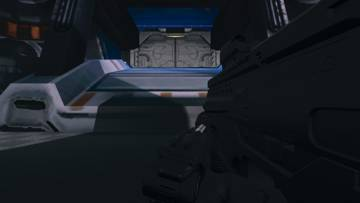</a>
<a href="/assets/d/2026-10-29/WindowsEditor_HighresScreenshot01540.jpg" target="_blank">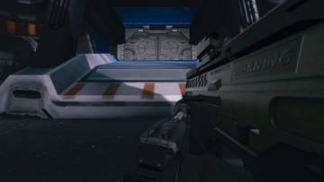</a>
<a href="/assets/d/2026-10-29/WindowsEditor_HighresScreenshot01541.jpg" target="_blank">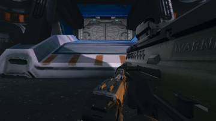</a>
<a href="/assets/d/2026-10-29/WindowsEditor_HighresScreenshot01542.jpg" target="_blank">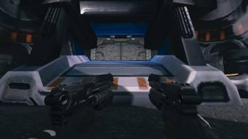</a>
<a href="/assets/d/2026-10-29/WindowsEditor_HighresScreenshot01543.jpg" target="_blank">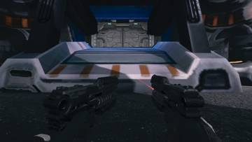</a>
<a href="/assets/d/2026-10-29/WindowsEditor_HighresScreenshot01548.jpg" target="_blank">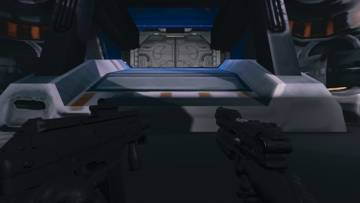</a>

00:03 쌍권총의 왼쪽 총이 제 모델을 유지하고 총구 섬광을 껐습니다

<a href="/assets/d/2026-10-29/WindowsEditor_HighresScreenshot01551.jpg" target="_blank">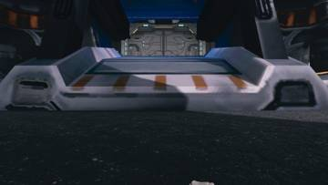</a>
<a href="/assets/d/2026-10-29/WindowsEditor_HighresScreenshot01552.jpg" target="_blank">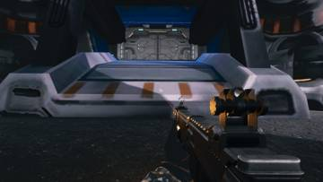</a>
<a href="/assets/d/2026-10-29/WindowsEditor_HighresScreenshot01553.jpg" target="_blank">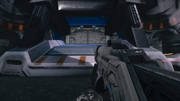</a>
<a href="/assets/d/2026-10-29/WindowsEditor_HighresScreenshot01554.jpg" target="_blank">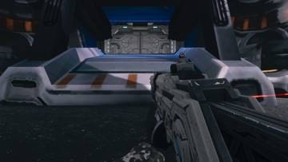</a>
<a href="/assets/d/2026-10-29/WindowsEditor_HighresScreenshot01555.jpg" target="_blank">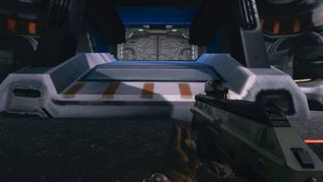</a>
<a href="/assets/d/2026-10-29/WindowsEditor_HighresScreenshot01556.jpg" target="_blank">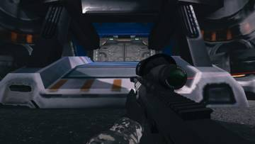</a>
<a href="/assets/d/2026-10-29/WindowsEditor_HighresScreenshot01560.jpg" target="_blank">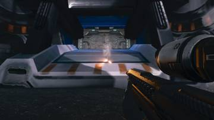</a>
<a href="/assets/d/2026-10-29/WindowsEditor_HighresScreenshot01561.jpg" target="_blank">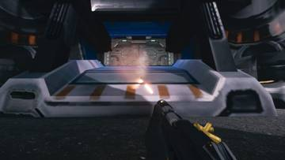</a>

00:13 총구 소켓을 총열 끝 중앙으로 옮기고 RGX에서는 줍기를 막았습니다.

<a href="/assets/d/2026-10-29/WindowsEditor_HighresScreenshot01608.jpg" target="_blank">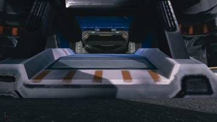</a>
<a href="/assets/d/2026-10-29/WindowsEditor_HighresScreenshot01614.jpg" target="_blank">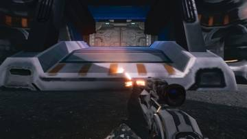</a>
<a href="/assets/d/2026-10-29/WindowsEditor_HighresScreenshot01616.jpg" target="_blank">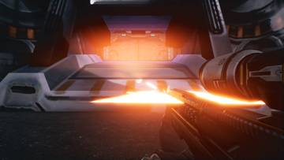</a>
<a href="/assets/d/2026-10-29/WindowsEditor_HighresScreenshot01617.jpg" target="_blank">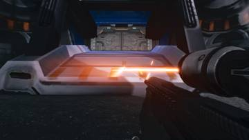</a>
<a href="/assets/d/2026-10-29/WindowsEditor_HighresScreenshot01618.jpg" target="_blank">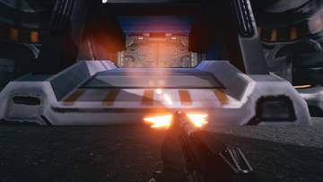</a>
<a href="/assets/d/2026-10-29/WindowsEditor_HighresScreenshot01620.jpg" target="_blank">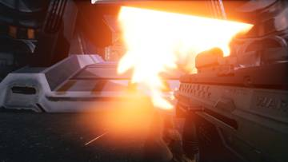</a>
<a href="/assets/d/2026-10-29/WindowsEditor_HighresScreenshot01621.jpg" target="_blank">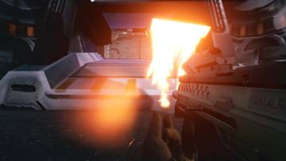</a>
<a href="/assets/d/2026-10-29/WindowsEditor_HighresScreenshot01622.jpg" target="_blank">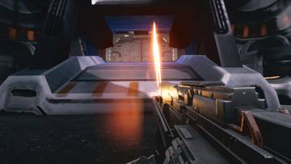</a>
<a href="/assets/d/2026-10-29/WindowsEditor_HighresScreenshot01623.jpg" target="_blank">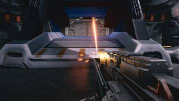</a>
<a href="/assets/d/2026-10-29/WindowsEditor_HighresScreenshot01624.jpg" target="_blank">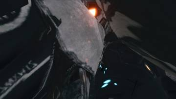</a>

01:27 총마다 총구 화염 위치를 총열 끝에 맞추고 태클 동작을 미리 불러오게 했습니다.

<a href="/assets/d/2026-10-29/WindowsEditor_HighresScreenshot01629.jpg" target="_blank">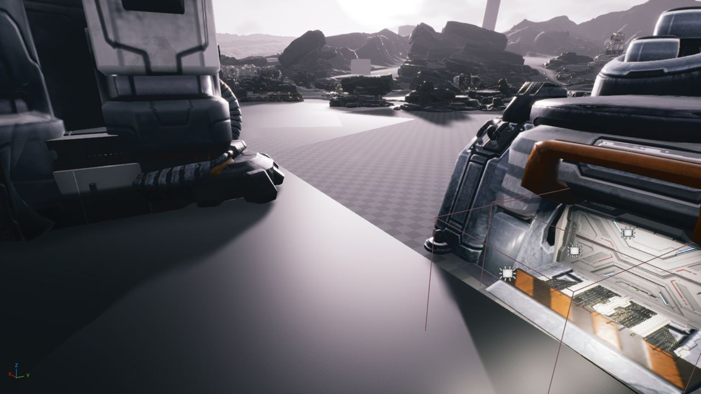</a>

03:23 무기 로딩 처리를 최적화해 비용을 약 0.33ms에서 0.185ms로 줄였습니다

<h2 id="weaponskin">weaponskin <small>무기 도색</small></h2>

몇몇 총의 회색 도색 밝기를 조절했습니다.

<a href="/assets/d/2026-10-29/WindowsEditor_HighresScreenshot01568.jpg" target="_blank">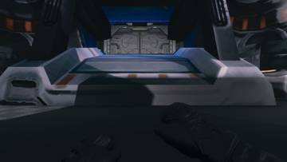</a>
<a href="/assets/d/2026-10-29/WindowsEditor_HighresScreenshot01569.jpg" target="_blank">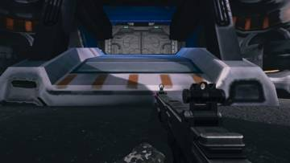</a>
<a href="/assets/d/2026-10-29/WindowsEditor_HighresScreenshot01570.jpg" target="_blank">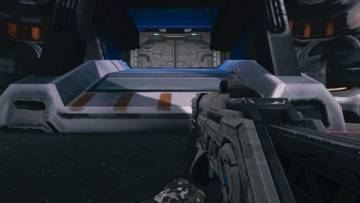</a>
<a href="/assets/d/2026-10-29/WindowsEditor_HighresScreenshot01571.jpg" target="_blank">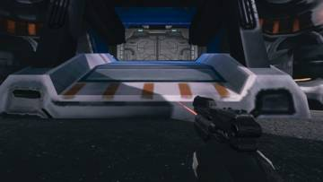</a>
<a href="/assets/d/2026-10-29/WindowsEditor_HighresScreenshot01573.jpg" target="_blank">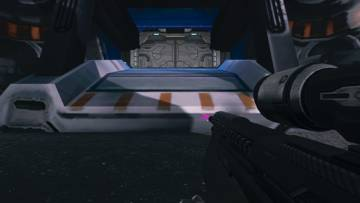</a>
<a href="/assets/d/2026-10-29/WindowsEditor_HighresScreenshot01575.jpg" target="_blank">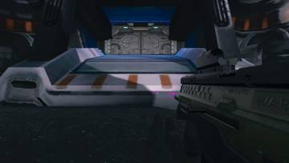</a>
<a href="/assets/d/2026-10-29/WindowsEditor_HighresScreenshot01576.jpg" target="_blank">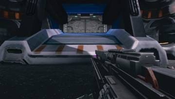</a>
<a href="/assets/d/2026-10-29/WindowsEditor_HighresScreenshot01578.jpg" target="_blank">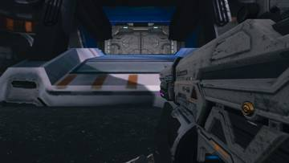</a>
<a href="/assets/d/2026-10-29/WindowsEditor_HighresScreenshot01579.jpg" target="_blank">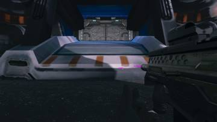</a>
<a href="/assets/d/2026-10-29/WindowsEditor_HighresScreenshot01590.jpg" target="_blank">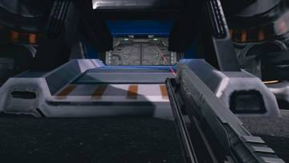</a>
<a href="/assets/d/2026-10-29/WindowsEditor_HighresScreenshot01591.jpg" target="_blank">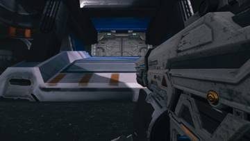</a>
<a href="/assets/d/2026-10-29/WindowsEditor_HighresScreenshot01592.jpg" target="_blank">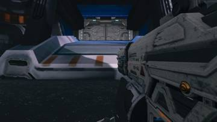</a>
<a href="/assets/d/2026-10-29/WindowsEditor_HighresScreenshot01595.jpg" target="_blank">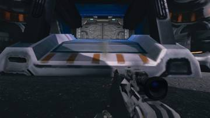</a>
<a href="/assets/d/2026-10-29/WindowsEditor_HighresScreenshot01596.jpg" target="_blank">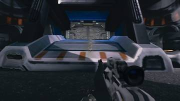</a>
<a href="/assets/d/2026-10-29/WindowsEditor_HighresScreenshot01597.jpg" target="_blank">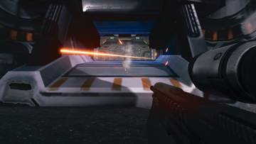</a>
<a href="/assets/d/2026-10-29/WindowsEditor_HighresScreenshot01598.jpg" target="_blank">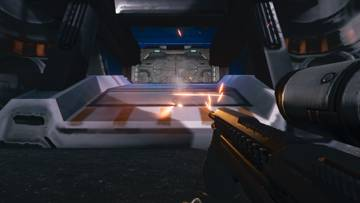</a>
<a href="/assets/d/2026-10-29/WindowsEditor_HighresScreenshot01600.jpg" target="_blank">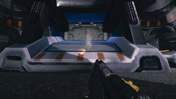</a>
<a href="/assets/d/2026-10-29/WindowsEditor_HighresScreenshot01601.jpg" target="_blank">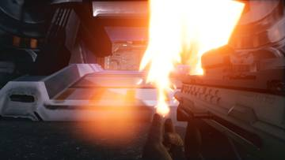</a>
<a href="/assets/d/2026-10-29/WindowsEditor_HighresScreenshot01602.jpg" target="_blank">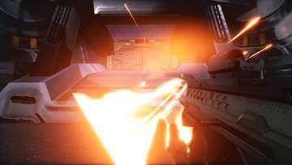</a>
<a href="/assets/d/2026-10-29/WindowsEditor_HighresScreenshot01603.jpg" target="_blank">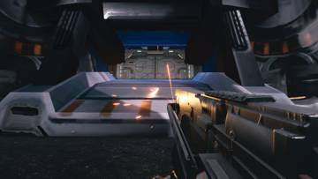</a>
<a href="/assets/d/2026-10-29/WindowsEditor_HighresScreenshot01605.jpg" target="_blank">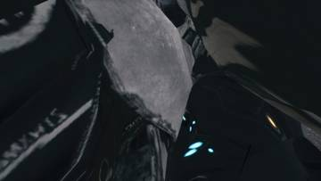</a>
<a href="/assets/d/2026-10-29/capture_sr8na_left.jpg" target="_blank">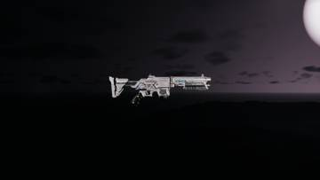</a>

01:07 SR8 흰 껍데기를 총 금속 회색으로 칠해 다른 총과 맞췄습니다.

<h2 id="zerg">zerg <small>저그</small></h2>

저글링 스폰 속도를 두 배로 늘리고 시체 처리를 조정했습니다.

<a href="/assets/d/2026-10-29/capture_fm_ga_left.jpg" target="_blank">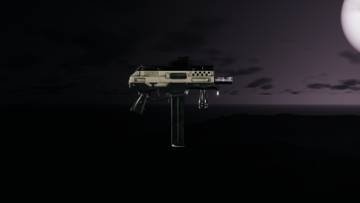</a>
<a href="/assets/d/2026-10-29/capture_ts_ga_left.jpg" target="_blank">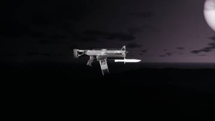</a>
<a href="/assets/d/2026-10-29/capture_gunpaint_ga_na_FM_Tesla_T200_Gauss.jpg" target="_blank">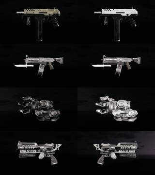</a>

02:23 시체 더미를 최대 50구로 줄이고 빨리 멈춘 시체는 물리 계산을 끄게 했습니다.

02:40 스타크래프트 2 시체 수거 타이밍과 피부 폭발 한계를 조사해 정리했습니다.

<h2 id="terran">terran <small>테란 아군</small></h2>

아군이 보이는 저글링을 모두 쏘고 새 몸 모델을 쓰게 했습니다.

02:41 아군 AI 외형을 레니게이드로 바꾸고 플레이어와 같은 재질을 입혔습니다.

03:29 아군 AI만 쓰러뜨리는 시험 명령을 만들어 네 명이 죽는 것을 확인했습니다.

<h2 id="audio">audio <small>소리</small></h2>

이벤트 효과음을 미리 불러와 끊김을 줄였습니다.

<h2 id="design">design <small>기획</small></h2>

아군 몸 모델 선택 메뉴에 새 항목을 추가했습니다.

<h2 id="perf">perf <small>성능</small></h2>

측정 중 게임 소리를 끄는 도구를 만들었습니다.

<h2 id="vfx">vfx <small>이펙트</small></h2>

피 입자 수를 제한하고 총구 화염 선택지를 정리했습니다.

