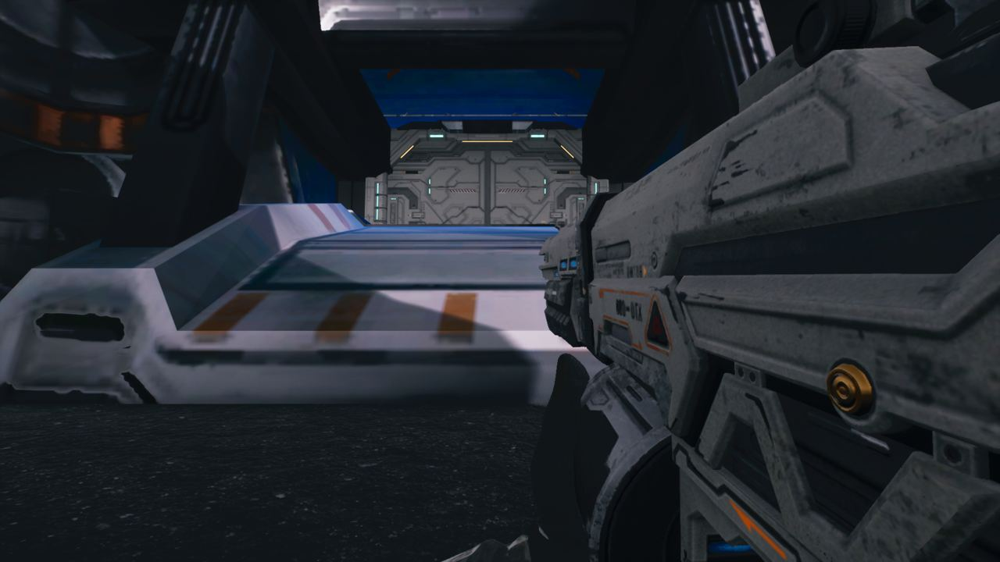

작업 5개 · 사진 6장

<ul class="toc">
<li><a href="#weapon">무기</a></li>
<li><a href="#weaponskin">무기 도색</a></li>
<li><a href="#terran">테란 아군</a></li>
<li><a href="#design">기획</a></li>
<li><a href="#vfx">이펙트</a></li>
</ul>
<h2 id="weapon">무기</h2>

총구 화염 위치를 총열 끝에 맞췄습니다.

00:03 쌍권총의 왼쪽 총이 제 모델을 유지하게 했습니다.

00:13 총구 위치를 총열 끝 중앙으로 옮겼습니다.

01:27 총마다 총구 화염 위치를 총열 끝에 맞췄습니다.

<h2 id="weaponskin">무기 도색</h2>

몇몇 총의 회색 도색 밝기를 조절했습니다.

01:07 흰 껍데기 샷건을 금속 회색으로 칠해 다른 총과 맞췄습니다.

<h2 id="terran">테란 아군</h2>

아군 외형을 새 모델로 바꿨습니다.

02:41 아군 AI 외형을 레네게이드로 바꾸고 같은 재질을 입혔습니다.

<h2 id="design">기획</h2>

아군 몸 모델 선택 메뉴에 새 항목을 넣었습니다.

<h2 id="vfx">이펙트</h2>

총구 화염 선택지를 정리했습니다.

