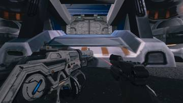
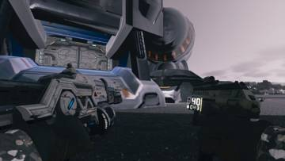

작업 2개 · 사진 2장

<ul class="toc">
<li><a href="#depot">보급창</a></li>
<li><a href="#weapon">무기</a></li>
</ul>
<h2 id="depot">보급창</h2>

보급고 내부를 새 연구실 모델로 바꾸기로 정했습니다.

21:21 보급고 내부를 SF 조립 연구실로 정하고 크기를 키웠습니다.

<h2 id="weapon">무기</h2>

쌍권총 든 자세를 참고 영상처럼 손 위치를 맞췄습니다.

21:21 쌍권총 자세를 참고 영상처럼 손을 바깥으로 벌리게 했습니다.

