
세션 8개 · 사진 57장

<ul class="toc">
<li><a href="#vfx">vfx — 이펙트</a></li>
<li><a href="#depot">depot — 보급창</a></li>
<li><a href="#weapon">weapon — 무기</a></li>
<li><a href="#level">level — 맵</a></li>
<li><a href="#design">design — 기획</a></li>
<li><a href="#gunsize">gunsize — gunsize</a></li>
<li><a href="#terran">terran — 테란 아군</a></li>
<li><a href="#zerg">zerg — 저그</a></li>
</ul>
<h2 id="vfx">vfx <small>이펙트</small></h2>

궤도 보급고 낙하 때의 추진 불꽃 효과를 만들었습니다.

<a href="/assets/d/2026-10-31/WindowsEditor_HighresScreenshot01639.jpg" target="_blank">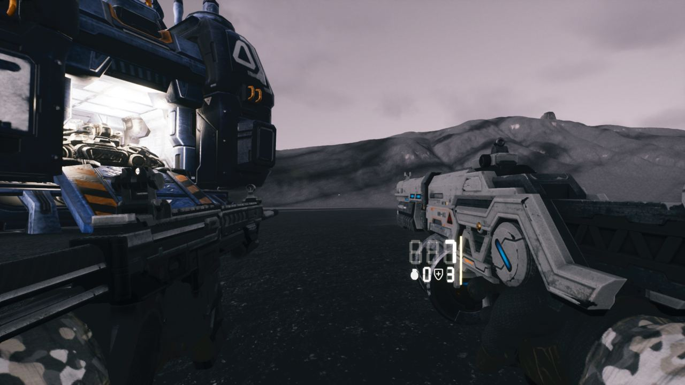</a>

02:51 스타크래프트 2의 궤도 보급고 자료를 꺼내 어떻게 떨어지는지 정리했습니다.

<a href="/assets/d/2026-10-31/WindowsEditor_ScreenShot00452.jpg" target="_blank">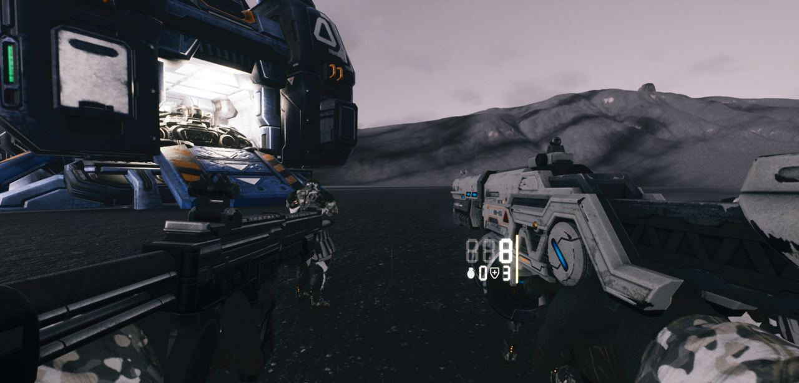</a>

02:53 보급고가 사령부 발사 없이 하늘에서 곧장 떨어지도록 할 일을 적었습니다

<h2 id="depot">depot <small>보급창</small></h2>

보급고 안에 새 연구실 방을 들여놓았습니다.

<a href="/assets/d/2026-10-31/WindowsEditor_NOW_1.jpg" target="_blank">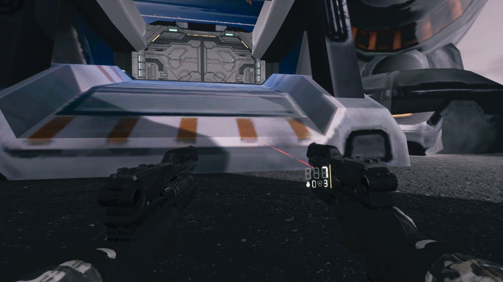</a>

03:03 보급고 시뮬레이션 패널의 크기를 모든 장비에 맞게 키웠습니다.

<a href="/assets/d/2026-10-31/WindowsEditor_HighresScreenshot01664.jpg" target="_blank">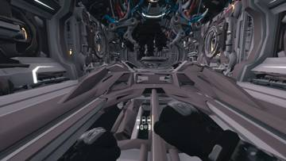</a>
<a href="/assets/d/2026-10-31/WindowsEditor_HighresScreenshot01665.jpg" target="_blank">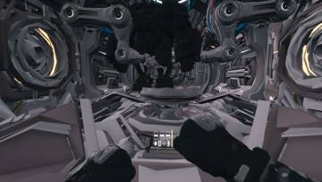</a>
<a href="/assets/d/2026-10-31/Offscreen_design_tab_1031_061412.jpg" target="_blank">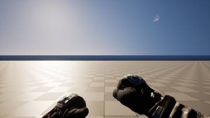</a>

06:10 보급고 연구실 방을 새로 교체하고 이전 방은 백업해 두었습니다

<a href="/assets/d/2026-10-31/Offscreen_level_1031_065545.jpg" target="_blank">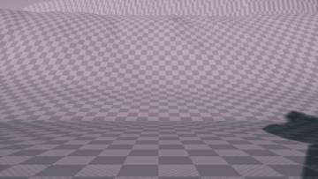</a>
<a href="/assets/d/2026-10-31/WindowsEditor_HighresScreenshot01670.jpg" target="_blank">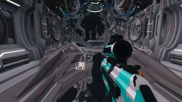</a>

06:58 보급고에 연구실과 중장갑 부품을 배치했고 조명은 다음 작업입니다

<h2 id="weapon">weapon <small>무기</small></h2>

보급고가 하늘에서 곧장 떨어지고 병과별 장비가 지급되게 했습니다.

<a href="/assets/d/2026-10-31/WindowsEditor_S_1_fresh.jpg" target="_blank">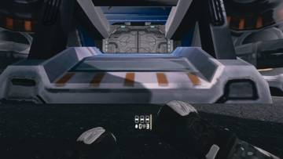</a>
<a href="/assets/d/2026-10-31/WindowsEditor_S_2_oldrow.jpg" target="_blank">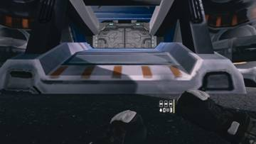</a>
<a href="/assets/d/2026-10-31/WindowsEditor_FER_1_ferromag.jpg" target="_blank">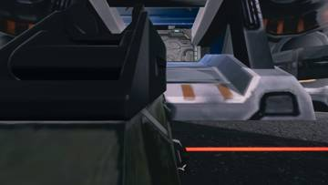</a>
<a href="/assets/d/2026-10-31/WindowsEditor_FER_2_fn92.jpg" target="_blank">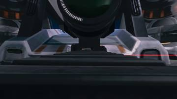</a>
<a href="/assets/d/2026-10-31/WindowsEditor_FER_3_sr8.jpg" target="_blank">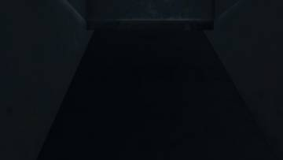</a>
<a href="/assets/d/2026-10-31/WindowsEditor_DUP_1_gauss.jpg" target="_blank">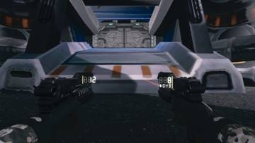</a>
<a href="/assets/d/2026-10-31/WindowsEditor_DUP_4_ferck.jpg" target="_blank">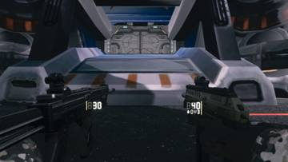</a>

03:30 양손 권총의 왼쪽 총 패널이 총을 따라다니게 고쳤습니다.

<a href="/assets/d/2026-10-31/WindowsEditor_HighresScreenshot01640.jpg" target="_blank">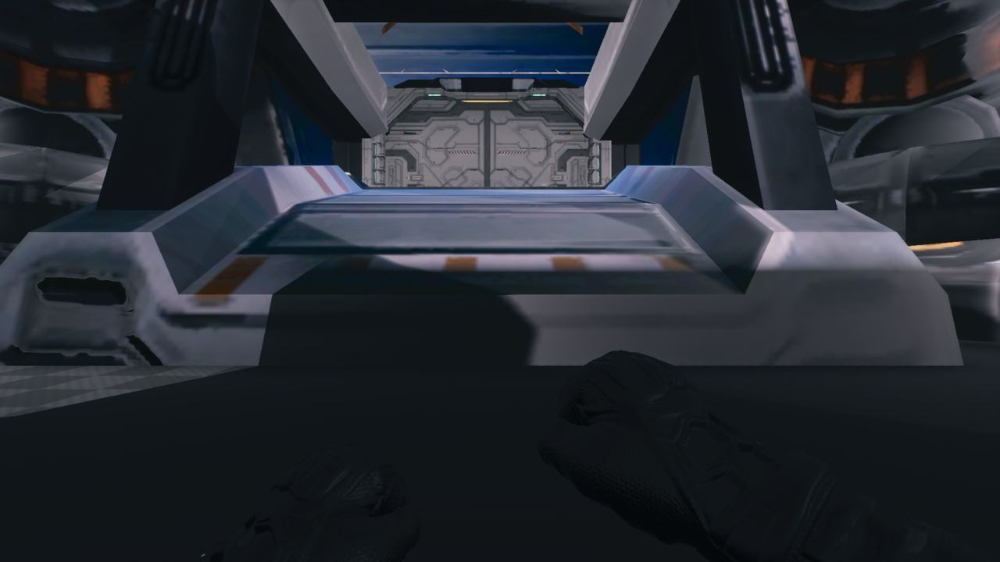</a>

04:59 양손 권총 3차 구현을 만들었고 화면 확인은 아직 하지 못했습니다.

<a href="/assets/d/2026-10-31/WindowsEditor_HighresScreenshot01645.jpg" target="_blank">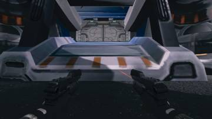</a>
<a href="/assets/d/2026-10-31/WindowsEditor_HighresScreenshot01646.jpg" target="_blank">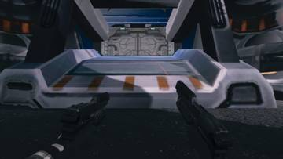</a>
<a href="/assets/d/2026-10-31/Offscreen_ops_probe_1031_051722.jpg" target="_blank">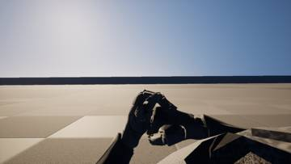</a>
<a href="/assets/d/2026-10-31/WindowsEditor_HighresScreenshot01654.jpg" target="_blank">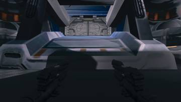</a>
<a href="/assets/d/2026-10-31/WindowsEditor_HighresScreenshot01655.jpg" target="_blank">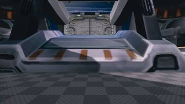</a>
<a href="/assets/d/2026-10-31/WindowsEditor_HighresScreenshot01659.jpg" target="_blank">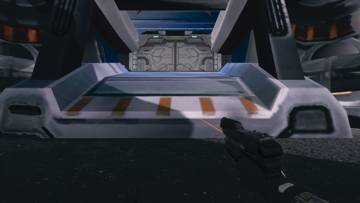</a>

05:18 쌍권총을 직접 실행해 확인하니 왼쪽 오른쪽이 따로 발사되고 재장전도 맞았습니다.

<a href="/assets/d/2026-10-31/WindowsEditor_HighresScreenshot01661.jpg" target="_blank">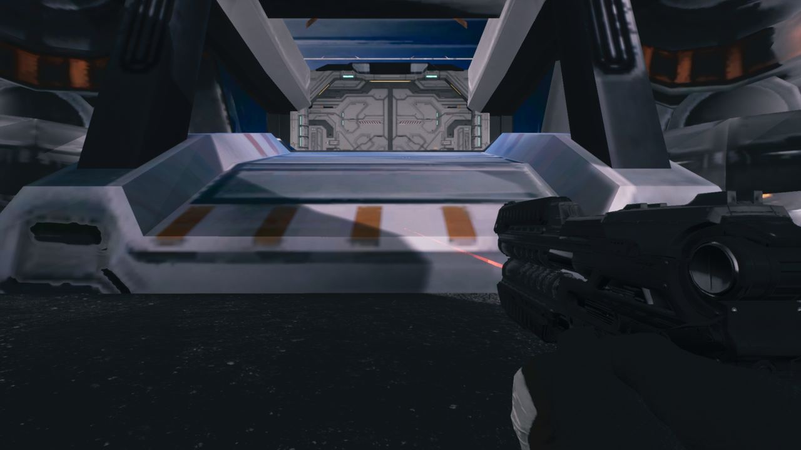</a>

06:06 쌍권총을 켜면 왼쪽 총에도 레이저가 나오게 했습니다.

<a href="/assets/d/2026-10-31/Offscreen_vfxdepot_1031_065319.jpg" target="_blank">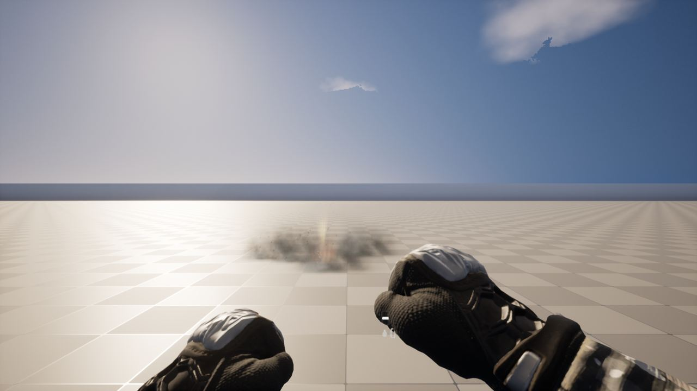</a>

06:56 쌍권총에서 왼쪽 총을 내리면 왼쪽 레이저도 꺼지게 했습니다.

<a href="/assets/d/2026-10-31/WindowsEditor_HighresScreenshot01671.jpg" target="_blank">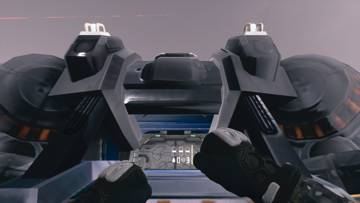</a>
<a href="/assets/d/2026-10-31/WindowsEditor_HighresScreenshot01672.jpg" target="_blank">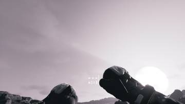</a>
<a href="/assets/d/2026-10-31/WindowsEditor_HighresScreenshot01673.jpg" target="_blank">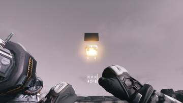</a>
<a href="/assets/d/2026-10-31/WindowsEditor_HighresScreenshot01675.jpg" target="_blank">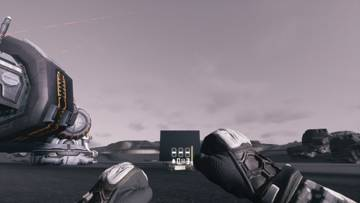</a>

07:50 보급고가 스타크래프트 2처럼 하늘에서 곧장 떨어지게 했습니다.

<a href="/assets/d/2026-10-31/WindowsEditor_HighresScreenshot01680.jpg" target="_blank">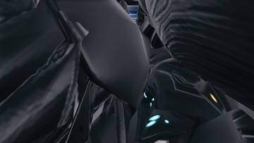</a>
<a href="/assets/d/2026-10-31/WindowsEditor_HighresScreenshot01681.jpg" target="_blank">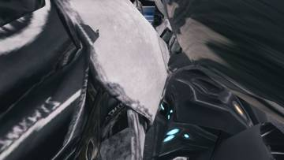</a>
<a href="/assets/d/2026-10-31/WindowsEditor_HighresScreenshot01682.jpg" target="_blank">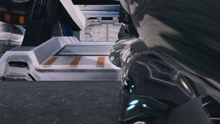</a>

16:51 해병 직업 장비를 넣어 파워 슈트를 입고 잠시 뒤 C-14를 받게 했습니다.

<h2 id="level">level <small>맵</small></h2>

헤이븐 신호탄 위치를 놓고 스타2식 계단 지형을 적용했습니다.

<a href="/assets/d/2026-10-31/Offscreen_level_1031_061518.jpg" target="_blank">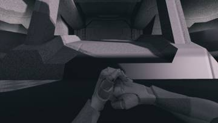</a>
<a href="/assets/d/2026-10-31/Offscreen_ops_probe3_1031_061832.jpg" target="_blank">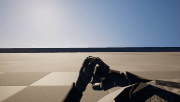</a>
<a href="/assets/d/2026-10-31/Offscreen_level_1031_062347.jpg" target="_blank">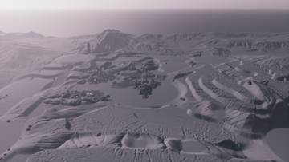</a>
<a href="/assets/d/2026-10-31/Offscreen_vfxdepot_1031_062637.jpg" target="_blank">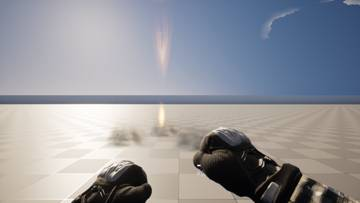</a>

06:17 계단식 지형을 만드는 도구를 만들고 높이 3단계로 나눴습니다

<a href="/assets/d/2026-10-31/Offscreen_level_1031_070206.jpg" target="_blank">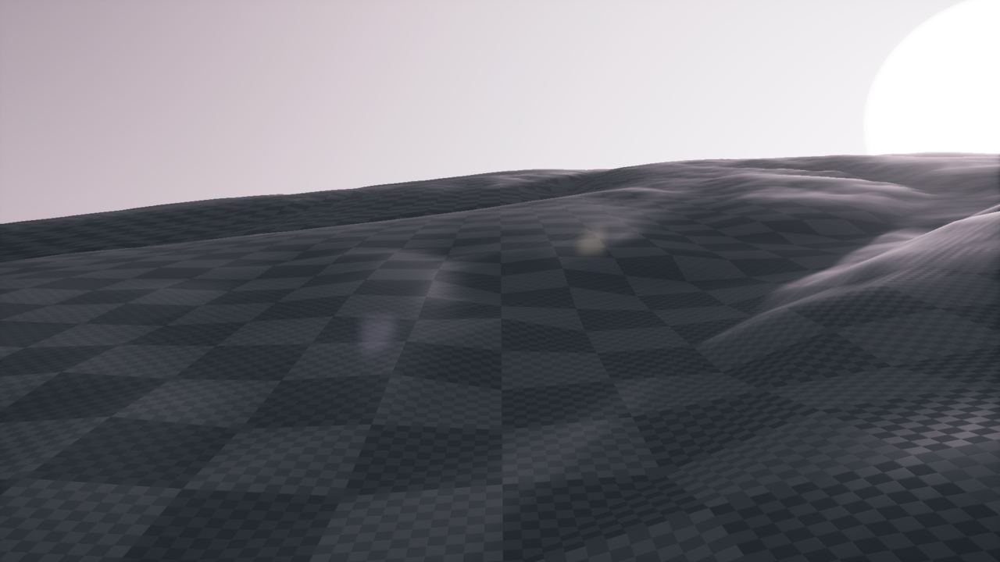</a>

07:04 테라스 지형 연구용 맵을 만들었습니다.

<a href="/assets/d/2026-10-31/Offscreen_level_fogbefore_1031_075534.jpg" target="_blank">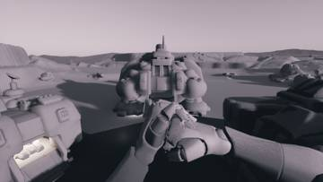</a>
<a href="/assets/d/2026-10-31/WindowsEditor_HighresScreenshot01676.jpg" target="_blank">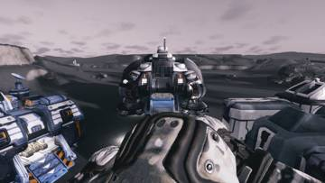</a>
<a href="/assets/d/2026-10-31/WindowsEditor_HighresScreenshot01677.jpg" target="_blank">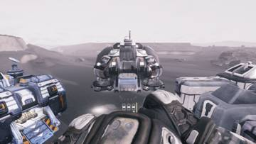</a>
<a href="/assets/d/2026-10-31/WindowsEditor_HighresScreenshot01678.jpg" target="_blank">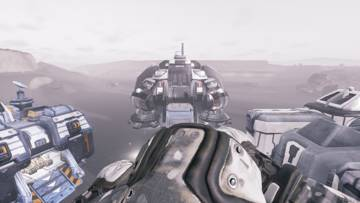</a>
<a href="/assets/d/2026-10-31/WindowsEditor_HighresScreenshot01679.jpg" target="_blank">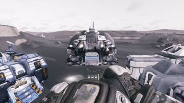</a>

07:58 높이 안개 설정을 바꿔 먼 산이 뿌옇게 보이면서 구름은 살아있게 했습니다.

<a href="/assets/d/2026-10-31/Offscreen_ph-fork_1031_081729.jpg" target="_blank">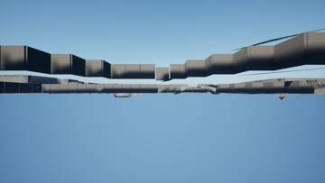</a>
<a href="/assets/d/2026-10-31/Offscreen_ph-fork_1031_082404.jpg" target="_blank">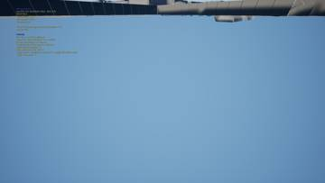</a>
<a href="/assets/d/2026-10-31/Offscreen_ph-A_1031_083821.jpg" target="_blank">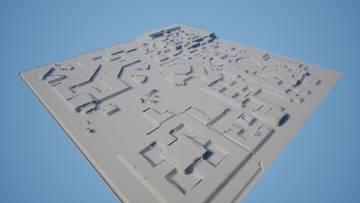</a>
<a href="/assets/d/2026-10-31/Offscreen_ph-B_1031_084059.jpg" target="_blank">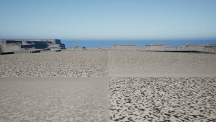</a>
<a href="/assets/d/2026-10-31/Offscreen_ph-C_1031_084755.jpg" target="_blank">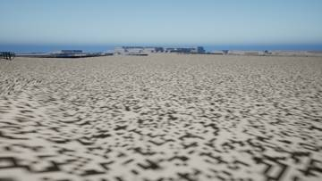</a>
<a href="/assets/d/2026-10-31/Offscreen_ph-D_1031_085009.jpg" target="_blank">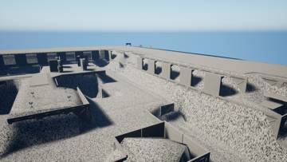</a>
<a href="/assets/d/2026-10-31/Offscreen_ph-D_1031_090044.jpg" target="_blank">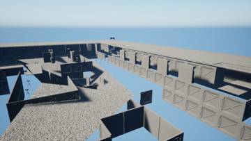</a>

08:19 헤이븐 맵에서 사령부 입구 앞에 신호 지점을 하나 놓았습니다.

<h2 id="design">design <small>기획</small></h2>

프로젝트 헤이븐 라운드 흐름과 병과 선택 화면을 만들었습니다.

<a href="/assets/d/2026-10-31/Offscreen_level_1031_064738.jpg" target="_blank">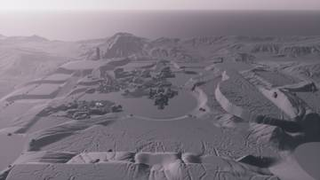</a>
<a href="/assets/d/2026-10-31/WindowsEditor_ScreenShot00454.jpg" target="_blank">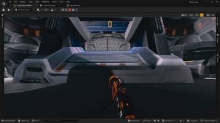</a>

06:50 화면 글꼴을 하나로 통일하고 HUD 글자를 영어로 바꿨습니다.

08:07 프로젝트 헤이븐 2의 맵 진행 방식을 조사해 정리했습니다.

<h2 id="gunsize">gunsize <small>gunsize</small></h2>

소총 모델에서 소음기와 가늠자를 떼어냈습니다.

<h2 id="terran">terran <small>테란 아군</small></h2>

아군 사격 거리를 확인하는 테스트를 했습니다.

<h2 id="zerg">zerg <small>저그</small></h2>

헤이븐 라운드용 저그 웨이브 소환 기능을 만들었습니다.

