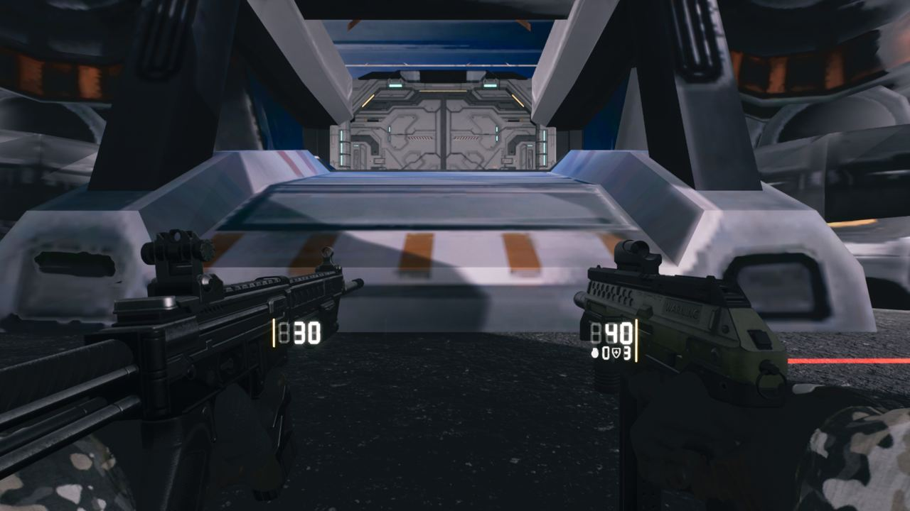
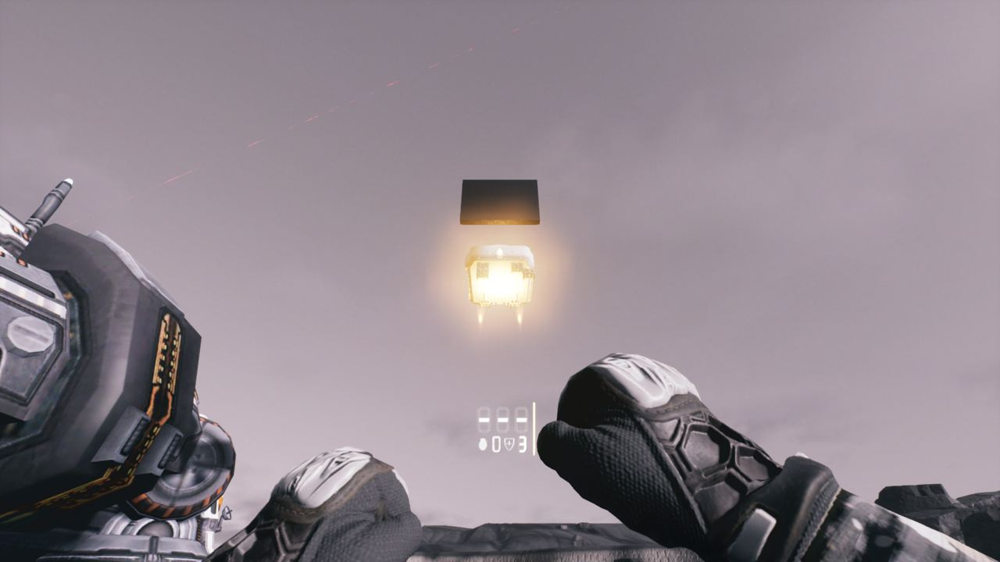
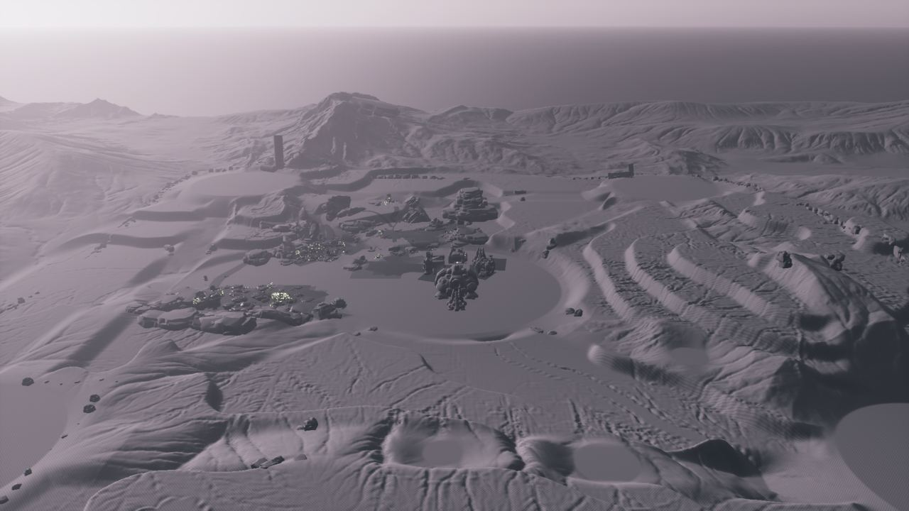

작업 7개 · 사진 6장

<ul class="toc">
<li><a href="#weapon">무기</a></li>
<li><a href="#depot">보급창</a></li>
<li><a href="#level">맵</a></li>
<li><a href="#design">기획</a></li>
<li><a href="#gunsize">gunsize</a></li>
<li><a href="#vfx">이펙트</a></li>
<li><a href="#zerg">저그</a></li>
</ul>
<h2 id="weapon">무기</h2>

보급고가 하늘에서 곧장 떨어지고 병과별 장비가 지급됩니다.

03:30 쌍권총의 왼쪽 총 패널이 총을 따라다니게 고쳤습니다.

05:18 쌍권총을 실행해 보니 좌우가 따로 발사되고 재장전도 맞았습니다.

06:06 쌍권총을 켜면 왼쪽 총에도 레이저가 나오게 했습니다.

06:56 쌍권총에서 왼쪽 총을 내리면 레이저도 꺼지게 했습니다.

07:50 보급고가 스타크래프트 2처럼 하늘에서 곧장 떨어지게 했습니다.

16:51 해병 직업 장비로 파워 슈트를 입고 곧 C-14를 받게 했습니다.

<h2 id="depot">보급창</h2>

보급고 안에 새 연구실 방을 들여놓았습니다.

06:10 보급고 연구실 방으로 교체하고 이전 방은 백업했습니다.

06:58 보급고에 연구실과 중장갑 부품을 배치했습니다.

<h2 id="level">맵</h2>

헤이븐 신호 지점을 놓고 계단식 지형을 적용했습니다.

06:17 계단식 지형을 만드는 도구를 만들고 높이를 3단계로 나눴습니다.

07:04 계단식 지형 연구용 맵을 만들었습니다.

07:58 높이 안개를 바꿔 먼 산은 뿌옇고 구름은 살아 있게 했습니다.

08:19 헤이븐 맵 사령부 입구 앞에 신호 지점을 놓았습니다.

<h2 id="design">기획</h2>

헤이븐 라운드 흐름과 병과 선택 화면을 만들었습니다.

06:50 화면 글꼴을 하나로 통일하고 HUD 글자를 영어로 바꿨습니다.

<h2 id="gunsize">gunsize</h2>

소총 모델에서 소음기와 가늠자를 떼어냈습니다.

<h2 id="vfx">이펙트</h2>

궤도 보급고 낙하 때의 추진 불꽃 효과를 만들었습니다.

<h2 id="zerg">저그</h2>

헤이븐 라운드용 저그 웨이브 기능을 만들었습니다.

