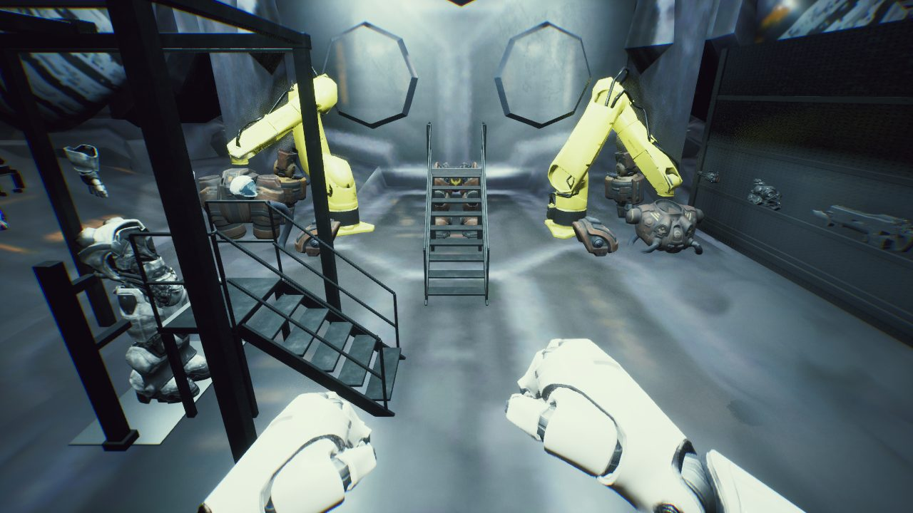
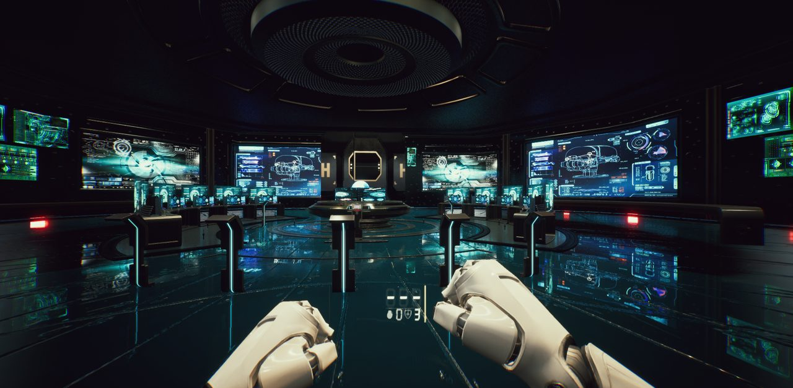
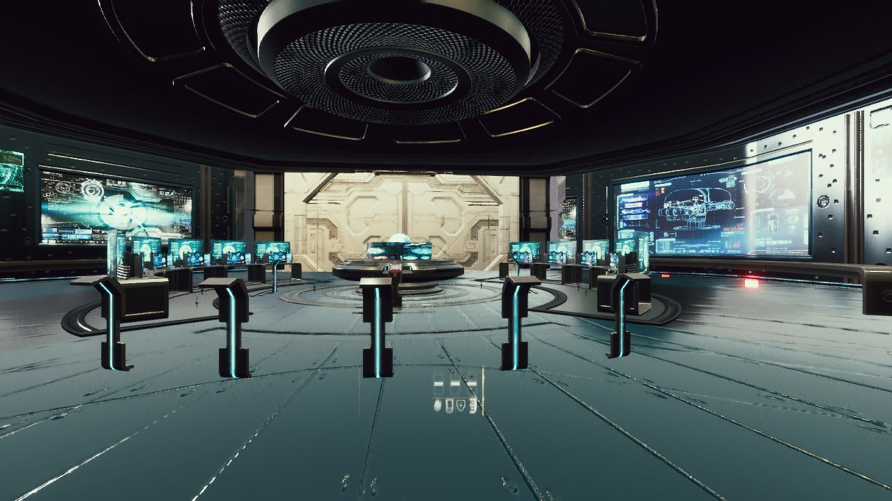
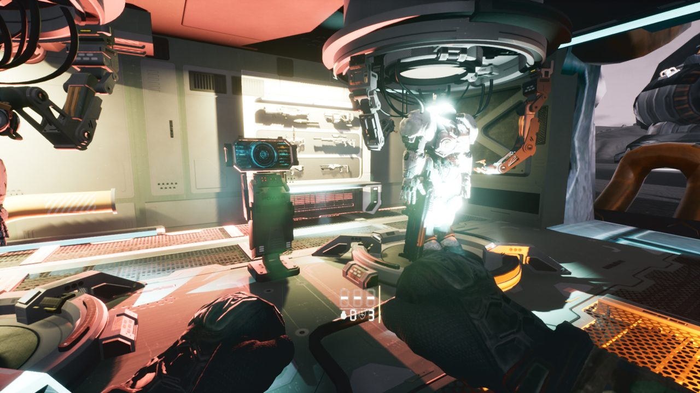
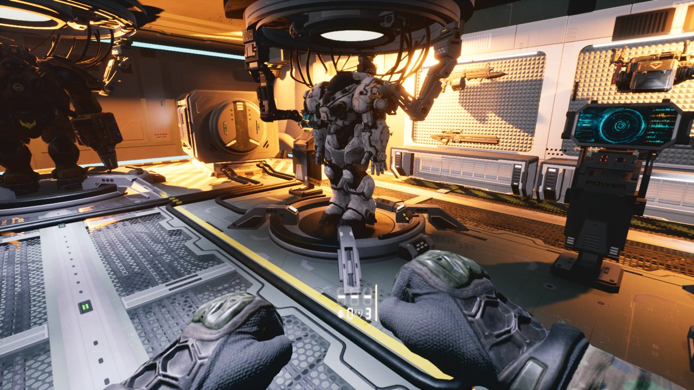
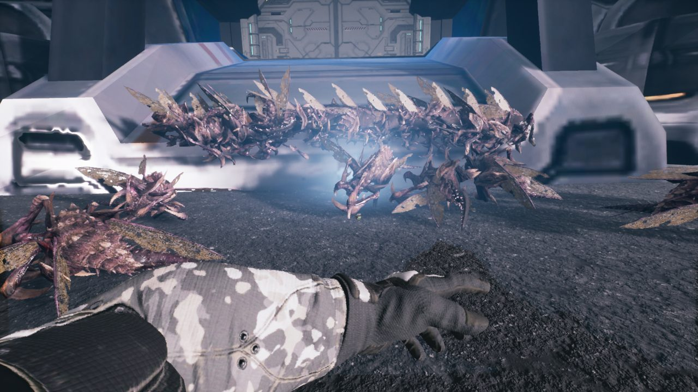
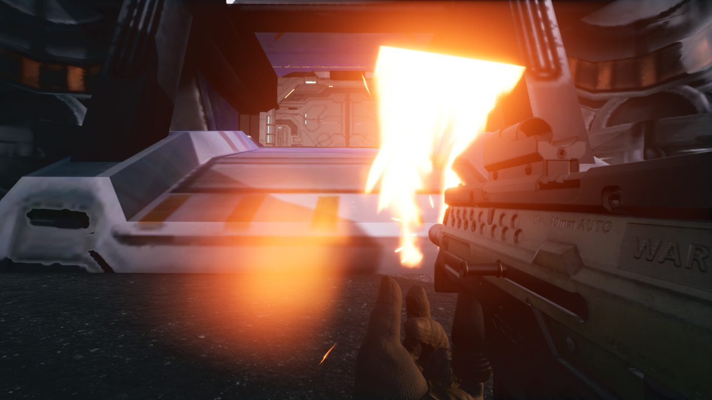
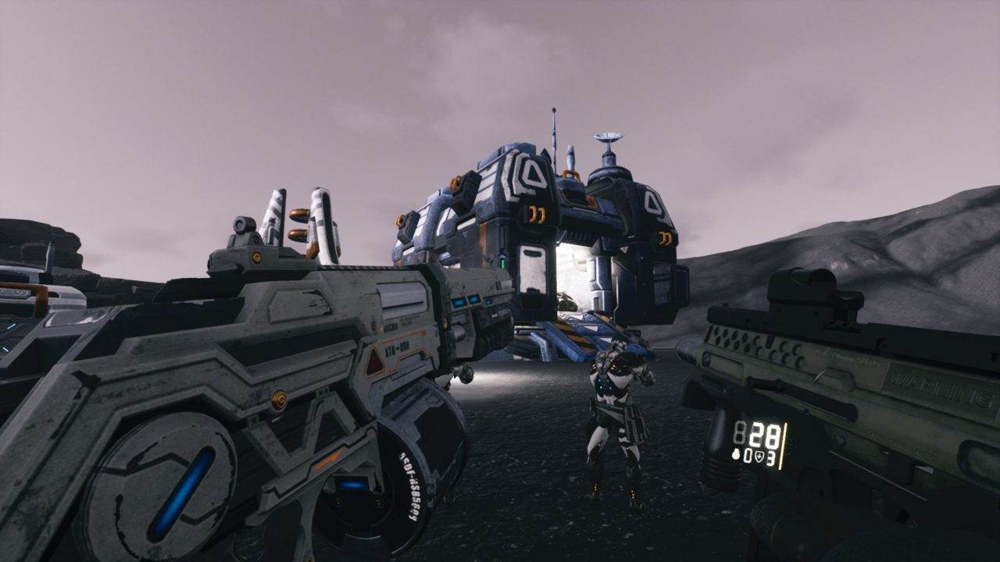

## 한 일

- 커맨드센터 내부를 언리얼에서 만들었습니다. 정비실, 관제실, 격납고가 들어갑니다.
- 보급창 안에 슈트를 입는 플랫폼 6개와 문을 달았습니다.
- 시즈탱크를 들여와 해치와 내부를 만들었습니다.
- 헬멧 바이저를 H 키로 올리고 내립니다.
- 미니건·개틀링, 가우스 총검 등 무기를 늘렸습니다.
- SCV가 쿵쿵 걷는 보행을 넣었습니다.
- 궤도에서 보급창이 떨어질 때의 추진 불꽃을 만들었습니다.

## 막혔던 것

- **재임포트하자 레벨이 1만 배로 커짐**: 다시 가져온 모델의 크기를 엔진이 1만 배로 읽었습니다. 크기를 되돌리는 스크립트로 복구했습니다.
- **그래픽 메모리 부족**: 8K 텍스처 5장을 4K로 줄였습니다. 한 장에 87MB에서 22MB가 됐습니다.

## 성능 — 아직 목표 미달

10월 28일 정식 측정을 세 번 했습니다.
평균은 약 59~61fps였지만, 1% low는 약 19fps였습니다.
목표(1% low 60)까지 아직 멀어서 계속 줄이고 있습니다.
