
세션 4개 · 사진 13장

<ul class="toc">
<li><a href="#weapon">weapon — 무기</a></li>
<li><a href="#design">design — 기획</a></li>
<li><a href="#level">level — 맵</a></li>
<li><a href="#sc2level">sc2level — SC2 맵</a></li>
</ul>
<h2 id="weapon">weapon <small>무기</small></h2>

병과별 장비와 상점 능력 효과를 넣고 양손 총을 다듬었습니다.

<a href="/assets/d/2026-11-01/WindowsEditor_HighresScreenshot01683.jpg" target="_blank">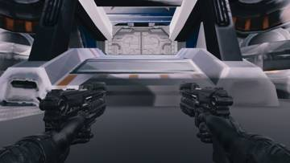</a>
<a href="/assets/d/2026-11-01/WindowsEditor_HighresScreenshot01684.jpg" target="_blank">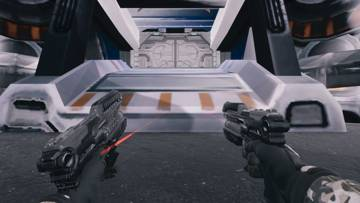</a>
<a href="/assets/d/2026-11-01/WindowsEditor_HighresScreenshot01685.jpg" target="_blank">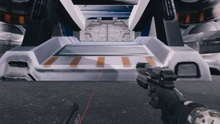</a>

05:14 쌍권총을 다시 두 팔 방식으로 돌리고 재장전을 총마다 따로 하게 했습니다

<a href="/assets/d/2026-11-01/WindowsEditor_HighresScreenshot01687.jpg" target="_blank">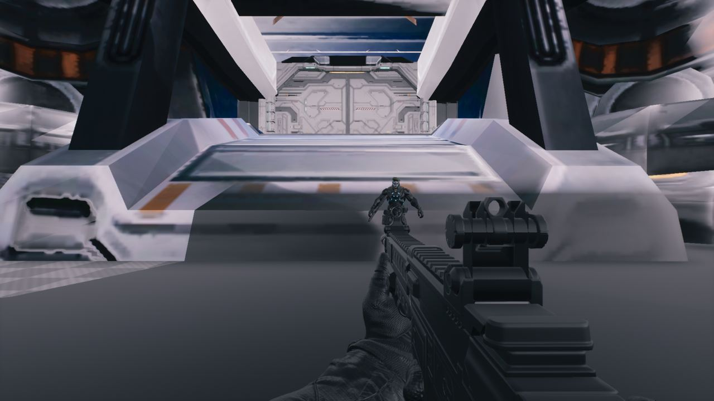</a>

05:30 지원병 직업이 가벼운 슈트와 카빈 소총을 갖도록 했습니다

<a href="/assets/d/2026-11-01/Offscreen_phlandA_1101_062925.jpg" target="_blank">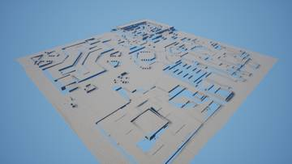</a>
<a href="/assets/d/2026-11-01/WindowsEditor_HighresScreenshot01689.jpg" target="_blank">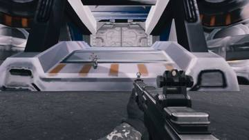</a>
<a href="/assets/d/2026-11-01/Offscreen_phlandC_1101_063453.jpg" target="_blank">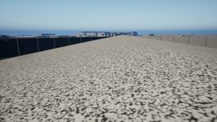</a>
<a href="/assets/d/2026-11-01/WindowsEditor_comms_green_crop.jpg" target="_blank">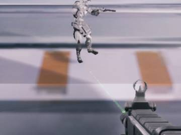</a>
<a href="/assets/d/2026-11-01/Offscreen_phlandA_1101_063849.jpg" target="_blank">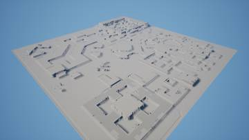</a>

06:31 G키 파편 수류탄과 통신 모듈의 초록 레이저 총을 만들었습니다.

<h2 id="design">design <small>기획</small></h2>

처치하면 광물을 얻고 아군에게 능력을 사줄 수 있게 했습니다.

<a href="/assets/d/2026-11-01/Offscreen_sc2stats_1101_053521.jpg" target="_blank">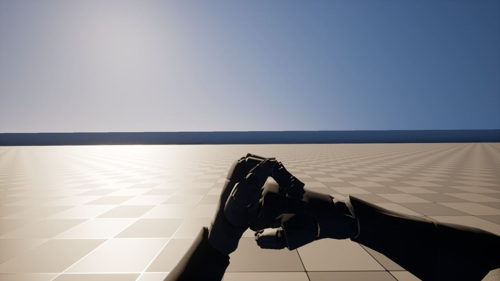</a>

05:38 웨이브 수익과 능력치 상점 사양을 정리했습니다.

<a href="/assets/d/2026-11-01/Offscreen_phlandC_1101_065118.jpg" target="_blank">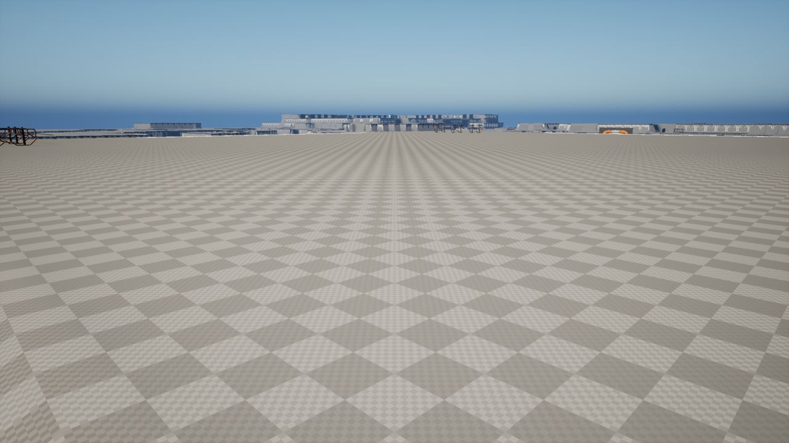</a>

06:53 적을 처치하면 미네랄이 지급되고 능력치 상점에서 쓸 수 있게 했습니다.

<h2 id="level">level <small>맵</small></h2>

프로젝트 헤이븐 지형을 지형 데이터로 만들었습니다.

<a href="/assets/d/2026-11-01/Offscreen_phlandC_1101_064036.jpg" target="_blank">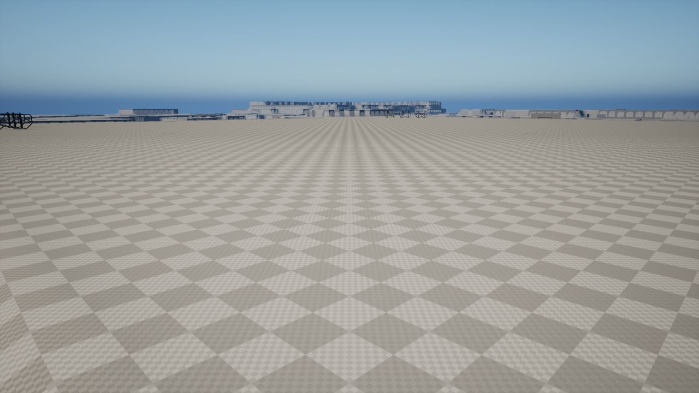</a>

06:42 프로젝트 헤이븐 지형을 2017x2017 지형으로 만드는 도구를 만들고 맵에 올렸습니다.

<h2 id="sc2level">sc2level <small>SC2 맵</small></h2>

지형 도구 사용 중 겪은 문제를 정리했습니다.

<a href="/assets/d/2026-11-01/Offscreen_phlandB_delay.jpg" target="_blank">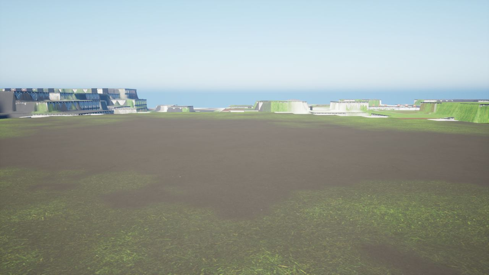</a>

07:20 지형 가져오기와 셰이더 컴파일 주의점을 기록으로 남겼습니다.

