
세션 8개 · 사진 21장

<ul class="toc">
<li><a href="#sc2level">sc2level — SC2 맵</a></li>
<li><a href="#design">design — 기획</a></li>
<li><a href="#vfx">vfx — 이펙트</a></li>
<li><a href="#modules">modules — modules</a></li>
<li><a href="#zerg">zerg — 저그</a></li>
<li><a href="#jobloadout">jobloadout — 병과·장비</a></li>
<li><a href="#terran">terran — 테란 아군</a></li>
<li><a href="#weapon">weapon — 무기</a></li>
</ul>
<h2 id="sc2level">sc2level <small>SC2 맵</small></h2>

헤이븐 지형의 경사면 질감을 개선했습니다.

<a href="/assets/d/2026-11-02/Offscreen_phlandA_delay.jpg" target="_blank">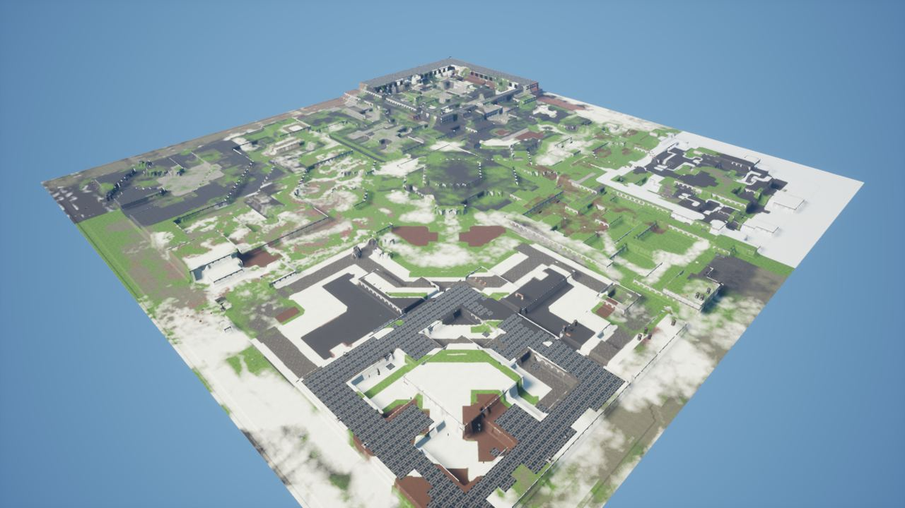</a>

20:27 산 경사면에서 땅 무늬가 늘어나지 않게 옆면 투영 재질을 적용했습니다.

<h2 id="design">design <small>기획</small></h2>

총 정보판 테두리를 스타2 명령 카드 스타일로 바꿨습니다.

<a href="/assets/d/2026-11-02/Offscreen_design_shop_1102_202727.jpg" target="_blank">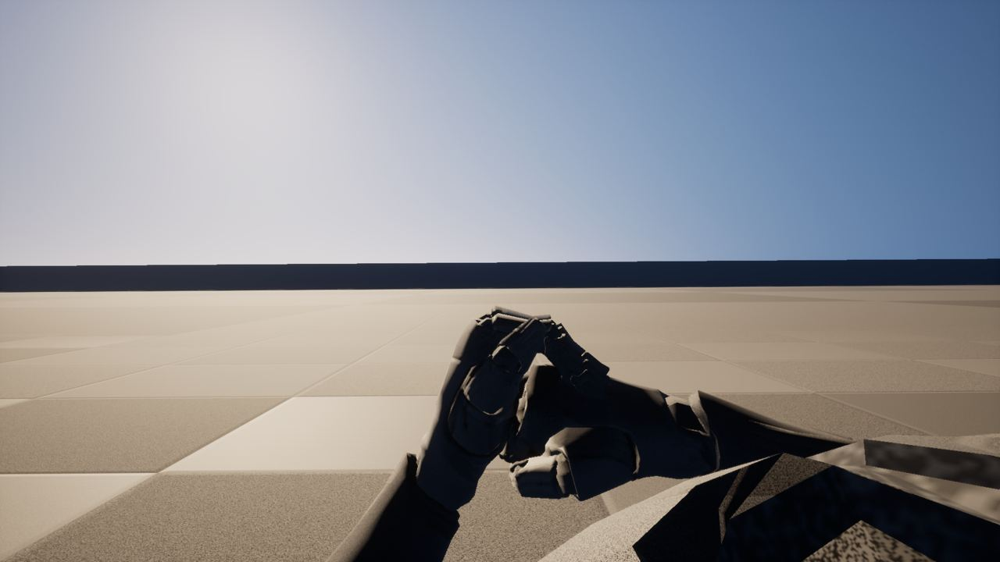</a>

20:30 BAR 래프터스의 호드 모드 스포너 가젯을 조사했습니다.

<a href="/assets/d/2026-11-02/WindowsEditor_ScreenShot00455.jpg" target="_blank">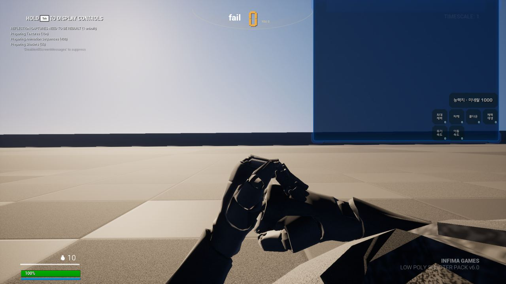</a>

20:38 미네랄 상점 창을 만들었고 능력치는 여섯 가지로 줄였습니다.

<a href="/assets/d/2026-11-02/Offscreen_phlandD_delay.jpg" target="_blank">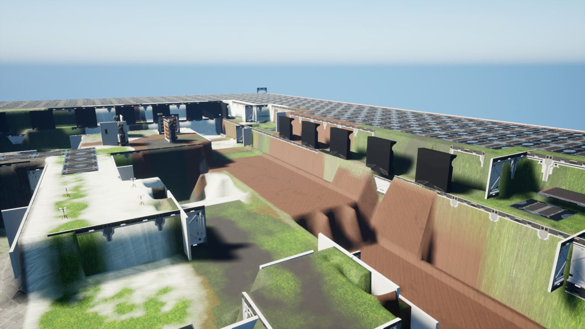</a>

21:16 장비 단말기 화면을 스타크래프트2 무기고 화면 모양으로 꾸몄습니다

<a href="/assets/d/2026-11-02/WindowsEditor_ScreenShot00456.jpg" target="_blank">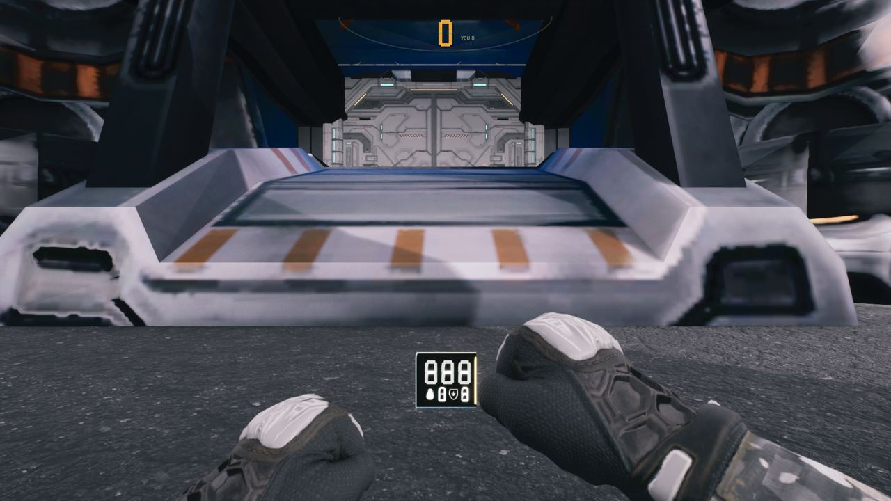</a>

22:37 헤이븐 라운드 진행을 PH2처럼 만들고 능력치 3종 상점과 SC2 패널 틀을 넣었습니다.

<a href="/assets/d/2026-11-02/Offscreen_weaponpanel_1102_235119.jpg" target="_blank">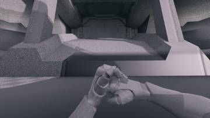</a>
<a href="/assets/d/2026-11-02/WindowsEditor_HighresScreenshot01698.jpg" target="_blank">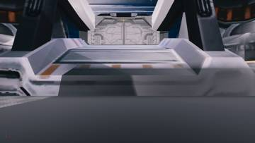</a>
<a href="/assets/d/2026-11-02/WindowsEditor_HighresScreenshot01699.jpg" target="_blank">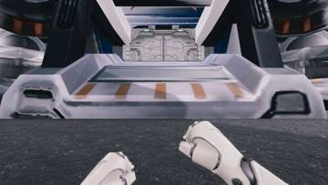</a>

23:54 총 패널 테두리를 스타크래프트 2 명령 카드 모양의 반투명 홀로그램으로 바꿨습니다.

<h2 id="vfx">vfx <small>이펙트</small></h2>

로치, 맹독충, 히드라리스크 재질을 만들었습니다.

<a href="/assets/d/2026-11-02/Offscreen_phlandC_delay.jpg" target="_blank">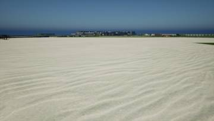</a>
<a href="/assets/d/2026-11-02/Offscreen_vfxhydra_1102_210308.jpg" target="_blank">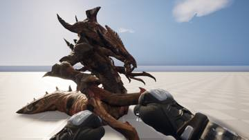</a>

20:52 히드라리스크 몸과 눈 재질을 만들어 입혔습니다.

<a href="/assets/d/2026-11-02/Offscreen_vfxbane_1102_214946.jpg" target="_blank">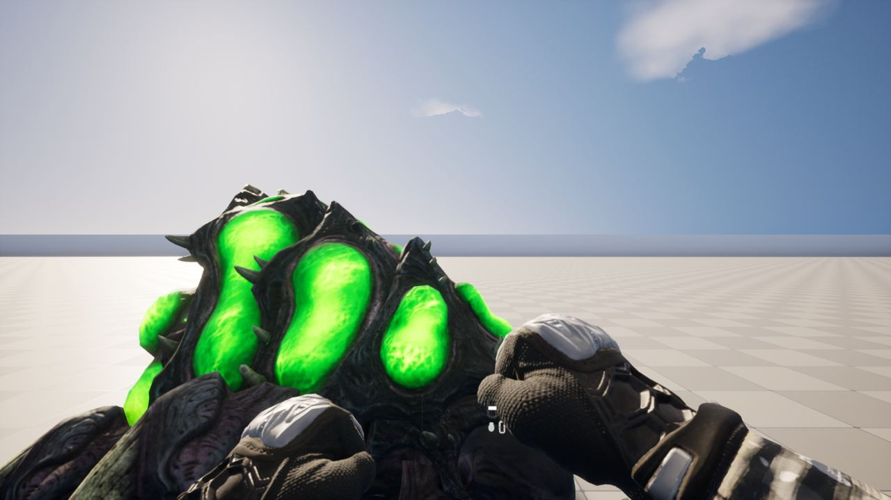</a>

21:53 맹독충에 빛나는 전용 재질을 새로 만들어 입혔습니다.

<a href="/assets/d/2026-11-02/Offscreen_vfxroach_1102_215007.jpg" target="_blank">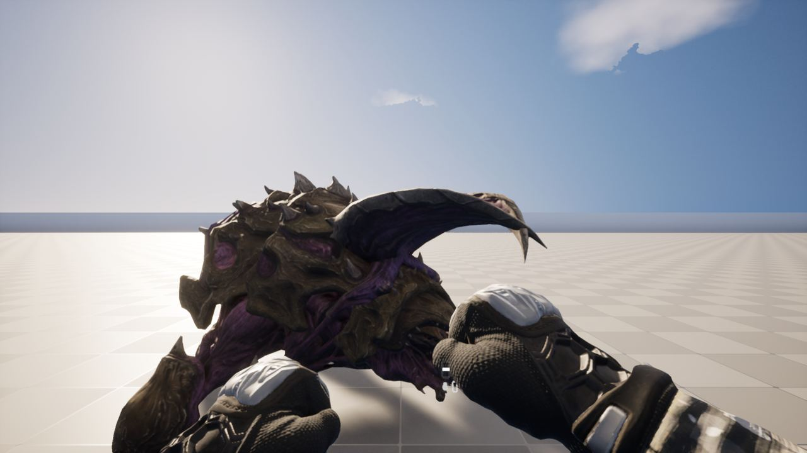</a>

21:54 바퀴벌레 재질을 만들어 몸과 눈에 적용했습니다

<h2 id="modules">modules <small>modules</small></h2>

메딕 병과를 만들고 마린 스팀팩과 포격 지원을 넣었습니다.

<a href="/assets/d/2026-11-02/WindowsEditor_HighresScreenshot01692.jpg" target="_blank">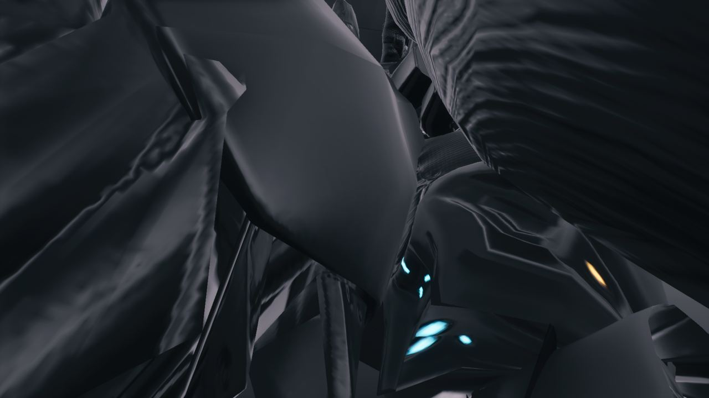</a>

22:08 해병 스팀팩과 방패 장치를 추가했습니다

<a href="/assets/d/2026-11-02/WindowsEditor_HighresScreenshot01694.jpg" target="_blank">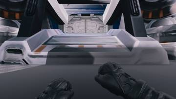</a>
<a href="/assets/d/2026-11-02/WindowsEditor_HighresScreenshot01695.jpg" target="_blank">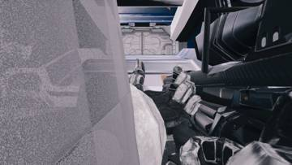</a>

23:21 플라즈마 소총과 치유 광선을 쓰는 의무병 병과를 추가했습니다.

<h2 id="zerg">zerg <small>저그</small></h2>

히드라리스크, 로치, 맹독충 모델을 스타2에서 가져왔습니다.

<a href="/assets/d/2026-11-02/Offscreen_hydraatk_1102_222023.jpg" target="_blank">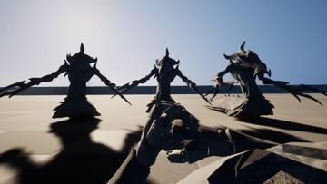</a>
<a href="/assets/d/2026-11-02/Offscreen_hydrawalk_1102_222225.jpg" target="_blank">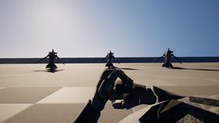</a>

22:22 쓸모없는 배회 계산을 건너뛰고 해병 방패가 포자와 덮치기를 막게 했습니다.

<a href="/assets/d/2026-11-02/Offscreen_hydra_walk.jpg" target="_blank">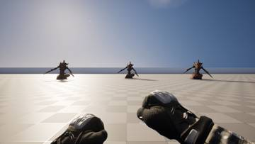</a>
<a href="/assets/d/2026-11-02/Offscreen_hydra_attack.jpg" target="_blank">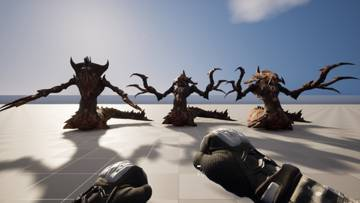</a>

22:29 히드라리스크를 추가했습니다. 가까운 테란에게 걸어가 사정거리에서 공격합니다.

<h2 id="jobloadout">jobloadout <small>병과·장비</small></h2>

<a href="/assets/d/2026-11-02/WindowsEditor_HighresScreenshot01693.jpg" target="_blank">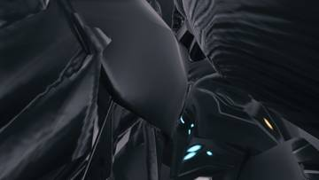</a>
<a href="/assets/d/2026-11-02/WindowsEditor_HighresScreenshot01697.jpg" target="_blank">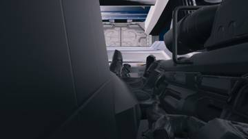</a>

22:52 

<h2 id="terran">terran <small>테란 아군</small></h2>

아군이 산 상점 능력이 아군에게 적용되게 했습니다.

<h2 id="weapon">weapon <small>무기</small></h2>

폭격과 방사능 지원 호출을 넣고 상점 효과를 확인했습니다.

