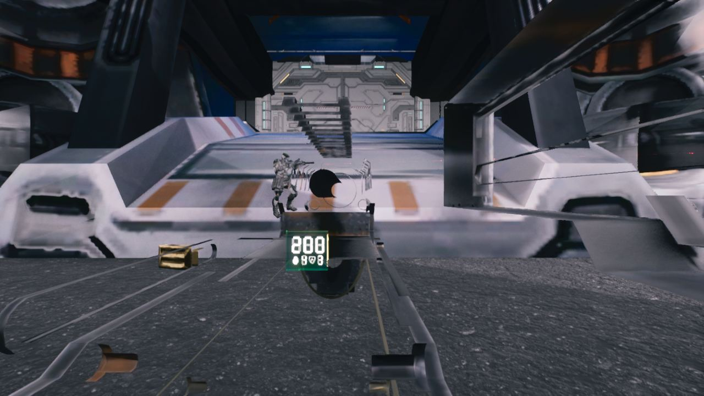

작업 6개 · 사진 11장

<ul class="toc">
<li><a href="#jobloadout">병과·장비</a></li>
<li><a href="#weapon">무기</a></li>
<li><a href="#vfx">이펙트</a></li>
<li><a href="#zerg">저그</a></li>
<li><a href="#modules">모듈</a></li>
<li><a href="#terran">테란 아군</a></li>
</ul>
<h2 id="jobloadout">병과·장비</h2>

족장 병과와 로봇 조종기를 추가했습니다.

00:11 족장 병과를 만들고 전쟁 함성을 넣었습니다.

<h2 id="weapon">무기</h2>

울펜슈타인 스타일 총구 불꽃과 양손 총을 손봤습니다.

00:32 파워슈트 시점에서 방패 패드가 자기 눈에 보이지 않게 했습니다.

02:07 파워슈트 시점에서 팔 없이 총만 보이게 했습니다.

04:03 양손 총 조합을 모두 시험해 제대로 작동하게 했습니다.

04:43 양손으로 쏠 때 두 총의 탄퍼짐을 1.5배로 키웠습니다.

<h2 id="vfx">이펙트</h2>

울펜슈타인 II 총구 불꽃을 가져와 색을 다듬었습니다.

08:02 울펜슈타인 II의 총구 불꽃 이미지를 가져왔습니다.

08:24 울펜슈타인 II의 총구 불꽃 다섯 종을 총에 달았습니다.

09:12 총구 불꽃을 덜 눈부시고 따뜻한 색으로 다듬었습니다.

17:11 피 구름 효과를 성능을 위해 끌 수 있게 했습니다.

<h2 id="zerg">저그</h2>

저그 시체 더미를 밟고 올라서게 하는 설정을 넣었습니다.

17:52 저그 시체 더미를 밟고 올라설 수 있는 설정을 넣었습니다.

<h2 id="modules">모듈</h2>

집행자와 사령관 병과를 추가했습니다.

<h2 id="terran">테란 아군</h2>

족장의 전쟁 함성이 아군 총 피해량도 올리게 했습니다.

