
세션 8개 · 사진 71장

<ul class="toc">
<li><a href="#jobloadout">jobloadout — 병과·장비</a></li>
<li><a href="#weapon">weapon — 무기</a></li>
<li><a href="#vfx">vfx — 이펙트</a></li>
<li><a href="#zerg">zerg — 저그</a></li>
<li><a href="#perf">perf — 성능</a></li>
<li><a href="#design">design — 기획</a></li>
<li><a href="#modules">modules — modules</a></li>
<li><a href="#terran">terran — 테란 아군</a></li>
</ul>
<h2 id="jobloadout">jobloadout <small>병과·장비</small></h2>

사냥꾼과 족장 병과, 로봇 조종기를 추가했습니다.

<a href="/assets/d/2026-11-03/WindowsEditor_HighresScreenshot01700.jpg" target="_blank">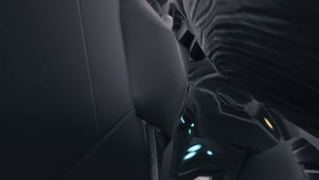</a>
<a href="/assets/d/2026-11-03/WindowsEditor_HighresScreenshot01701.jpg" target="_blank">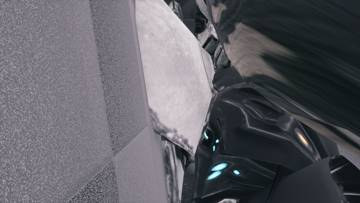</a>
<a href="/assets/d/2026-11-03/Offscreen_calldown_Banshee.jpg" target="_blank">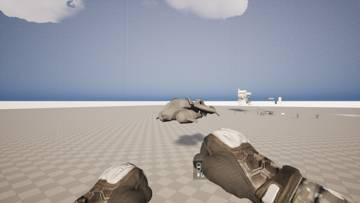</a>
<a href="/assets/d/2026-11-03/Offscreen_calldown_Thor.jpg" target="_blank">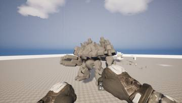</a>
<a href="/assets/d/2026-11-03/WindowsEditor_HighresScreenshot01704.jpg" target="_blank">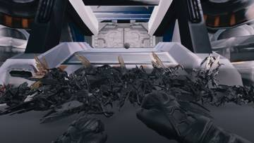</a>

00:11 족장 병과를 넣었습니다. 2번 키로 함성을 질러 15초 동안 공격력을 15% 올립니다.

<h2 id="weapon">weapon <small>무기</small></h2>

울펜슈타인 스타일 총구 화염과 사냥꾼 병과 장비를 넣었습니다.

<a href="/assets/d/2026-11-03/Offscreen_weapon_1103_002802_1.jpg" target="_blank">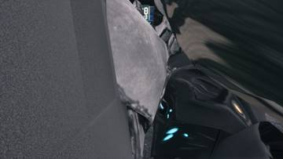</a>
<a href="/assets/d/2026-11-03/Offscreen_calldown_units.jpg" target="_blank">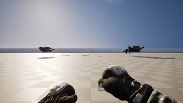</a>
<a href="/assets/d/2026-11-03/Offscreen_weapon_1103_004305_1.jpg" target="_blank">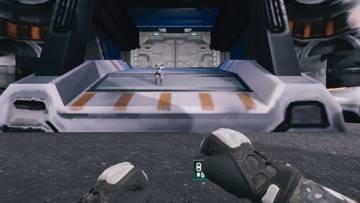</a>
<a href="/assets/d/2026-11-03/Offscreen_weapon_1103_004305_3.jpg" target="_blank">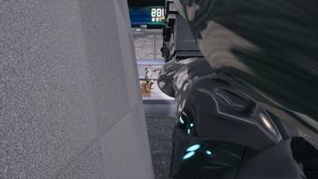</a>
<a href="/assets/d/2026-11-03/Offscreen_weapon_1103_010625_2.jpg" target="_blank">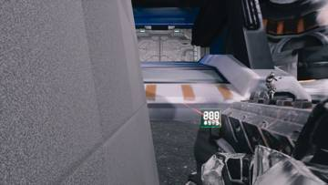</a>
<a href="/assets/d/2026-11-03/Offscreen_calldown_VikingAssault.jpg" target="_blank">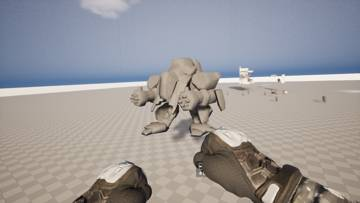</a>
<a href="/assets/d/2026-11-03/Offscreen_weapon_1103_011359_2.jpg" target="_blank">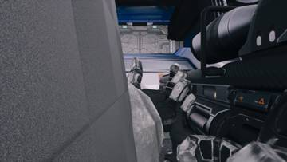</a>
<a href="/assets/d/2026-11-03/Offscreen_weapon_1103_012125_1.jpg" target="_blank">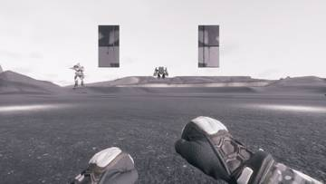</a>
<a href="/assets/d/2026-11-03/Offscreen_weapon_1103_012125_2.jpg" target="_blank">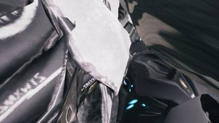</a>
<a href="/assets/d/2026-11-03/Offscreen_weapon_1103_020017_2.jpg" target="_blank">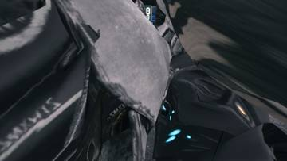</a>

00:32 파워슈트 시점에서 카메라에 붙던 1미터짜리 상자 모양 임시물을 숨겼습니다.

<a href="/assets/d/2026-11-03/Offscreen_modules_thor_1103_020435.jpg" target="_blank">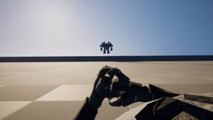</a>
<a href="/assets/d/2026-11-03/Offscreen_weapon_1103_031843_1.jpg" target="_blank">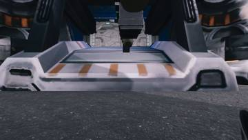</a>
<a href="/assets/d/2026-11-03/Offscreen_weapon_1103_032647_2.jpg" target="_blank">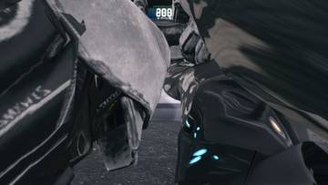</a>
<a href="/assets/d/2026-11-03/Offscreen_weapon_1103_032647_3.jpg" target="_blank">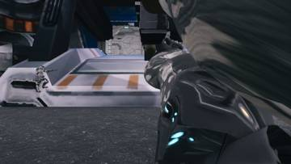</a>
<a href="/assets/d/2026-11-03/Offscreen_weapon_1103_034836_2.jpg" target="_blank">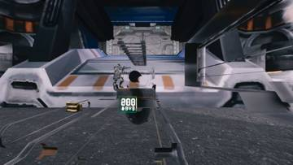</a>
<a href="/assets/d/2026-11-03/Offscreen_weapon_1103_034836_3.jpg" target="_blank">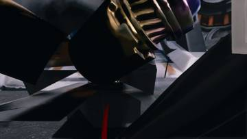</a>

02:07 파워슈트 시점에서 팔은 숨기고 무기만 손 위치에 보이게 했습니다.

<a href="/assets/d/2026-11-03/WindowsEditor_DST_00_GaussPistol_GaussPistol_rest.jpg" target="_blank">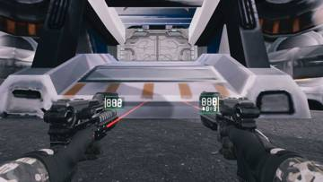</a>
<a href="/assets/d/2026-11-03/WindowsEditor_DST_00_GaussPistol_GaussPistol_inspect.jpg" target="_blank">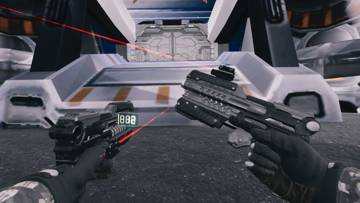</a>
<a href="/assets/d/2026-11-03/WindowsEditor_DST_03_GaussPistol_SR8_rest.jpg" target="_blank">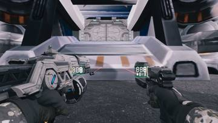</a>
<a href="/assets/d/2026-11-03/WindowsEditor_DST_03_GaussPistol_SR8_inspect.jpg" target="_blank">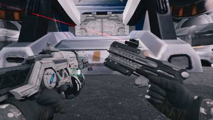</a>
<a href="/assets/d/2026-11-03/WindowsEditor_DST_04_GaussPistol_CK27_rest.jpg" target="_blank">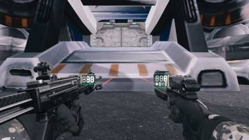</a>
<a href="/assets/d/2026-11-03/WindowsEditor_DST_06_Ferromag_GaussPistol_inspect.jpg" target="_blank">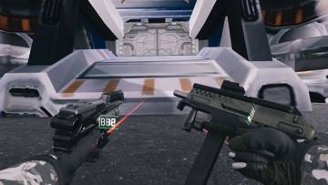</a>
<a href="/assets/d/2026-11-03/WindowsEditor_DST_12_FN92_GaussPistol_rest.jpg" target="_blank">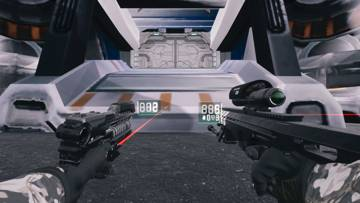</a>
<a href="/assets/d/2026-11-03/WindowsEditor_DST_12_FN92_GaussPistol_inspect.jpg" target="_blank">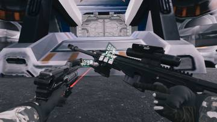</a>
<a href="/assets/d/2026-11-03/WindowsEditor_DST_18_SR8_GaussPistol_inspect.jpg" target="_blank">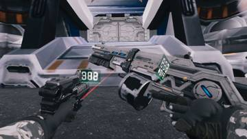</a>
<a href="/assets/d/2026-11-03/WindowsEditor_DST_19_SR8_Ferromag_rest.jpg" target="_blank">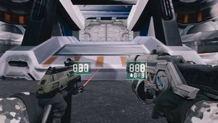</a>
<a href="/assets/d/2026-11-03/WindowsEditor_DST_24_CK27_GaussPistol_inspect.jpg" target="_blank">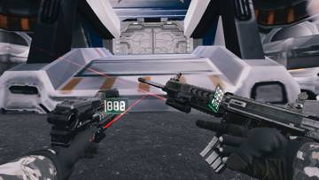</a>
<a href="/assets/d/2026-11-03/WindowsEditor_DST_27_CK27_SR8_inspect.jpg" target="_blank">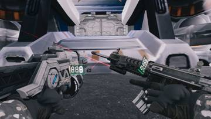</a>
<a href="/assets/d/2026-11-03/WindowsEditor_DST_31_GL_Ferromag_inspect.jpg" target="_blank">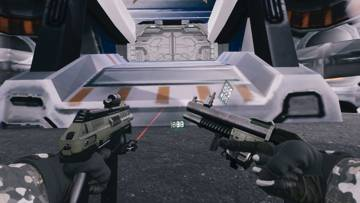</a>
<a href="/assets/d/2026-11-03/WindowsEditor_DST_32_GL_FN92_inspect.jpg" target="_blank">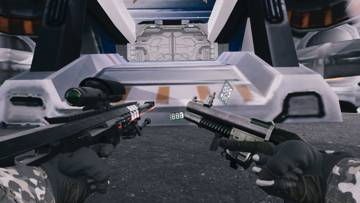</a>
<a href="/assets/d/2026-11-03/WindowsEditor_DST_34_GL_CK27_rest.jpg" target="_blank">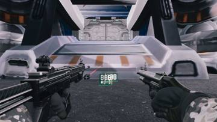</a>

04:03 쌍권총 자체 테스트를 36개 모두 통과시켰습니다

<a href="/assets/d/2026-11-03/WindowsEditor_DST_21_SR8_SR8_rest.jpg" target="_blank">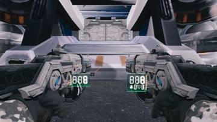</a>
<a href="/assets/d/2026-11-03/WindowsEditor_DST_21_SR8_SR8_inspect.jpg" target="_blank">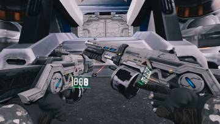</a>
<a href="/assets/d/2026-11-03/WindowsEditor_DST_22_SR8_CK27_rest.jpg" target="_blank">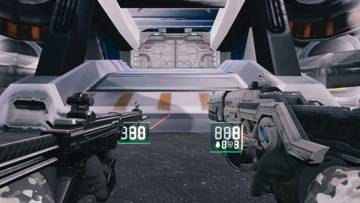</a>

04:43 쌍권총일 때 두 정 모두 탄퍼짐이 1.5배가 되도록 했습니다.

<a href="/assets/d/2026-11-03/Offscreen_weapon_pad_1103_230310_1.jpg" target="_blank">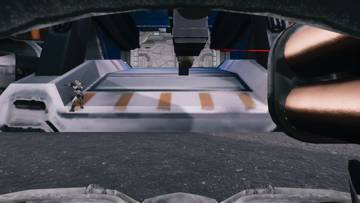</a>
<a href="/assets/d/2026-11-03/Offscreen_weapon_pad_1103_230310_2.jpg" target="_blank">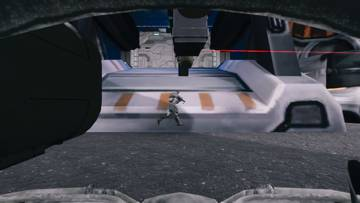</a>

23:06 파워슈트에서 어깨 포드가 올라가 키를 누를 때마다 로켓이 한 발씩 나가게 했습니다.

<h2 id="vfx">vfx <small>이펙트</small></h2>

울펜슈타인 II 총구 화염을 가져와 색을 다듬었습니다.

<a href="/assets/d/2026-11-03/WindowsEditor_HighresScreenshot01705.jpg" target="_blank">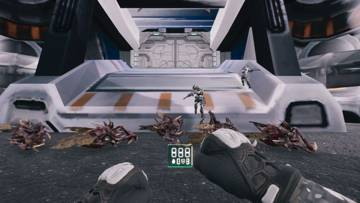</a>
<a href="/assets/d/2026-11-03/WindowsEditor_HighresScreenshot01706.jpg" target="_blank">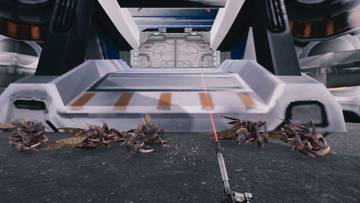</a>
<a href="/assets/d/2026-11-03/WindowsEditor_HighresScreenshot01707.jpg" target="_blank">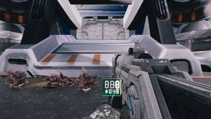</a>
<a href="/assets/d/2026-11-03/WindowsEditor_HighresScreenshot01710.jpg" target="_blank">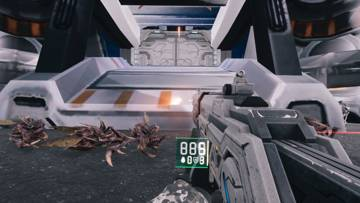</a>

08:02 울펜슈타인 2 총구 화염 텍스처를 가져오고 제작법을 문서에 적었습니다.

<a href="/assets/d/2026-11-03/WindowsEditor_HighresScreenshot01711.jpg" target="_blank">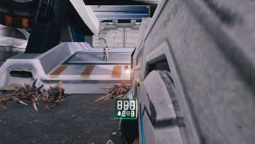</a>
<a href="/assets/d/2026-11-03/WindowsEditor_HighresScreenshot01712.jpg" target="_blank">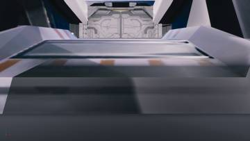</a>
<a href="/assets/d/2026-11-03/WindowsEditor_HighresScreenshot01713.jpg" target="_blank">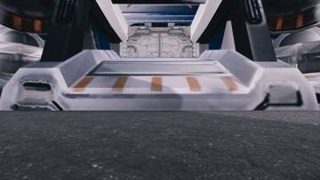</a>
<a href="/assets/d/2026-11-03/WindowsEditor_HighresScreenshot01714.jpg" target="_blank">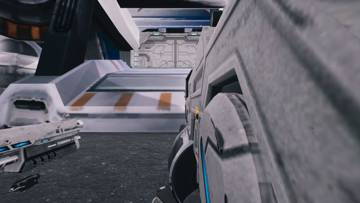</a>
<a href="/assets/d/2026-11-03/WindowsEditor_HighresScreenshot01716.jpg" target="_blank">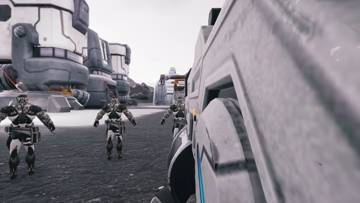</a>

08:24 울펜슈타인 II의 총구 화염 5종을 가져와 총 종류별로 붙였습니다.

09:12 총구 섬광이 화면을 뒤덮던 문제를 줄여 작고 따뜻한 불빛으로 바꿨습니다

17:11 성능을 위해 피 구름 충돌을 끌 수 있는 옵션을 넣었습니다.

<h2 id="zerg">zerg <small>저그</small></h2>

저글링 시체 더미 처리 방식을 바꿔 성능을 높였습니다.

17:52 저그 시체 더미를 플레이어가 밟고 올라설 수 있게 하는 옵션을 넣었습니다.

<h2 id="perf">perf <small>성능</small></h2>

그래픽 설정을 조정하고 저글링 2000마리 성능을 측정했습니다.

21:07 저그 수를 늘려 측정하는 옵션을 만들었고 2000마리에서 평균 54.6fps가 나왔습니다

<h2 id="design">design <small>기획</small></h2>

작업 규칙에 자체 점검 단계를 추가했습니다.

<h2 id="modules">modules <small>modules</small></h2>

집행자와 사령관 병과를 추가했습니다.

<h2 id="terran">terran <small>테란 아군</small></h2>

족장의 전쟁 함성이 아군 총 피해량도 올리게 했습니다.

