
세션 18개 · 사진 370장

<ul class="toc">
<li><a href="#weapon">weapon — 무기</a></li>
<li><a href="#zerg">zerg — 저그</a></li>
<li><a href="#design">design — 기획</a></li>
<li><a href="#goliath">goliath — 골리앗</a></li>
<li><a href="#siegetank">siegetank — 시즈탱크</a></li>
<li><a href="#level">level — 맵</a></li>
<li><a href="#jobloadout">jobloadout — 병과·장비</a></li>
<li><a href="#vfx">vfx — 이펙트</a></li>
<li><a href="#vehicle">vehicle — 차량</a></li>
<li><a href="#medicsuit">medicsuit — 의무병 슈트</a></li>
<li><a href="#lurker">lurker — 가시지옥</a></li>
<li><a href="#heavy">heavy — 중화기병</a></li>
<li><a href="#marine">marine — 해병</a></li>
<li><a href="#audio">audio — 소리</a></li>
<li><a href="#anim">anim — 애니메이션</a></li>
<li><a href="#gearwall">gearwall — 장비 거치대</a></li>
<li><a href="#ghost">ghost — 고스트</a></li>
<li><a href="#jetpack">jetpack — 제트팩</a></li>
</ul>
<h2 id="weapon">weapon <small>무기</small></h2>

호출 사격 효과와 화염방사기, 방패 위치를 개선했습니다.

<a href="/assets/d/2026-11-04/Offscreen_weapon_frag_1104_002420_3.jpg" target="_blank">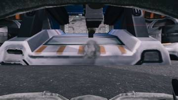</a>

00:27 파편 수류탄의 폭발 효과를 울펜슈타인 II식 폭발로 바꿨습니다.

<a href="/assets/d/2026-11-04/Offscreen_gearanim_1104_035327_2.jpg" target="_blank">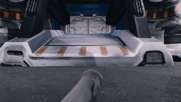</a>
<a href="/assets/d/2026-11-04/Offscreen_gearanim_1104_035327_3.jpg" target="_blank">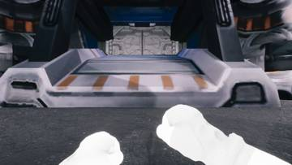</a>

03:57 F 키가 골리앗과 시즈 탱크 탑승을 건너뛰게 하고 카메라 회전도 맞췄습니다.

<a href="/assets/d/2026-11-04/WindowsEditor_HighresScreenshot01839.jpg" target="_blank">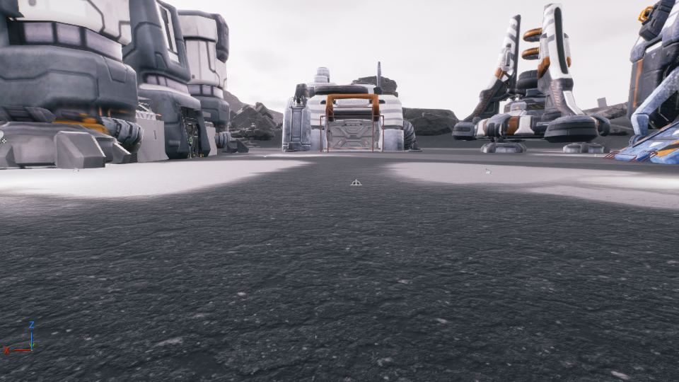</a>

15:39 쌍권총 계획에서 세 번째 자세 에셋을 그대로 쓰기로 하고 작업을 마무리했습니다.

<a href="/assets/d/2026-11-04/Offscreen_shield_shot_0.jpg" target="_blank">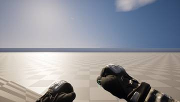</a>
<a href="/assets/d/2026-11-04/Offscreen_shield_shot_1.jpg" target="_blank">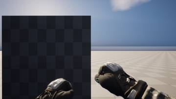</a>
<a href="/assets/d/2026-11-04/Offscreen_shield_shot_2.jpg" target="_blank">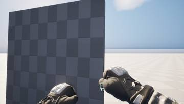</a>
<a href="/assets/d/2026-11-04/Offscreen_shield_shot_3.jpg" target="_blank">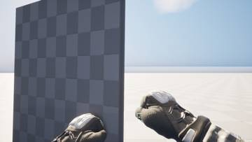</a>
<a href="/assets/d/2026-11-04/Offscreen_shield_shot_4.jpg" target="_blank">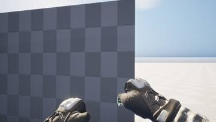</a>

16:23 방패를 카메라 쪽으로 향하게 왼쪽 위에 들도록 위치를 맞췄습니다.

<a href="/assets/d/2026-11-04/Offscreen_gearanim5_1104_163330_17.jpg" target="_blank">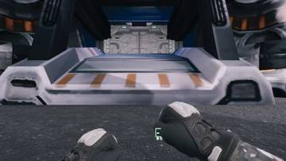</a>
<a href="/assets/d/2026-11-04/Offscreen_gearanim6_1104_170836.jpg" target="_blank">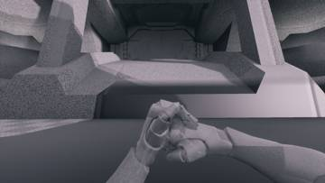</a>

16:37 화염방사기를 울펜슈타인 II식 불꽃으로 바꾸고 노즐을 따라가게 했습니다.

<a href="/assets/d/2026-11-04/Offscreen_gearsync_1104_191357.jpg" target="_blank">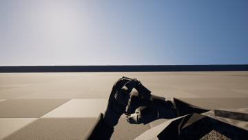</a>
<a href="/assets/d/2026-11-04/WindowsEditor_HighresScreenshot01843.jpg" target="_blank">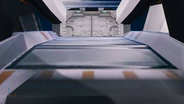</a>
<a href="/assets/d/2026-11-04/WindowsEditor_HighresScreenshot01844.jpg" target="_blank">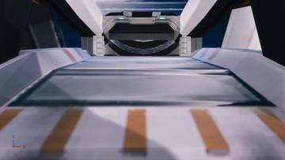</a>
<a href="/assets/d/2026-11-04/WindowsEditor_HighresScreenshot01847.jpg" target="_blank">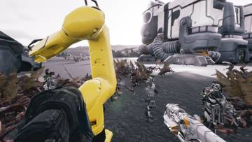</a>
<a href="/assets/d/2026-11-04/Offscreen_gearanim7_ga_Absorb.jpg" target="_blank">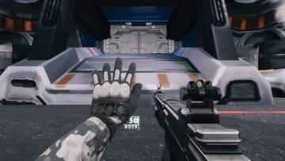</a>
<a href="/assets/d/2026-11-04/Offscreen_gearanim7_ga_CaduceusLoop.jpg" target="_blank">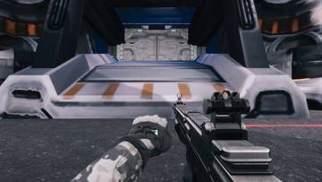</a>
<a href="/assets/d/2026-11-04/Offscreen_gearanim7_ga_Decoy.jpg" target="_blank">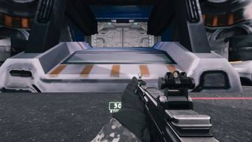</a>
<a href="/assets/d/2026-11-04/Offscreen_gearanim7_ga_Drone.jpg" target="_blank">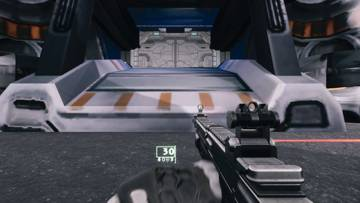</a>
<a href="/assets/d/2026-11-04/Offscreen_gearanim7_ga_Radio.jpg" target="_blank">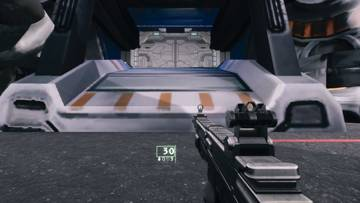</a>
<a href="/assets/d/2026-11-04/Offscreen_gearanim7_ga_WarCry.jpg" target="_blank">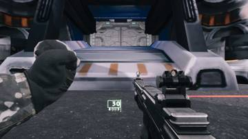</a>

19:15 장비 동작 애니메이션이 손 움직임까지 함께 재생되도록 연결했습니다.

<a href="/assets/d/2026-11-04/Offscreen_calldown_shot_0.jpg" target="_blank">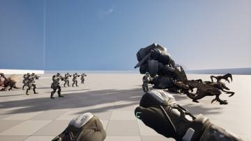</a>
<a href="/assets/d/2026-11-04/Offscreen_calldown_shot_5.jpg" target="_blank">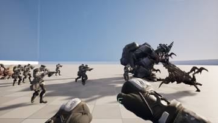</a>
<a href="/assets/d/2026-11-04/Offscreen_calldown_shot_7.jpg" target="_blank">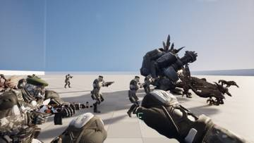</a>

22:07 함포 지원 발사 때 발사와 폭발 효과가 실제로 나오게 했습니다

<h2 id="zerg">zerg <small>저그</small></h2>

히드라와 맹독충을 구현하고 웨이브에 저그 종류를 섞었습니다.

<a href="/assets/d/2026-11-04/WindowsEditor_HighresScreenshot01750.jpg" target="_blank">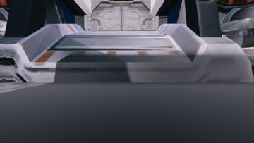</a>
<a href="/assets/d/2026-11-04/WindowsEditor_HighresScreenshot01751.jpg" target="_blank">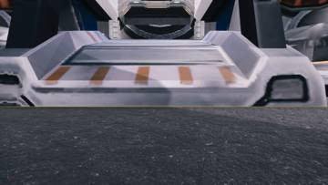</a>

01:43 적이 액터와 일반 상태를 빠르게 오가는 떨림을 막으려고 잠깐 상태를 유지하게 했습니다.

<a href="/assets/d/2026-11-04/Offscreen_siegetank_1104_032825_01.jpg" target="_blank">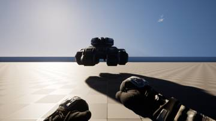</a>

<a href="/assets/d/2026-11-04/Offscreen_siegetank_1104_032825_06.jpg" target="_blank">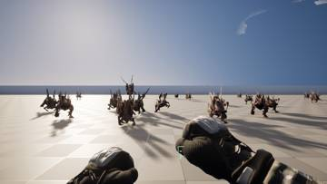</a>
<a href="/assets/d/2026-11-04/Offscreen_siegetank_1104_032825_07.jpg" target="_blank">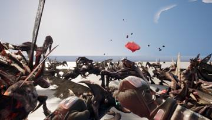</a>
<a href="/assets/d/2026-11-04/Offscreen_siegetank_1104_032825_08.jpg" target="_blank">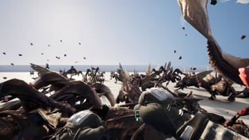</a>

03:30 웨이브 모드가 스스로 시작되게 하고 유령의 은신 상태를 적이 건너뛰게 했습니다.

<a href="/assets/d/2026-11-04/Offscreen_roach_walk.jpg" target="_blank">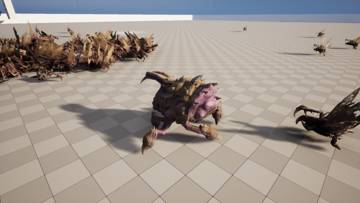</a>
<a href="/assets/d/2026-11-04/Offscreen_roach_attack.jpg" target="_blank">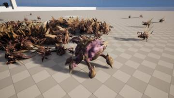</a>
<a href="/assets/d/2026-11-04/Offscreen_roach_death.jpg" target="_blank">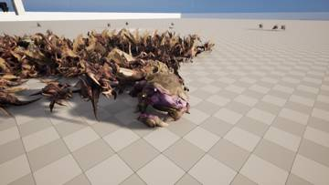</a>

04:27 로치 테스트에서 카메라를 따로 두어 죽는 모습을 확인했고 3개 모두 통과했습니다.

<a href="/assets/d/2026-11-04/Offscreen_warhound_1104_073155_2_camera.jpg" target="_blank">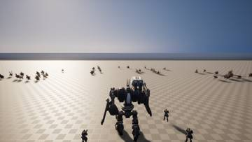</a>
<a href="/assets/d/2026-11-04/Offscreen_warhound_1104_073155_4_turn.jpg" target="_blank">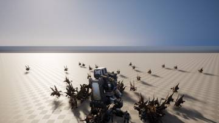</a>
<a href="/assets/d/2026-11-04/Offscreen_cyclone_1104_073832_01.jpg" target="_blank">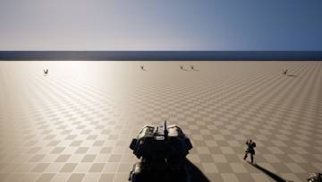</a>
<a href="/assets/d/2026-11-04/WindowsEditor_GHOST_kit.jpg" target="_blank">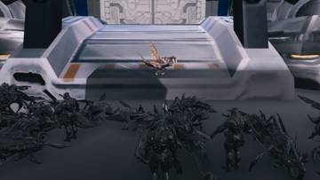</a>
<a href="/assets/d/2026-11-04/Offscreen_cyclone_1104_073832_06.jpg" target="_blank">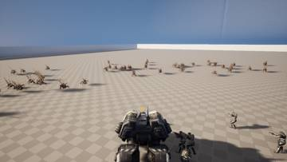</a>
<a href="/assets/d/2026-11-04/WindowsEditor_GHOST_cloak.jpg" target="_blank">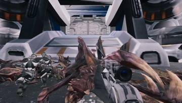</a>
<a href="/assets/d/2026-11-04/WindowsEditor_GHOST_laser.jpg" target="_blank">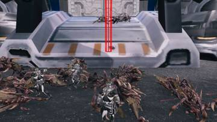</a>
<a href="/assets/d/2026-11-04/WindowsEditor_GHOST_nuke.jpg" target="_blank">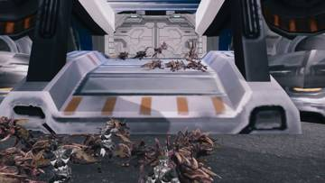</a>
<a href="/assets/d/2026-11-04/WindowsEditor_PSI_kit.jpg" target="_blank">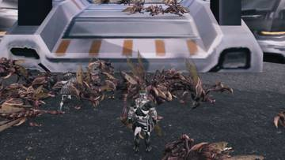</a>
<a href="/assets/d/2026-11-04/WindowsEditor_PSI_absorb.jpg" target="_blank">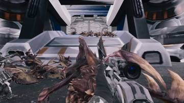</a>
<a href="/assets/d/2026-11-04/WindowsEditor_PSI_overwhelm.jpg" target="_blank">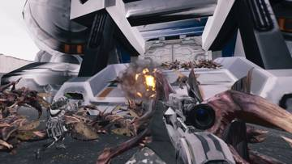</a>
<a href="/assets/d/2026-11-04/WindowsEditor_PSI_cannon.jpg" target="_blank">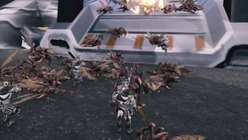</a>
<a href="/assets/d/2026-11-04/WindowsEditor_PSI_reload.jpg" target="_blank">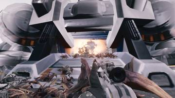</a>
<a href="/assets/d/2026-11-04/Offscreen_goliath_1104_074521_3_turn.jpg" target="_blank">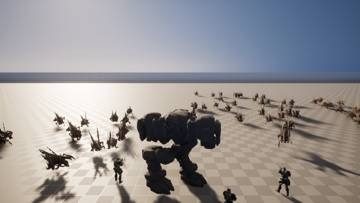</a>
<a href="/assets/d/2026-11-04/Offscreen_goliath_1104_074521_4_aimyaw.jpg" target="_blank">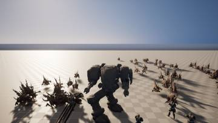</a>
<a href="/assets/d/2026-11-04/Offscreen_goliath_1104_074521_6_fire.jpg" target="_blank">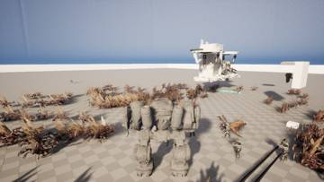</a>
<a href="/assets/d/2026-11-04/Offscreen_goliath_1104_074521_7_out.jpg" target="_blank">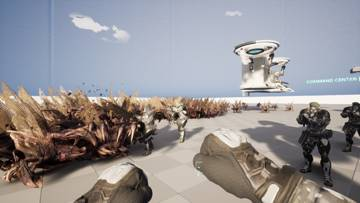</a>

07:35 저그 감독 시스템을 넣어 웨이브 구성을 플레이어 무기에 맞춰 조절하게 했습니다.

09:25 히드라리스크가 죽을 때 시체가 멀리 미끄러지던 문제를 고쳤습니다.

14:10 맹독충을 추가했습니다. 가장 가까운 테란에게 굴러가 닿으면 터집니다.

17:08 히드라 테스트 화면 촬영 시점을 조정해 방패와 공격 장면이 제대로 찍히게 했습니다.

<h2 id="design">design <small>기획</small></h2>

아이템 이름을 시트에 맞춰 바꾸고 참고 자료를 채웠습니다.

01:45 총 패널을 전투기 HUD처럼 초록색 가는 선으로 바꿨습니다.

03:16 여섯 가지 능력치별 제작사 이름을 정했습니다

03:53 헤이븐을 완벽히 따라가는 규칙을 없애고 참고로만 쓰기로 했습니다.

04:09 저그 디렉터 질문에 답해 무기 그룹과 시작 수치를 정했습니다

04:13 장비 벽 세 개를 무기, 가젯, 슈트 탭이 있는 하나의 단말기로 합쳤습니다.

08:45 아이템별 참고 자료 열을 채우고 근거 없는 항목을 표시했습니다

12:21 전술 장비와 중력 장비의 참고 출처를 오버워치 시그마로 정했습니다.

12:26 방어 드론의 참고 게임을 헬다이버즈 2 방어막 발생기로 적었습니다.

12:41 드론과 공격 모듈의 참고 출처를 아머드 코어 6으로 정했습니다.

12:57 전술 중력 이펙트의 참고 게임을 데스티니 2 수류탄으로 적었습니다.

<h2 id="goliath">goliath <small>골리앗</small></h2>

골리앗, 워하운드, 아레스를 직접 몰 수 있게 했습니다.

03:10 

07:29 골리앗, 워하운드, A.R.E.S. 조종 차량을 만들었습니다.

<h2 id="siegetank">siegetank <small>시즈탱크</small></h2>

사이클론과 위도우 마인을 직접 조종할 수 있게 했습니다.

03:53 자체 테스트에서 차체가 시점을 따라 도는 문제를 막았습니다

04:31 사이클론과 위도우 마인을 직접 조종하는 플레이어 차량을 만들었습니다

07:23 로봇은 직접 몰지 않는 설계에 맞춰 위도우 마인 차량을 없앴습니다.

08:01 소환된 전차가 바닥 위에 바로 놓이도록 시작할 때 위치를 맞췄습니다.

08:41 전차가 바닥에서 떠 있던 문제를 충돌 크기를 고쳐 해결했습니다.

<h2 id="level">level <small>맵</small></h2>

헤이븐 재현 지형에 경사로와 창문, 벽을 다듬어 넣었습니다.

04:03 프로젝트 헤이븐을 본뜬 새 맵에 지형 높이와 벽 3277개, 소품 359개를 올렸습니다.

07:04 폐허 맵의 벽을 지형 높이에 맞춰 다시 세웠습니다

09:10 프로젝트 헤이븐 맵의 높이 층 사이에 경사로 79개를 파 넣고 길찾기를 다시 만들었습니다.

12:35 헤이븐 맵의 건물 정면 벽을 문과 창문 모듈로 바꿨습니다.

<h2 id="jobloadout">jobloadout <small>병과·장비</small></h2>

화염병과 약탈자 등 여러 병과와 차량을 추가했습니다.

04:28 제트팩 장비 동작을 연결하고 리퍼 장비와 호출 공격 정보를 정리했습니다.

07:44 고스트와 사이오닉 테스트가 설정을 읽고 시야를 연 뒤 쓰도록 고쳤습니다

12:51 

14:08 돌격, 화염, 정찰 병과와 여러 차량 병과를 열고 테스트를 돌렸습니다.

21:07 중장갑 슈트 불곰과 마라우더를 열고 고르면 정거장 팔이 바뀌게 했습니다.

21:45 리퍼 수류탄을 집속탄 하나로 정리했습니다.

<h2 id="vfx">vfx <small>이펙트</small></h2>

슬램, 충격 패드, 화염방사기와 호출 사격 효과를 만들었습니다.

08:11 빔 끝 위치가 전달되지 않아 빔이 제대로 안 나가던 문제를 고쳤습니다.

08:25 나이아가라 이펙트에 입력값을 넣는 도구를 만들어 화염 연기에 쓰게 했습니다.

13:40 히드라리스크, 로치, 맹독충 같은 개별 저그에도 상처 자국을 붙였습니다.

21:59 건설 병과의 슬램과 충격 패드 효과를 스타크래프트 2 그대로 가져왔습니다.

23:50 래비저 미사일과 포격 이펙트를 SC2 원본 그대로 옮겼습니다.

<h2 id="vehicle">vehicle <small>차량</small></h2>

여러 차량 병과의 설정과 테스트를 정리했습니다.

08:25 SCV 병과로 시작하면 SCV를 만들어 플레이어를 태우는 기능을 넣었습니다.

08:45 로봇 테스트에서 아군에 막히거나 저글링에게 당하지 않도록 조건을 고쳤습니다.

09:50 로봇 테스트 중 아군 사격과 위치 문제를 막아 안정적으로 돌게 했습니다

13:31 차량 6종의 직업 항목과 장비 줄을 정리했습니다.

14:00 로봇 시험에서 더미를 만들기 전에 시점을 시작 방향으로 되돌리게 했습니다.

14:53 로봇 자체 테스트가 중간에 저그 때문에 끊기지 않도록 고쳤습니다

<h2 id="medicsuit">medicsuit <small>의무병 슈트</small></h2>

메딕 슈트의 몸 위치와 재질을 바로잡았습니다.

08:25 의무병 슈트를 뼈대에 맞춰 만들어 플레이어가 입을 수 있게 했습니다.

14:10 리그 기준 크기를 바로잡아 몸이 8미터 넘게 어긋나던 문제를 고쳤습니다.

<h2 id="lurker">lurker <small>가시지옥</small></h2>

스타2 가시지옥과 분열기 저그를 게임에 넣었습니다.

08:41 외부에서 받은 리깅 파일을 블렌더로 옮겨 러커 모델을 만들었습니다

14:21 테스트 촬영 카메라가 건물 안에 갇히지 않게 시야 좋은 쪽을 고르게 했습니다

22:25 저그 신규 유닛 래버저를 추가했습니다. 플라즈마 사격과 부식성 담즙 공격을 합니다.

<h2 id="heavy">heavy <small>중화기병</small></h2>

중장갑 슈트의 양팔 무기가 1인칭에서 보이고 발사되게 했습니다.

12:51 중장갑 팔로 왼팔 오른팔을 따로 쏘게 하고 화염방사와 유탄 공격을 넣었습니다

<h2 id="marine">marine <small>해병</small></h2>

파워슈트 병과들의 동작을 자동 테스트로 확인했습니다.

14:06 파워 슈트 직업별 자체 테스트를 통과시키고 건너 슬램 동작을 고쳤습니다

<h2 id="audio">audio <small>소리</small></h2>

건설, 차량, 저그, 라운드 진행 소리를 새로 넣었습니다.

16:36 장비별 효과음을 상태에 맞춰 재생하는 소리 시스템을 만들었습니다

19:38 아군이 맞거나 쓰러질 때 소리가 나게 했습니다.

22:38 건설 팩과 가우스 부착물 소리를 추가했습니다.

<h2 id="anim">anim <small>애니메이션</small></h2>

장비 사용 때 왼팔 애니메이션을 총에 맞춰 다듬었습니다.

18:55 장비 동작 18개에 왼손 IK를 적용해 총을 든 채로도 손이 움직이게 했습니다.

19:28 1인칭 왼팔 장비 애니메이션이 모두 통과했고 눈으로 확인할 차례입니다

<h2 id="gearwall">gearwall <small>장비 거치대</small></h2>

연구와 아이템 능력 공유 방식을 정리했습니다.

<h2 id="ghost">ghost <small>고스트</small></h2>

고스트 테스트가 가장 가까운 저글링을 겨누게 했습니다.

<h2 id="jetpack">jetpack <small>제트팩</small></h2>

제트팩 이동 속도를 조정했습니다.

