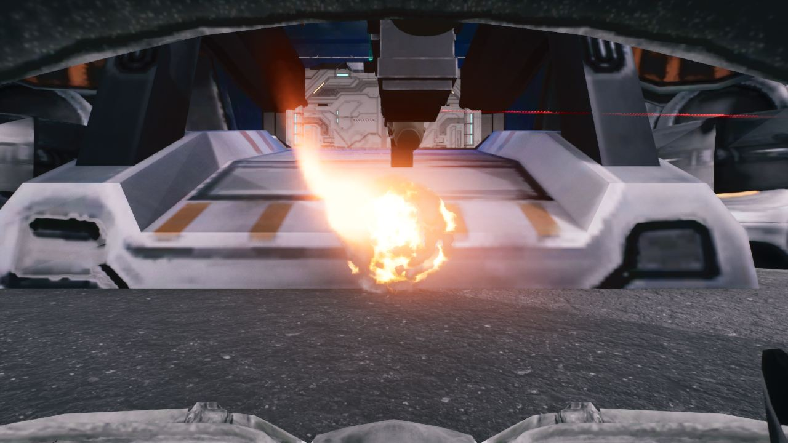
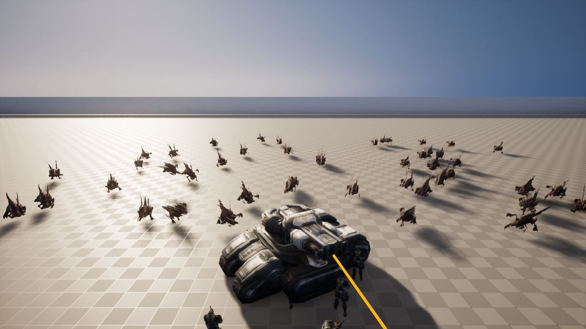
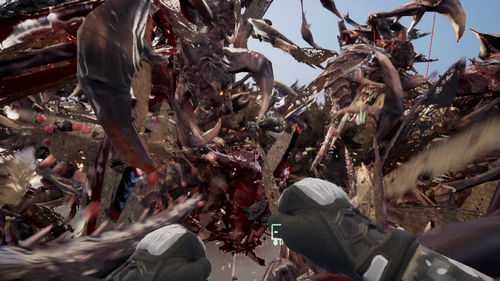
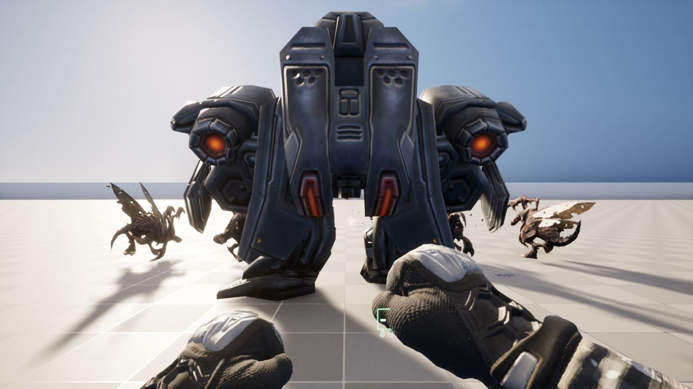
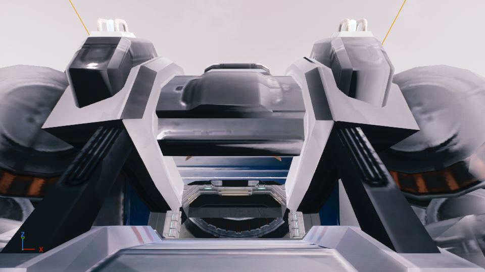

작업 15개 · 사진 29장

<ul class="toc">
<li><a href="#weapon">무기</a></li>
<li><a href="#design">기획</a></li>
<li><a href="#goliath">골리앗</a></li>
<li><a href="#zerg">저그</a></li>
<li><a href="#level">맵</a></li>
<li><a href="#jobloadout">병과·장비</a></li>
<li><a href="#siegetank">시즈탱크</a></li>
<li><a href="#vfx">이펙트</a></li>
<li><a href="#medicsuit">의무병 슈트</a></li>
<li><a href="#vehicle">차량</a></li>
<li><a href="#heavy">중화기병</a></li>
<li><a href="#audio">소리</a></li>
<li><a href="#anim">애니메이션</a></li>
<li><a href="#lurker">가시지옥</a></li>
<li><a href="#jetpack">제트팩</a></li>
</ul>
<h2 id="weapon">무기</h2>

호출 사격 효과와 화염방사기, 방패 위치를 개선했습니다.

00:27 파편 수류탄 폭발을 울펜슈타인 II 효과로 바꿨습니다.

03:57 초점 전환이 골리앗과 공성전차 탑승 중에는 걸리지 않게 했습니다.

16:23 방패를 왼손에 들어 올려 카메라를 향하게 했습니다.

16:37 화염방사기가 울펜슈타인 II의 불꽃을 쓰게 했습니다.

19:15 장비를 쓸 때 왼팔 동작이 함께 나오게 했습니다.

22:07 호출 사격이 스타2의 발사와 폭발 효과를 쓰게 했습니다.

<h2 id="design">기획</h2>

총 정보판을 전투기 계기판처럼 바꾸고 장비 단말기를 합쳤습니다.

01:45 총 정보판을 전투기 계기판처럼 초록색 한 가지로 바꿨습니다.

03:16 여섯 능력치에 각각 제조사 이름을 붙였습니다.

04:13 장비 벽 세 개를 하나의 장비 단말기로 합쳤습니다.

<h2 id="goliath">골리앗</h2>

골리앗, 워하운드, 아레스를 직접 몰 수 있게 했습니다.

03:10 골리앗과 워하운드, 아레스에 올라타 직접 몰 수 있게 했습니다.

<h2 id="zerg">저그</h2>

히드라리스크와 맹독충을 구현하고 웨이브에 섞었습니다.

03:30 웨이브가 바로 시작되고 고스트 은신 중에는 표적이 되지 않게 했습니다.

07:35 웨이브마다 저글링, 히드라리스크, 로치, 맹독충이 섞여 나오게 했습니다.

09:25 히드라리스크가 죽을 때 시체가 튕겨 나가던 문제를 고쳤습니다.

14:10 맹독충이 테란에게 굴러가 닿으면 터지게 했습니다.

<h2 id="level">맵</h2>

헤이븐 재현 맵에 경사로와 창문, 벽을 넣었습니다.

04:03 프로젝트 헤이븐 지형 높이를 옮긴 재현 맵을 만들었습니다.

07:04 재현 맵의 벽을 지형 높이에 맞춰 세웠습니다.

09:10 재현 맵의 높이가 다른 곳 사이에 경사로를 놓았습니다.

12:35 건물 정면 자리의 벽을 문과 창 모듈로 바꿨습니다.

<h2 id="jobloadout">병과·장비</h2>

여러 병과와 차량 병과를 추가했습니다.

04:28 제트팩 장비 동작을 병과 장비에 연결했습니다.

14:08 돌격병, 화염병, 정찰병과 여러 차량 병과를 열었습니다.

21:07 화염방사병과 약탈자 중장갑 병과를 고를 수 있게 했습니다.

21:45 사신 수류탄을 집속탄 하나로 정리했습니다.

<h2 id="siegetank">시즈탱크</h2>

사이클론을 직접 조종할 수 있게 했습니다.

04:31 사이클론을 3인칭으로 직접 몰고 쏠 수 있게 했습니다.

07:23 로봇은 직접 몰지 않으므로 위도우 마인 조종을 없앴습니다.

08:01 소환한 공성전차가 바닥에 제대로 서게 고쳤습니다.

08:41 공성전차가 바닥에서 떠 있던 문제를 고쳤습니다.

<h2 id="vfx">이펙트</h2>

슬램, 충격 패드, 분열기 포탄 효과를 만들었습니다.

08:11 광선 효과의 끝이 목표 위치를 제대로 따라가게 했습니다.

13:40 히드라리스크, 로치, 맹독충에 상처 자국이 생기게 했습니다.

21:59 슬램과 충격 패드 효과를 스타2 것 그대로 만들었습니다.

23:50 분열기 포탄과 포격 효과를 스타2 것 그대로 만들었습니다.

<h2 id="medicsuit">의무병 슈트</h2>

메딕 슈트의 몸 위치를 바로잡았습니다.

08:25 로만 메딕 슈트를 뼈대에 맞춰 연결했습니다.

14:10 메딕 슈트의 몸 위치 어긋남을 바로잡았습니다.

<h2 id="vehicle">차량</h2>

여러 차량 병과의 장비 목록을 채웠습니다.

08:25 SCV 병과를 고르면 SCV에 올라타게 했습니다.

13:31 여섯 차량 병과의 장비 목록을 채웠습니다.

<h2 id="heavy">중화기병</h2>

중장갑 슈트의 양팔 무기가 1인칭에서 보이고 발사되게 했습니다.

12:51 중장갑 슈트의 두 팔로 각각 쏠 수 있게 했습니다.

<h2 id="audio">소리</h2>

건설, 차량, 저그, 라운드 진행 소리를 새로 넣었습니다.

16:36 장비 사용 소리를 넣었습니다.

19:38 아군이 맞거나 쓰러질 때 소리를 넣었습니다.

22:38 건설 장비와 가우스 개조 소리를 넣었습니다.

<h2 id="anim">애니메이션</h2>

장비 사용 때 왼팔 동작을 총에 맞춰 다듬었습니다.

18:55 장비를 쓸 때 왼팔이 따라 움직이는 동작을 만들었습니다.

<h2 id="lurker">가시지옥</h2>

스타2 분열기 저그를 게임에 넣었습니다.

22:25 스타2 분열기 모델을 넣어 걷고 공격하는 저그로 만들었습니다.

<h2 id="jetpack">제트팩</h2>

제트팩 이동 속도를 조정했습니다.

