
세션 3개 · 사진 31장

<ul class="toc">
<li><a href="#vfx">vfx — 이펙트</a></li>
<li><a href="#lurker">lurker — 가시지옥</a></li>
<li><a href="#weapon">weapon — 무기</a></li>
</ul>
<h2 id="vfx">vfx <small>이펙트</small></h2>

방사능과 봉쇄 효과를 고치고 사냥꾼 표식 효과를 만들었습니다.

<a href="/assets/d/2026-11-05/WindowsEditor_HighresScreenshot01906.jpg" target="_blank">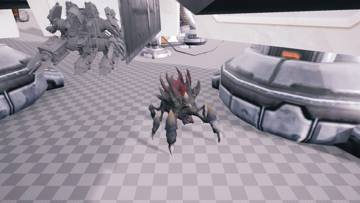</a>
<a href="/assets/d/2026-11-05/WindowsEditor_HighresScreenshot01907.jpg" target="_blank">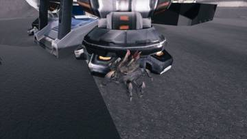</a>
<a href="/assets/d/2026-11-05/WindowsEditor_HighresScreenshot01908.jpg" target="_blank">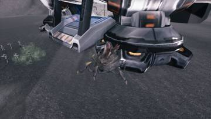</a>
<a href="/assets/d/2026-11-05/WindowsEditor_HighresScreenshot01909.jpg" target="_blank">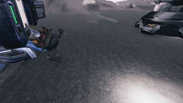</a>
<a href="/assets/d/2026-11-05/WindowsEditor_HighresScreenshot01910.jpg" target="_blank">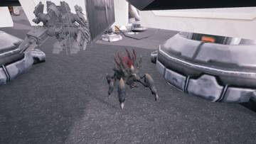</a>

<a href="/assets/d/2026-11-05/WindowsEditor_HighresScreenshot01912.jpg" target="_blank">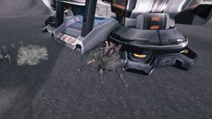</a>
<a href="/assets/d/2026-11-05/WindowsEditor_HighresScreenshot01913.jpg" target="_blank">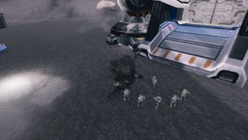</a>
<a href="/assets/d/2026-11-05/WindowsEditor_HighresScreenshot01917.jpg" target="_blank">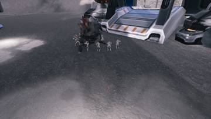</a>
<a href="/assets/d/2026-11-05/WindowsEditor_HighresScreenshot01919.jpg" target="_blank">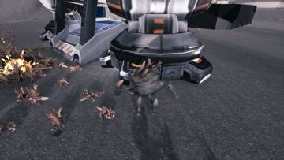</a>
<a href="/assets/d/2026-11-05/WindowsEditor_HighresScreenshot01920.jpg" target="_blank">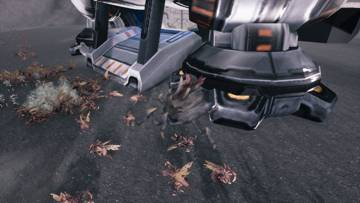</a>
<a href="/assets/d/2026-11-05/WindowsEditor_HighresScreenshot01921.jpg" target="_blank">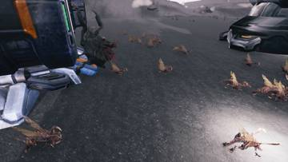</a>

00:06 래비저 미사일과 포격 이펙트를 SC2 원본 그대로 옮겼습니다.

<h2 id="lurker">lurker <small>가시지옥</small></h2>

분열기 사망 테스트를 다듬었습니다.

<a href="/assets/d/2026-11-05/WindowsEditor_HighresScreenshot01922.jpg" target="_blank">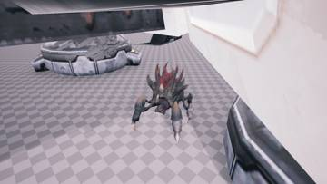</a>
<a href="/assets/d/2026-11-05/WindowsEditor_HighresScreenshot01923.jpg" target="_blank">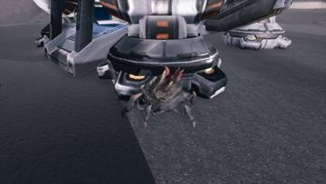</a>
<a href="/assets/d/2026-11-05/WindowsEditor_HighresScreenshot01924.jpg" target="_blank">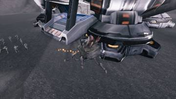</a>
<a href="/assets/d/2026-11-05/WindowsEditor_HighresScreenshot01925.jpg" target="_blank">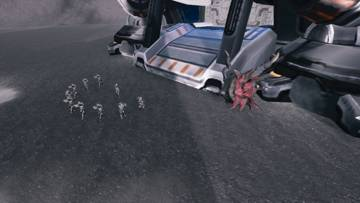</a>
<a href="/assets/d/2026-11-05/WindowsEditor_HighresScreenshot01926.jpg" target="_blank">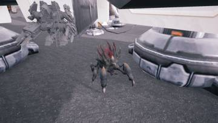</a>
<a href="/assets/d/2026-11-05/WindowsEditor_HighresScreenshot01927.jpg" target="_blank">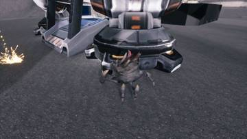</a>
<a href="/assets/d/2026-11-05/WindowsEditor_HighresScreenshot01928.jpg" target="_blank">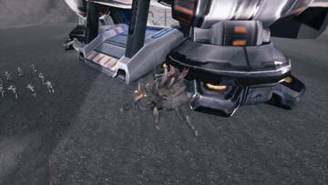</a>
<a href="/assets/d/2026-11-05/WindowsEditor_HighresScreenshot01929.jpg" target="_blank">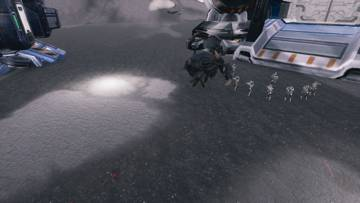</a>
<a href="/assets/d/2026-11-05/WindowsEditor_HighresScreenshot01933.jpg" target="_blank">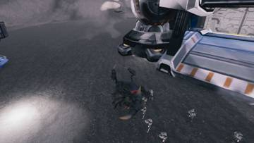</a>

00:44 래비저 시체 시험을 시체가 멈출 때까지 기다린 뒤 판정하도록 고쳤습니다.

<h2 id="weapon">weapon <small>무기</small></h2>

슬램과 충격 패드 등 장비 효과를 게임에 연결했습니다.

<a href="/assets/d/2026-11-05/Offscreen_gearfx_shot_0.jpg" target="_blank">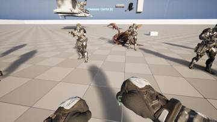</a>
<a href="/assets/d/2026-11-05/Offscreen_gearfx_shot_3.jpg" target="_blank">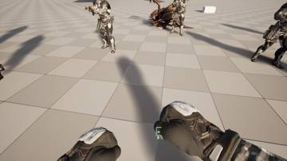</a>
<a href="/assets/d/2026-11-05/Offscreen_gearfx_shot_9.jpg" target="_blank">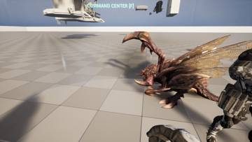</a>
<a href="/assets/d/2026-11-05/Offscreen_gearfx_shot_10.jpg" target="_blank">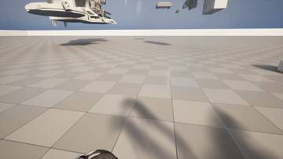</a>
<a href="/assets/d/2026-11-05/Offscreen_gearfx_shot_Psion_0.jpg" target="_blank">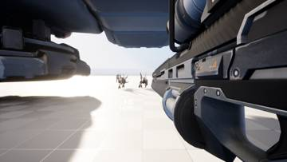</a>
<a href="/assets/d/2026-11-05/Offscreen_gearfx_shot_Psion_3.jpg" target="_blank">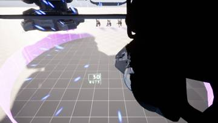</a>
<a href="/assets/d/2026-11-05/Offscreen_gearfx_shot_Psion_4.jpg" target="_blank">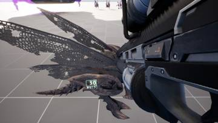</a>
<a href="/assets/d/2026-11-05/Offscreen_gearfx_shot_Gunner_0.jpg" target="_blank">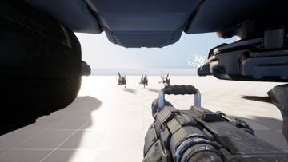</a>
<a href="/assets/d/2026-11-05/Offscreen_gearfx_shot_Gunner_3.jpg" target="_blank">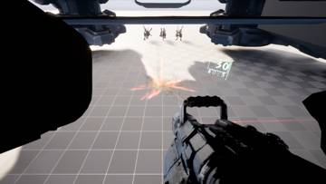</a>
<a href="/assets/d/2026-11-05/Offscreen_gearfx_shot_Gunner_4.jpg" target="_blank">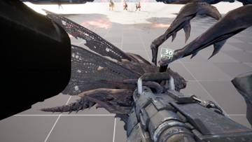</a>

01:34 장비 이펙트를 연결해 충격파와 사냥꾼 표식, 돌격 효과가 나오게 했습니다.

