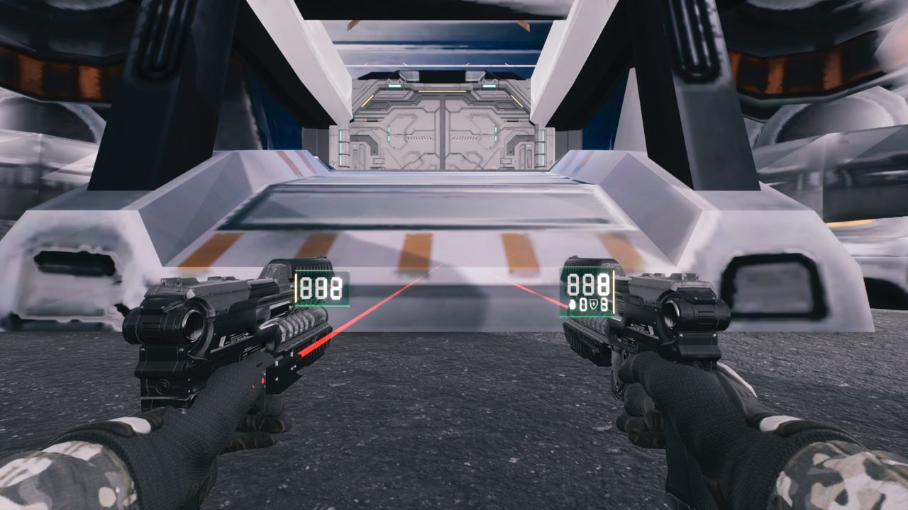
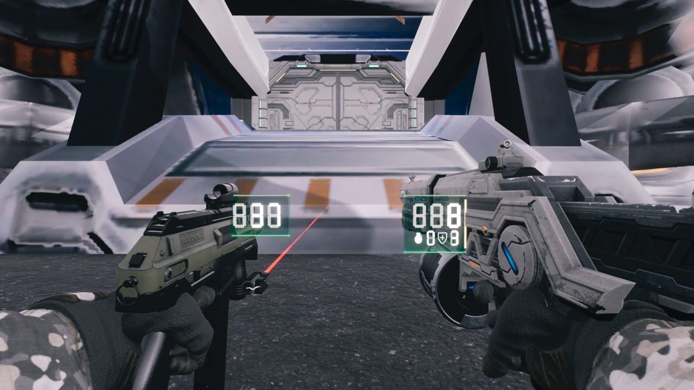
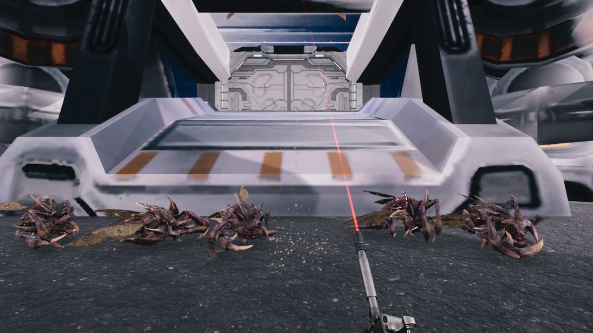
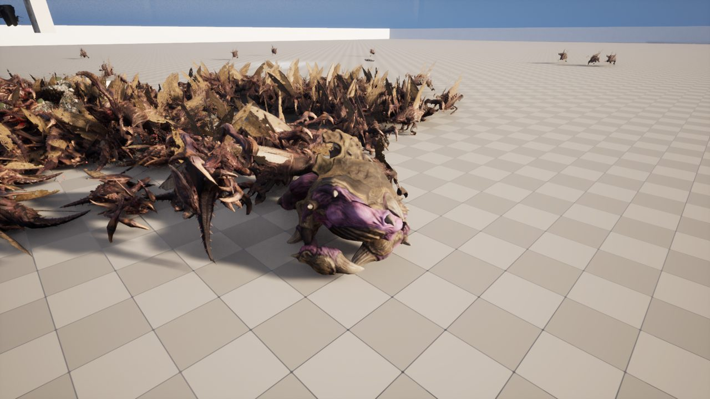
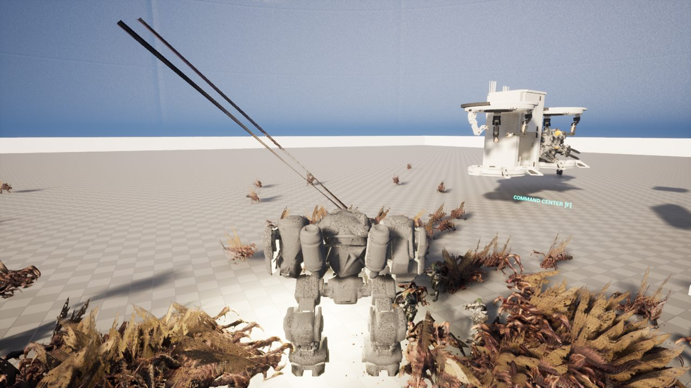
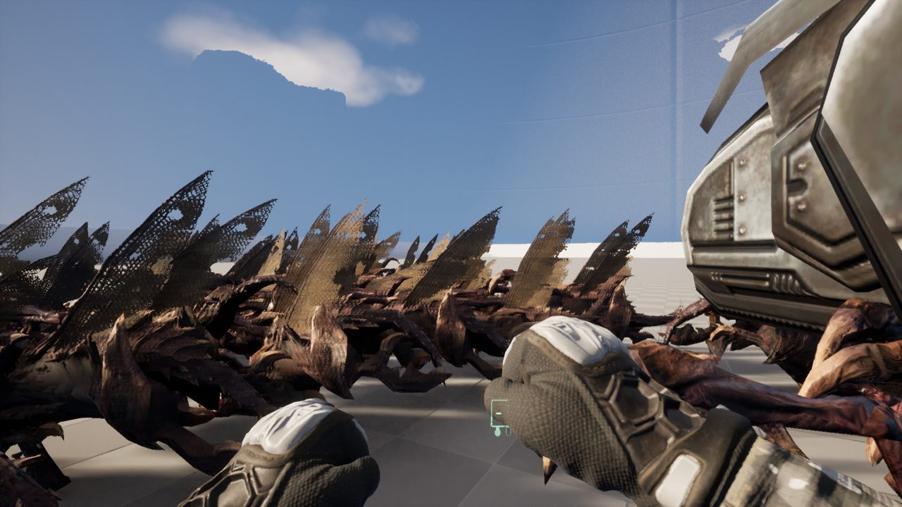
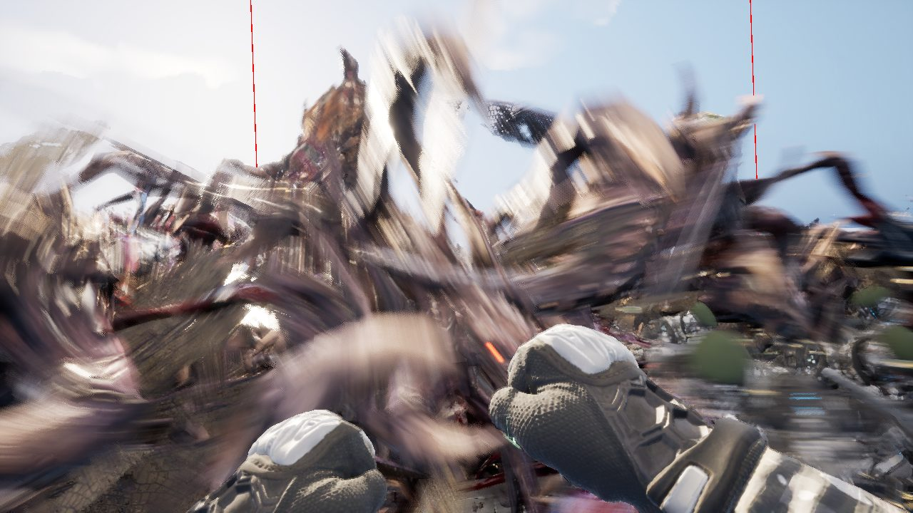
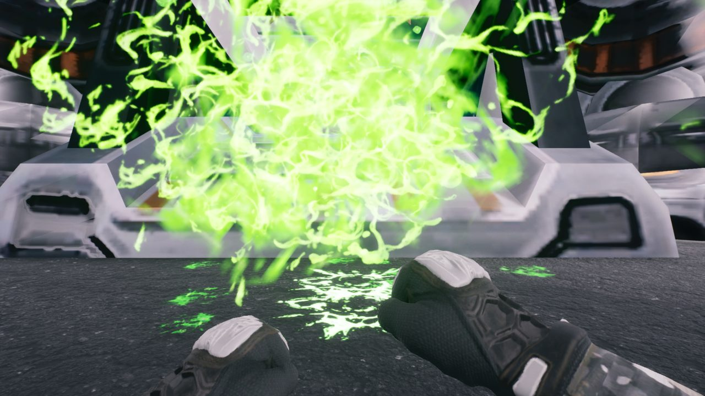
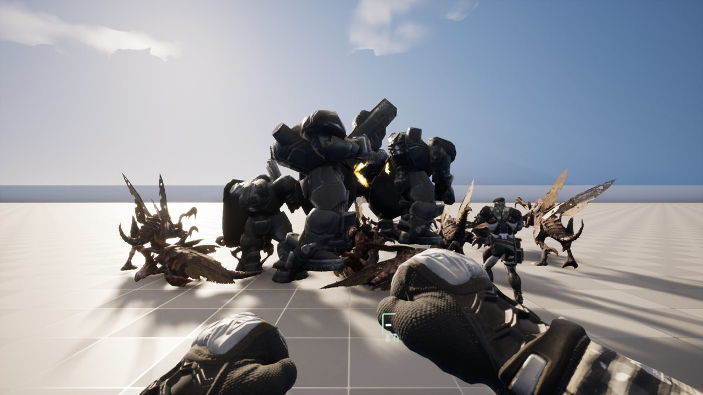

## 한 일

- 저글링 말고도 저그가 늘었습니다: 맹독충, 바퀴, 히드라리스크, 가시지옥, 궤멸충 이펙트.
- 시즈탱크를 정화팀 흰색으로 칠했고, 벌처도 들여왔습니다.
- 섬광탄, 중력 소용돌이, 치료 광선, 수류탄 같은 장비 이펙트와 소리를 넣었습니다.
- 양손에 총을 하나씩 드는 사격을 다듬었습니다.
- 지원 병과: 처치 보상 미네랄, 상점, 통신 장치를 넣었습니다.
- 새 큰 지형(약 2km 넓이)을 들여왔습니다.

## 막혔던 것

- **저글링 2000마리는 무거움**: 1000마리일 때 평균 70.1 / 1% low 51.9fps, 2000마리일 때 54.6 / 37.9fps였습니다. 원인은 저그 몸체를 너무 자주 바꿔 끼우는 것이어서, 잠깐 붙잡아 두는 처리를 넣었습니다.
- **바퀴가 죽으면 몸이 한 점으로 빨려 들어감**: 뼈 단위가 미터로 나가서 크기가 100배로 잡혀 있었습니다. 센티미터로 다시 만들었습니다.
- **가시지옥이 차 지붕 위에서 제자리걸음**: 길이 보장되는 곳에만 나오게 바꿨습니다.

## 성능

11월 3일 측정에서 저글링 1000마리 기준 평균 70.1fps, 1% low 51.9fps였습니다.
목표 60까지 조금 남았습니다.
